## الساحلي — اختيار التنسيق قبل التنفيذ

[PDF واحد: ١٠ توزيعات أثاث وأفكار الأرضيات والحوائط](drawings/coastal-design-choices/COASTAL_10_LAYOUTS_AND_WALLS.pdf)

## اللوبي — إصلاح فحص المقاسات 1.4.2

[تحميل التحديث](drawings/hotel-native-builder/Ayaa_Lobby_Components_v1_4_2.rbz) · [التركيب والتحقق](drawings/hotel-bounds-fix-1-4-2/README.md)

## اللوبي — إصلاح التشغيل 1.4.1

[تحميل الإصلاح الكامل](drawings/hotel-native-builder/Ayaa_Lobby_Components_v1_4_1.rbz) · [خطوات التركيب ونتائج الاختبار](drawings/hotel-refresh-fix-1-4-1/README.md)

## اللوبي — تحديث 1.4

[تحميل الإضافة](drawings/hotel-native-builder/Ayaa_Lobby_Components_v1_4_0.rbz) · [المعاينة](drawings/hotel-distinct-update-1-4/DISTINCT_LOBBY_PREVIEW.pdf) · [التركيب والتفاصيل](drawings/hotel-distinct-update-1-4/README.md)

## اللوبي — تحديث 1.3.0

[تحميل الإضافة](drawings/hotel-native-builder/Ayaa_Lobby_Components_v1_3_0.rbz) · [معاينة البوهيمي والساحلي](drawings/hotel-rich-update-1-3/RICH_LOBBY_PREVIEW.pdf) · [التفاصيل والتركيب](drawings/hotel-rich-update-1-3/README.md)

## العلمين — آخر تحديث: التسعة بامتدادات متوازنة

[تحميل DWG التسعة](drawings/elalamein-nine-balanced/ELALAMEIN_9_OPTIONS.dwg) · [معاينة PDF](drawings/elalamein-nine-balanced/ALL_9_PREVIEW.pdf) · [الملفات المنفصلة والفحص](drawings/elalamein-nine-balanced/README.md)

الروابط التالية للنسخ السابقة؛ النسخة الحالية أعلاه.

## العلمين — النسخة المصححة من PDF المعتمد

[تحميل DWG التسعة](drawings/elalamein-approved-pdf/ALL_9_FROM_APPROVED_PDF.dwg) · [مقارنة المرجع والنتيجة](drawings/elalamein-approved-pdf/REFERENCE_COMPARISON.pdf) · [تفاصيل وملفات منفصلة](drawings/elalamein-approved-pdf/README.md)

## العلمين — تسعة كونسبتات AutoCAD

[تحميل DWG التسعة](drawings/elalamein-nine-concepts/ALL_9_CONCEPTS.dwg) · [معاينة PDF](drawings/elalamein-nine-concepts/ALL_9_PREVIEW.pdf) · [الملفات المنفصلة والتفاصيل](drawings/elalamein-nine-concepts/README.md)

## تحديث اللوبي1.2.0

[تحميل الإضافة](drawings/hotel-native-builder/Ayaa_Lobby_Components_v1_2_0.rbz) · [معاينة التصميمات المعدلة](drawings/hotel-layout-revision-1-2/revised_options_preview.pdf)

## تحديث الإضافة 1.1.0 — أوبشن ساحلي يوناني جديد

[تحميل الإضافة بالثلاثة أوبشنز](drawings/hotel-native-builder/Ayaa_Lobby_Components_v1_1_0.rbz) · [صور اليوناني PDF](drawings/hotel-greek-coastal/greek_coastal_preview.pdf)

## الأحدث: البوهيمي V2 — أشكال أثاث جديدة

[تحميل الحزمة](drawings/hotel-bohemian-option-v2/hotel_bohemian_v2.zip) · [مقارنة الشكل بدون ألوان](drawings/hotel-bohemian-option-v2/shape_comparison.pdf) · [الصور](drawings/hotel-bohemian-option-v2/presentation.pdf)

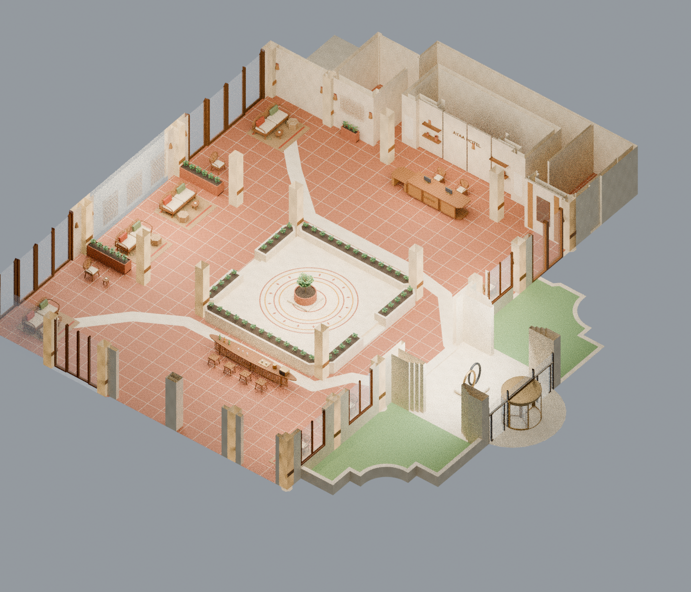

## الأحدث: اللوبي — مودرن مصحّح + أوبشن بوهيمي

[المودرن المصحّح](drawings/hotel-modern-corrected-v5/README.md) · [البوهيمي](drawings/hotel-bohemian-option-v1/README.md) · [مقارنة PDF](drawings/hotel-options-v5/comparison.pdf)

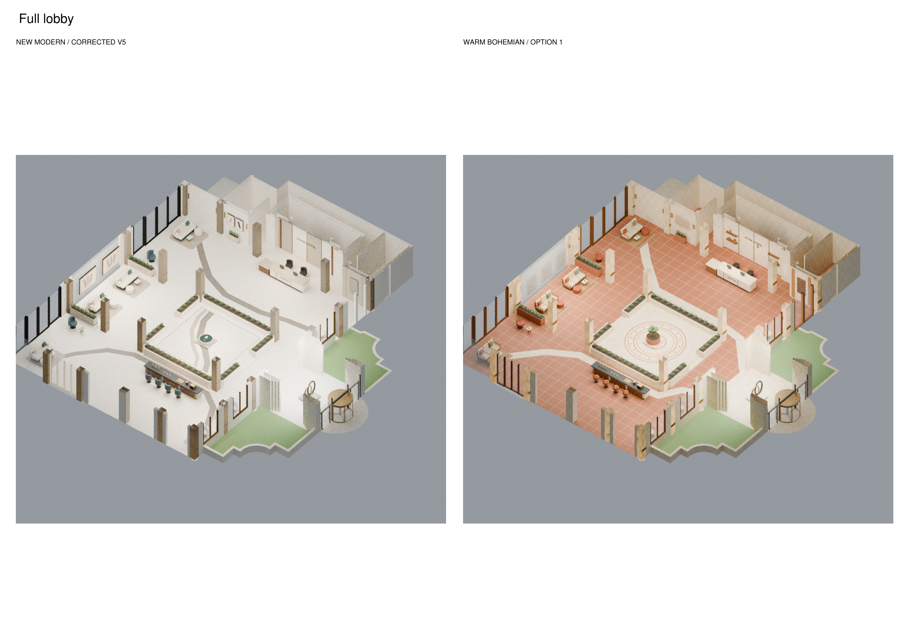

## الأحدث: لوبي الفندق New Modern — تصميم جديد V4

[حزمة SketchUp بالخامات](drawings/ayaa-hotel-new-modern-v4/SketchUp_New_Modern_V4.zip) · [عرض التصميم](drawings/ayaa-hotel-new-modern-v4/presentation.pdf) · [البلان](drawings/ayaa-hotel-new-modern-v4/plan.png) · [التفاصيل](drawings/ayaa-hotel-new-modern-v4/README.md)

## الأحدث: واجهة تجارية بطراز الهاي تك

[تحميل DWG](drawings/high-tech-commercial/hightech.dwg) · [مقارنة قبل وبعد](drawings/high-tech-commercial/before_after.pdf) · [الحزمة](drawings/high-tech-commercial/hightech_package.zip) · [التفاصيل والفحص](drawings/high-tech-commercial/README.md)

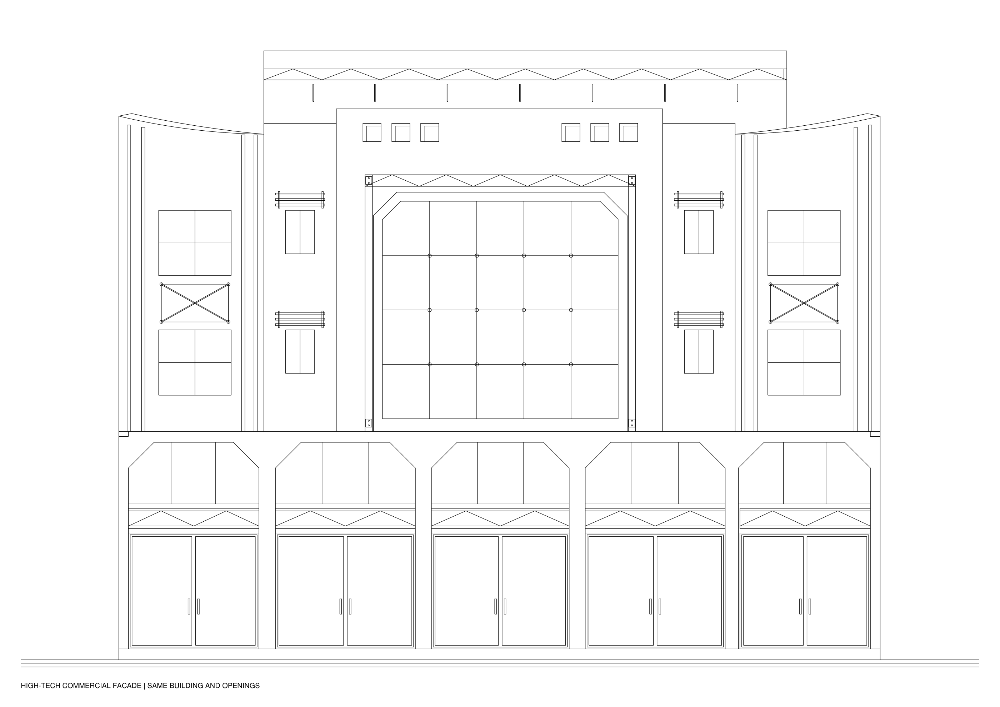

## تحديث أندلسي: حليات حدوة الفرس وألفيز وسبكة على معمارية الأصل

[تحميل الأوتوكاد المصحّح](drawings/andalusian-source-restored/andalusian.dwg) · [مقارنة الأصل والتصحيح](drawings/andalusian-source-restored/before_after.pdf) · [حزمة الأربع واجهات بعد التحديث](drawings/four-elevations-restyled/four_styles_full_package.zip) · [التفاصيل](drawings/andalusian-source-restored/README.md)

## الأحدث: مول تجاري — فرعوني معاصر

[تحميل الأوتوكاد DWG](drawings/egyptian-contemporary-mall/egyptian_mall.dwg) · [الحزمة كاملة](drawings/egyptian-contemporary-mall/egyptian_mall_package.zip) · [مقارنة الأصل والتعديل](drawings/egyptian-contemporary-mall/before_after.pdf) · [التفاصيل والفحص](drawings/egyptian-contemporary-mall/README.md)

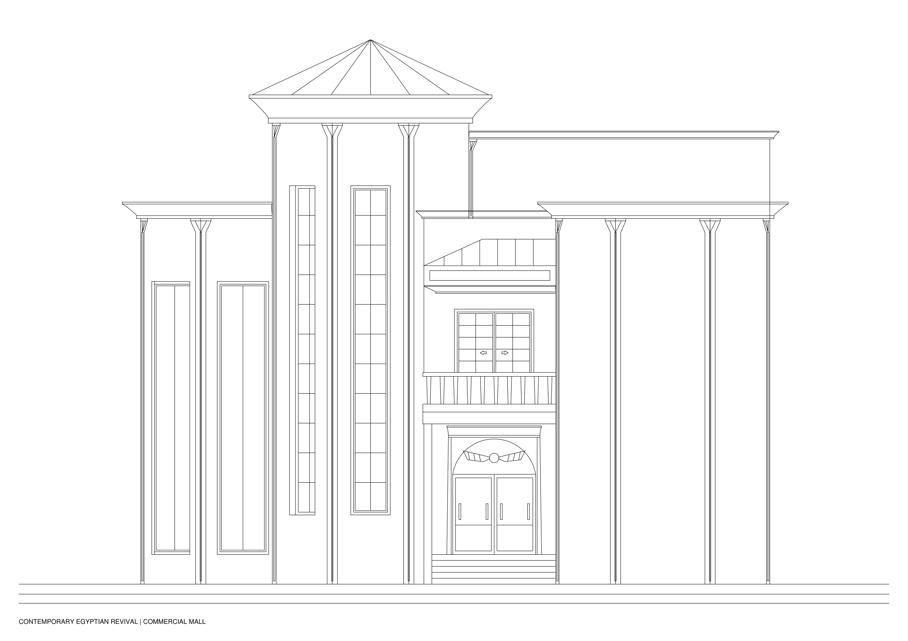

## الأحدث: واجهة إسلامية معاصرة بروح مملوكية

[تحميل ملف الأوتوكاد DWG](drawings/islamic-contemporary-mamluk/mamluk.dwg) · [الحزمة كاملة](drawings/islamic-contemporary-mamluk/mamluk_full_package.zip) · [قبل وبعد PDF](drawings/islamic-contemporary-mamluk/before_after.pdf) · [التفاصيل والفحص](drawings/islamic-contemporary-mamluk/README.md)

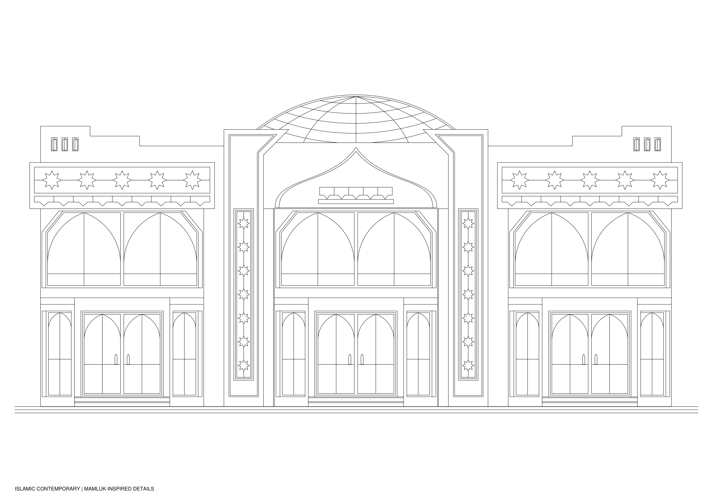

## الأحدث: أربع واجهات — قوطي، يوناني إحيائي، أندلسي، وآرت نوفو

[تحميل الحزمة الكاملة DWG + DXF + PDF](drawings/four-elevations-restyled/four_styles_full_package.zip) · [DWG مجمّع](drawings/four-elevations-restyled/four_facades.dwg) · [قبل / بعد PDF](drawings/four-elevations-restyled/before_after_all.pdf) · [التفاصيل والملفات المنفصلة](drawings/four-elevations-restyled/README.md)

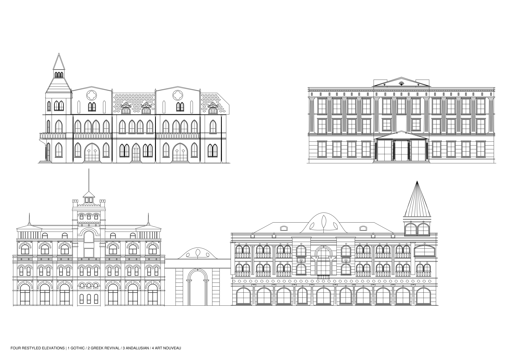

## الأحدث: لوبي الفندق حسب المرجع — الإصدار 3

[تحميل الموديل والخامات لـSketchUp](drawings/ayaa-hotel-reference-modern/SketchUp_reference_modern_v3.zip) · [عرض التصميم PDF](drawings/ayaa-hotel-reference-modern/presentation.pdf) · [التفاصيل وطريقة الفتح](drawings/ayaa-hotel-reference-modern/README.md)

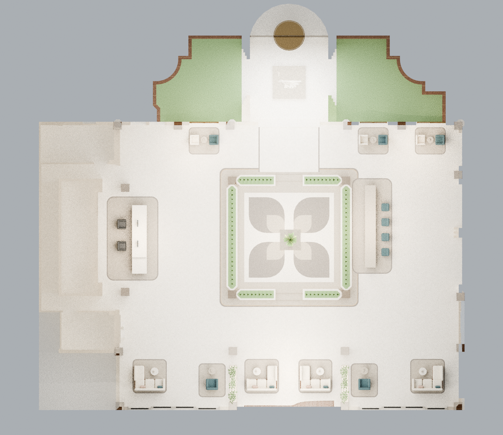

## الأحدث: لوبي فندق AYAA — New Modern

[الموديل والخامات لـSketchUp](drawings/ayaa-hotel-new-modern/SketchUp_import_package.zip) · [عرض التصميم PDF](drawings/ayaa-hotel-new-modern/presentation.pdf) · [المعاينة والتفاصيل](drawings/ayaa-hotel-new-modern/README.md)

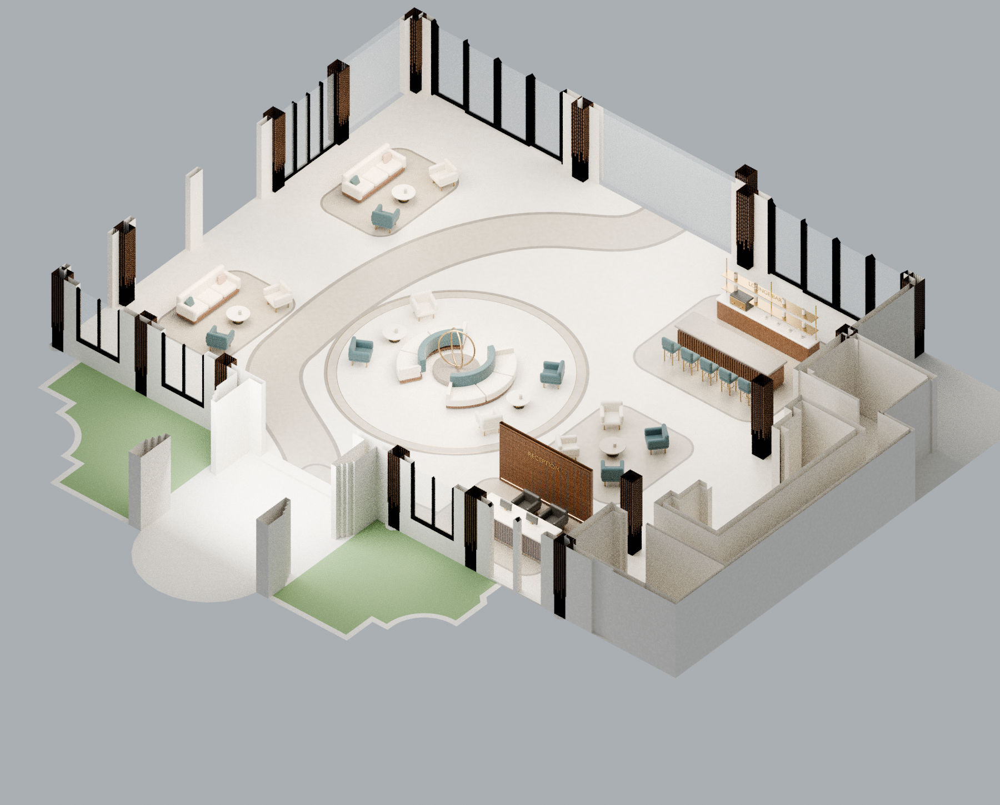

# الأحدث — استدامة مع الحفاظ على شكل الواجهة V2

[تحميل DWG](drawings/sustainable-shape-v2/sustainable_facade.dwg?raw=true) · [تحميل DXF](drawings/sustainable-shape-v2/sustainable_facade.dxf?raw=true) · [الصورة](drawings/sustainable-shape-v2/preview.png) · [PDF](drawings/sustainable-shape-v2/sustainable_facade.pdf?raw=true) · [مقارنة بالأصل وجدول البدائل](drawings/sustainable-shape-v2/before_after.pdf?raw=true) · [الحزمة كاملة](drawings/sustainable-shape-v2/sustainable_package.zip?raw=true)

عودة العقود وبروز المدخل والجزء العلوي إلى نسب الأصل، مع توظيف حقول الحليات للتظليل والخلايا الشمسية والتهوية، بدون زرع. فحص الكاد: صفر نهايات حرة، وإعادة قراءة DWG ناجحة. [تفاصيل المعالجة والفحص](drawings/sustainable-shape-v2/README_AR.md).

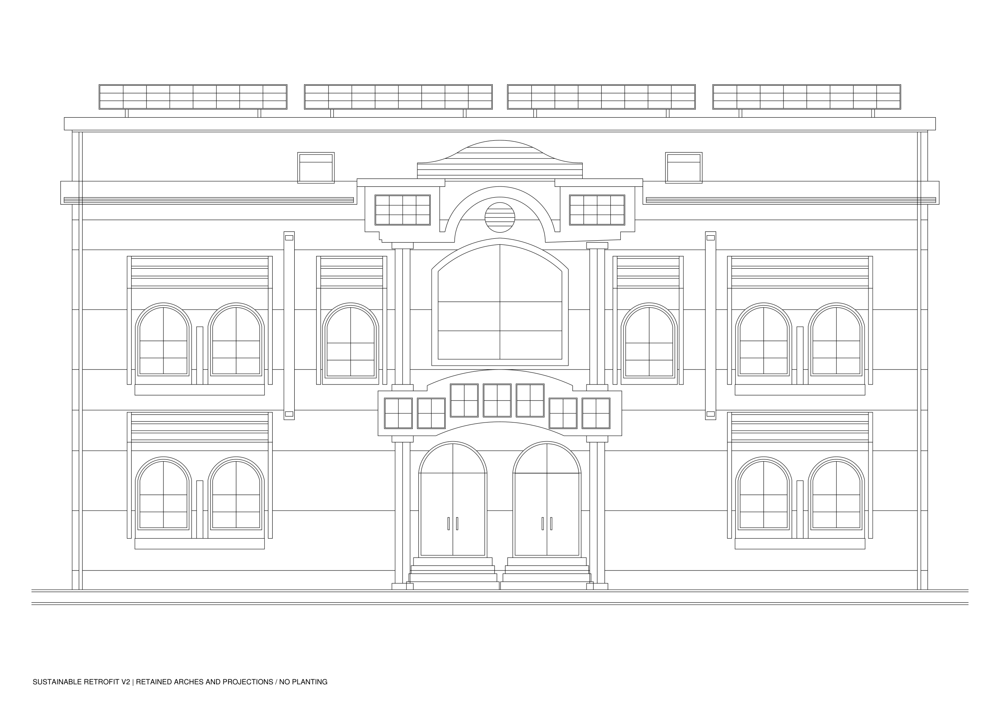

---

# الأحدث — واجهة مستدامة بدون زرع من الملف الجديد

[تحميل DWG](drawings/sustainable-clean-new/sustainable_facade.dwg?raw=true) · [تحميل DXF](drawings/sustainable-clean-new/sustainable_facade.dxf?raw=true) · [الصورة](drawings/sustainable-clean-new/preview.png) · [PDF](drawings/sustainable-clean-new/sustainable_facade.pdf?raw=true) · [قبل وبعد](drawings/sustainable-clean-new/before_after.pdf?raw=true) · [الحزمة](drawings/sustainable-clean-new/sustainable_package.zip?raw=true)

ألواح شمسية، وكاسرات شمس، وكسوة مقترحة بفراغ تهوية، وتجميع مياه سقف، بدون زرع أو بلوكات زخرفية قديمة. فحص الاتصال والحواف: صفر نهايات حرة ولا حواف ظاهرة ناقصة؛ وإعادة قراءة DWG أعطت فرق إحداثيات صفرًا. [تفاصيل التصميم والفحص وحدود المقترح](drawings/sustainable-clean-new/README_AR.md).

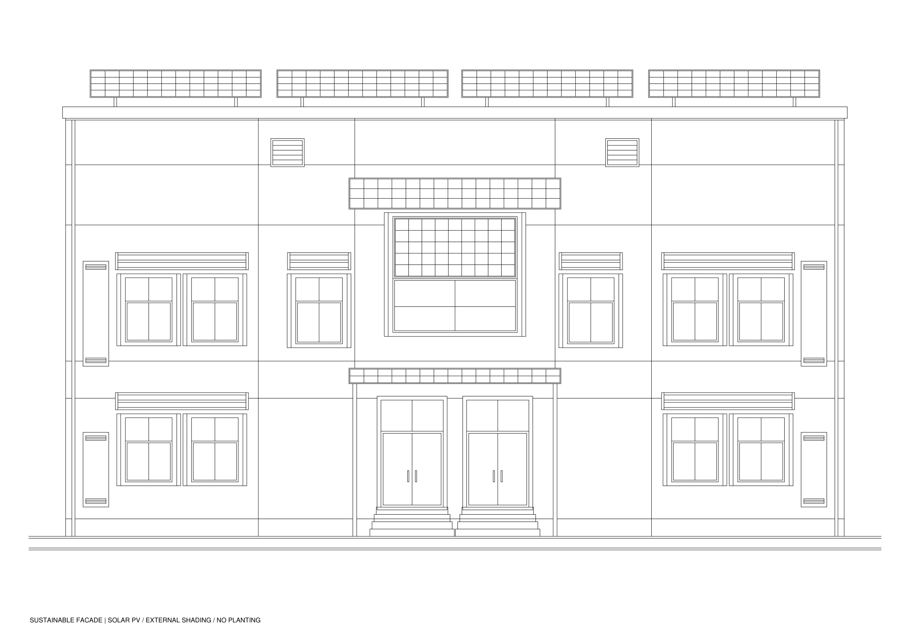

---

# الأحدث — معالجة الواجهة بالطراز الباروكي

[تحميل DWG](drawings/baroque-native/baroque_facade.dwg?raw=true) · [تحميل DXF](drawings/baroque-native/baroque_facade.dxf?raw=true) · [معاينة](drawings/baroque-native/preview.png) · [PDF](drawings/baroque-native/baroque_facade.pdf?raw=true) · [قبل وبعد وتفاصيل](drawings/baroque-native/before_after.pdf?raw=true) · [الحزمة كاملة](drawings/baroque-native/baroque_package.zip?raw=true)

باروك بتفاصيل متوسطة: تاج بقوس مكسور ولفائف، تيجان أعمدة، درابزين حجري وكارتوشات، دون زرع. فحص الاتصال وجد صفر نهايات حرة؛ وأُعيدت قراءة DWG ومقارنة هندسته. [تفاصيل التصميم والفحص وحدود المقترح](drawings/baroque-native/README_AR.md).

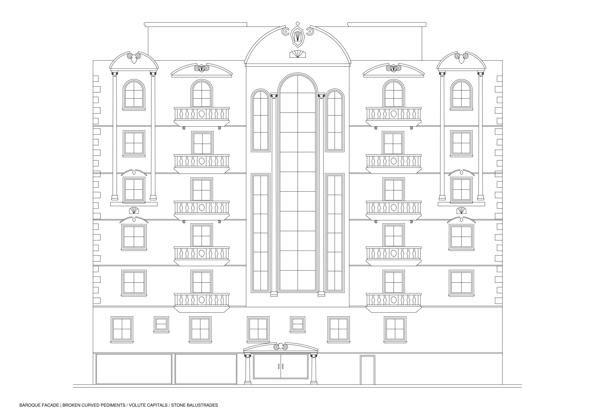

---

# الأحدث — تصحيح الوصلات والتيجان الإسلامية V2

[تحميل DWG](drawings/islamic-connected-v2/islamic_facade.dwg?raw=true) · [تحميل DXF](drawings/islamic-connected-v2/islamic_facade.dxf?raw=true) · [معاينة](drawings/islamic-connected-v2/preview.png) · [مقارنة قبل وبعد](drawings/islamic-connected-v2/before_after.pdf?raw=true) · [الحزمة كاملة](drawings/islamic-connected-v2/islamic_package.zip?raw=true)

شرافات إسلامية هندسية بدل أشرطة التيجان القديمة، وإصلاح الوصلات وتنظيف بقايا البلوكات. فحص الاتصال وجد صفر نهايات حرة داخل نطاق الواجهة؛ خطا الأرض مفتوحان خارج المبنى. [تفاصيل الفحص وحدوده](drawings/islamic-connected-v2/README_AR.md).

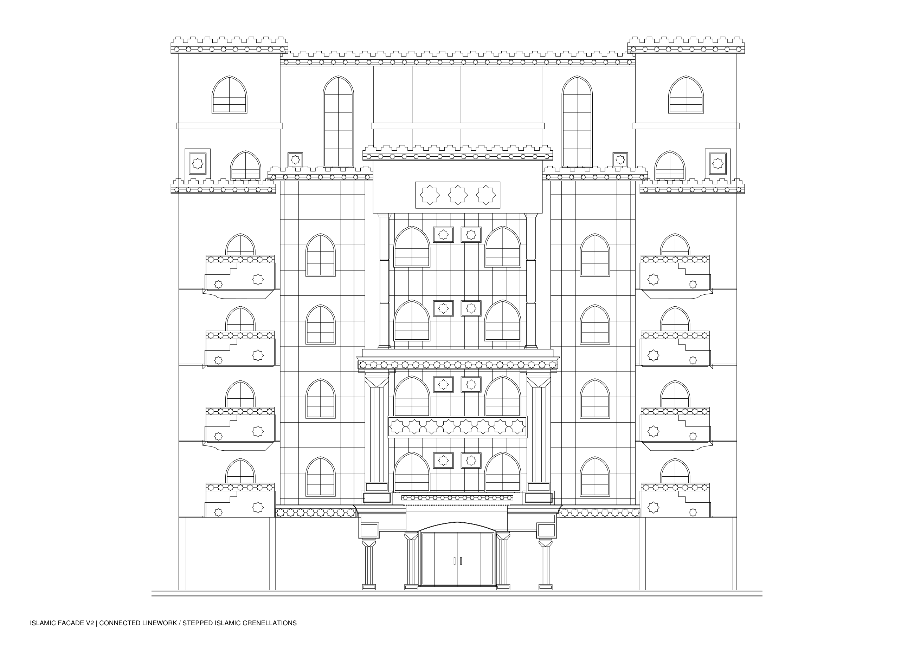

---

# الأحدث — الواجهة الأصلية بتفاصيل إسلامية

[تحميل DWG](drawings/islamic-original-adaptation/islamic_facade.dwg?raw=true) · [تحميل DXF](drawings/islamic-original-adaptation/islamic_facade.dxf?raw=true) · [معاينة](drawings/islamic-original-adaptation/preview.png) · [قبل وبعد PDF](drawings/islamic-original-adaptation/before_after.pdf?raw=true) · [تحميل الحزمة](drawings/islamic-original-adaptation/islamic_package.zip?raw=true)

الحفاظ على كتلة الواجهة الأصلية وتدرج الكرانيش والقطاعات الخارجية للبلكونات، مع تحويل الشبابيك والتيجان والحشوات والزخارف إلى طابع إسلامي. [تفاصيل التعديل والفحص](drawings/islamic-original-adaptation/README_AR.md).

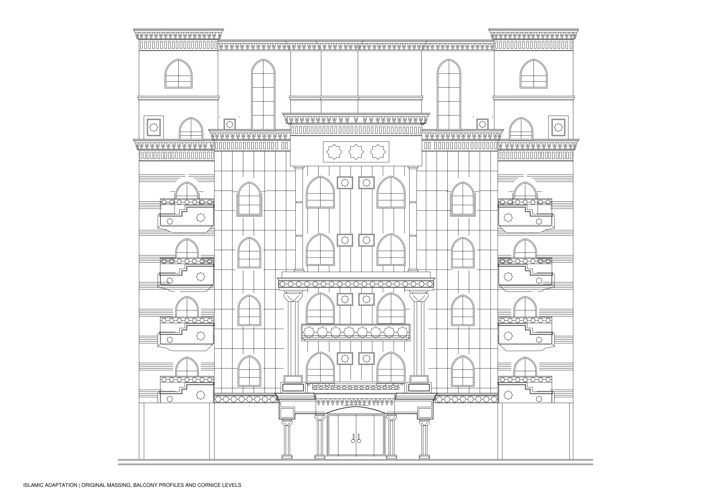

---

# الأحدث — واجهة إسلامية معاصرة قليلة الزخارف

[تحميل DWG](drawings/contemporary-islamic-facade/islamic_facade.dwg?raw=true) · [تحميل DXF](drawings/contemporary-islamic-facade/islamic_facade.dxf?raw=true) · [معاينة الواجهة](drawings/contemporary-islamic-facade/preview.png) · [قبل وبعد PDF](drawings/contemporary-islamic-facade/before_after.pdf?raw=true) · [الحزمة كاملة](drawings/contemporary-islamic-facade/islamic_package.zip?raw=true)

معالجة إسلامية معاصرة على إحداثيات الواجهة الأخيرة، بعقود مدببة بسيطة وحوائط سادة وعشر إشارات هندسية صغيرة فقط على الدرابزين. أُزيلت الحليات الكلاسيكية، دون إضافة زرع. [التفاصيل والفحص وحدود المقترح](drawings/contemporary-islamic-facade/README_AR.md).

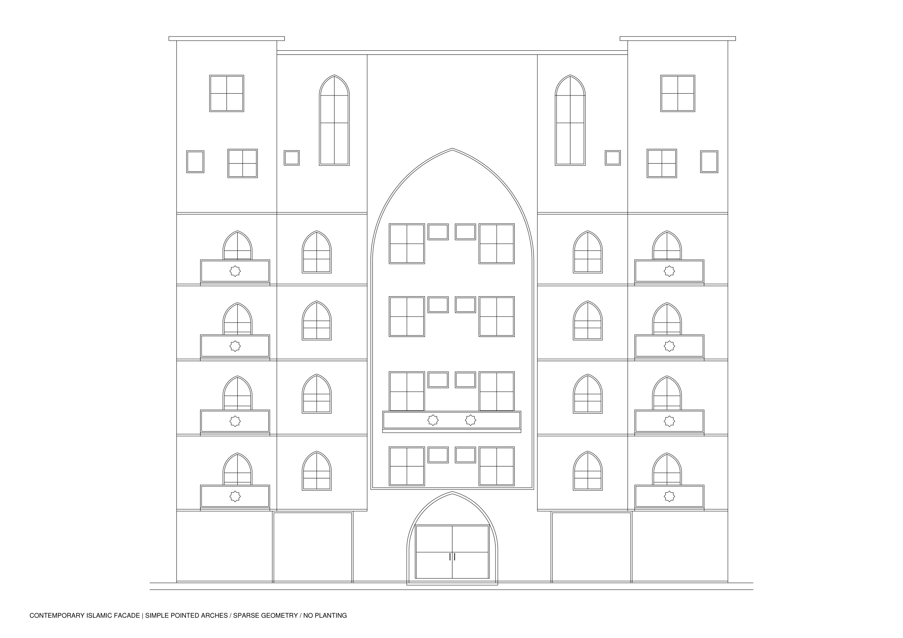

---

# الأحدث — تصحيح الطراز: واجهة مستدامة معاصرة V2

[تحميل DWG](drawings/sustainable-modern-v2/sustainable_facade.dwg?raw=true) · [تحميل DXF](drawings/sustainable-modern-v2/sustainable_facade.dxf?raw=true) · [معاينة التصحيح](drawings/sustainable-modern-v2/preview.png) · [مقارنة النسخة السابقة بالتصحيح PDF](drawings/sustainable-modern-v2/before_after.pdf?raw=true) · [الحزمة كاملة](drawings/sustainable-modern-v2/sustainable_package.zip?raw=true)

أُزيل التاج الباروكي وتيجان الأعمدة والتحليات، وأصبحت البراويز والكسوات مستقيمة وبسيطة، مع ألواح شمسية مدمجة بدل التاج. أعلى العقود مقترح تغطيته بحشوات خفيفة معزولة لتظهر رؤوس الفتحات مستطيلة. [التفاصيل وحدود المقترح والفحص](drawings/sustainable-modern-v2/README_AR.md).

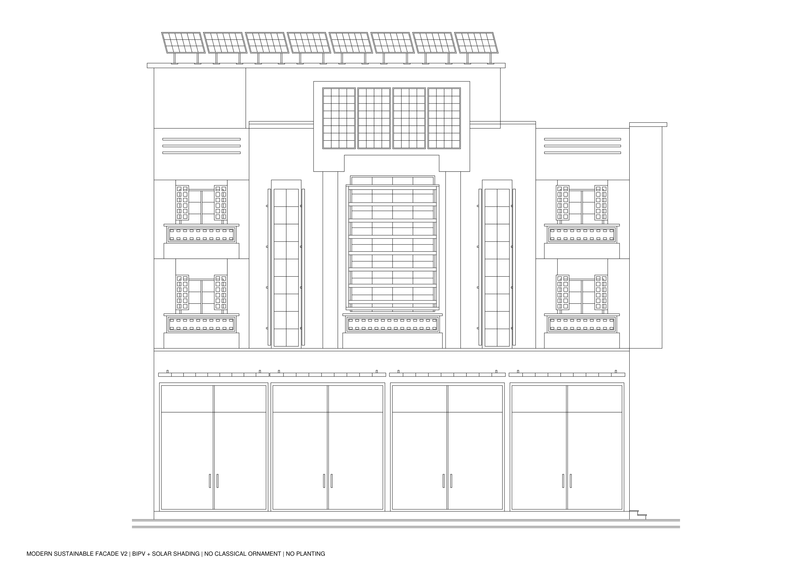

---

# الأحدث — تأهيل الواجهة بعناصر استدامة واضحة، بدون زرع

[تحميل DWG](drawings/sustainable-retrofit-native/sustainable_facade.dwg?raw=true) · [تحميل DXF](drawings/sustainable-retrofit-native/sustainable_facade.dxf?raw=true) · [معاينة الواجهة](drawings/sustainable-retrofit-native/preview.png) · [قبل وبعد PDF](drawings/sustainable-retrofit-native/before_after.pdf?raw=true) · [الحزمة كاملة](drawings/sustainable-retrofit-native/sustainable_package.zip?raw=true)

تعديل مبني على الكاد الأصلي: ألواح شمسية ظاهرة، وكاسرات للشمس، وشاشات مثقبة، ومظلات للمداخل، مع إزالة الزرع والحفاظ على العقود ومواقع الفتحات. [تفاصيل التصميم والفحص](drawings/sustainable-retrofit-native/README_AR.md).

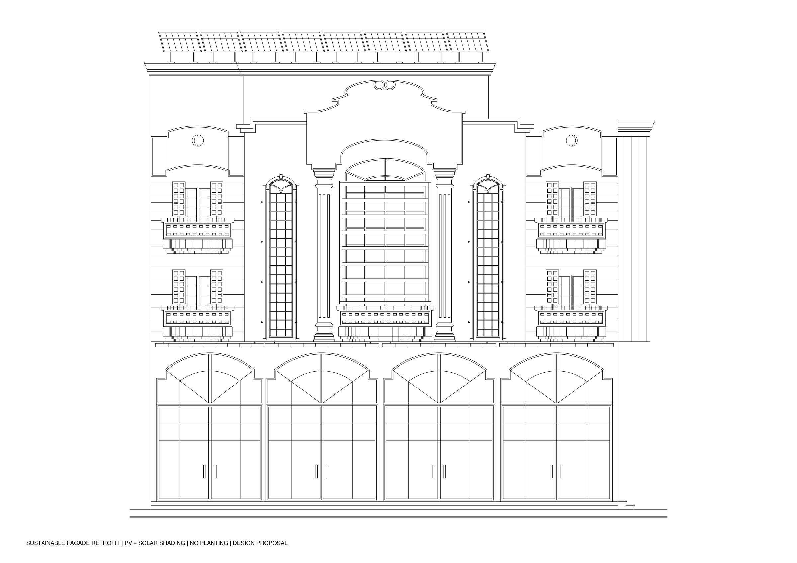

---

# الأحدث — تحويل الواجهة الأصلية إلى آرت ديكو

[تحميل DWG](drawings/art-deco-native/art_deco_facade.dwg?raw=true) · [تحميل DXF](drawings/art-deco-native/art_deco_facade.dxf?raw=true) · [الواجهة PDF](drawings/art-deco-native/art_deco_facade.pdf?raw=true) · [مقارنة قبل وبعد](drawings/art-deco-native/before_after.pdf?raw=true) · [الحزمة كاملة](drawings/art-deco-native/art_deco_package.zip?raw=true)

إعادة معالجة هندسية من ملف DWG المرفوع، مع حفظ إحداثيات زجاج الفتحات الـ٨٦. خطوط موحّدة السمك، وإطارات متدرجة وزخارف هندسية وتاج أشعة. [تفاصيل العمل والفحص](drawings/art-deco-native/README_AR.md).

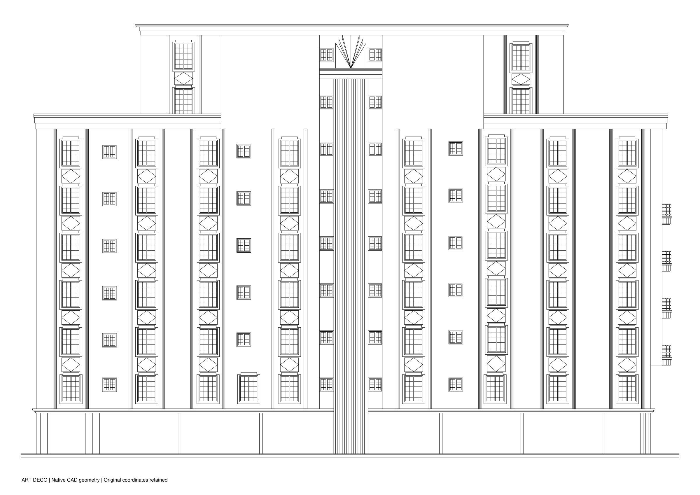

---

# الواجهة المستدامة — تصحيح استقامة الخطوط V2

**[تحميل الكاد والـPDF بالزرع الأخضر](drawings/sustainable-straight-v2/facade_green.zip)** — الزرع أخضر، والهندسة نفسها دون تغيير.

أُعيد بناء الحواف المعمارية بخطوط LINE مستقيمة والأقواس بعناصر ARC. السمك موحّد 0.13 مم. تفاصيل الزرع والحجر تحتاج مراجعة، ولا توجد مطالبة بمطابقة 100% أو إغلاق كل المسارات.

**[تحميل الكاد الجديد داخل ZIP](drawings/sustainable-straight-v2/facade_straight_v2_cad.zip)** — اضغطي Download raw file، ثم Extract All، وافتحي **facade_straight_v2.dxf**.

[PDF](drawings/sustainable-straight-v2/facade_straight_v2.pdf?raw=true) · [AutoLISP — الأمر FACADE2](drawings/sustainable-straight-v2/facade_straight_v2.lsp?raw=true) · [الحزمة كاملة](drawings/sustainable-straight-v2/facade_straight_v2_package.zip) · [التفاصيل والفحص](drawings/sustainable-straight-v2/README_AR.md)

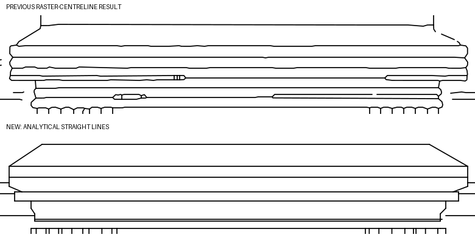

---

## أرشيف النسخ السابقة

# الواجهة المستدامة — تتبّع الصورة الأصلية

**[تحميل ملف الكاد فقط — ZIP](drawings/sustainable-facade/facade_cad.zip)** — افتحي الرابط واضغطي Download raw file (السهم لأسفل)، ثم فكّي الضغط وافتحي facade_cad.dxf داخل AutoCAD.

المصدر: [IMG_3106.PNG](IMG_3106.PNG). نسخة للمراجعة بخطوط سوداء موحّدة، PDF متجهي وDXF وAutoLISP. **ليست مطابقة مضمونة 100% ولا كل مساراتها مغلقة**؛ التفاصيل وحدود الفحص موضّحة في [تعليمات النسخة](drawings/sustainable-facade/README_AR.md).

[تحميل الحزمة كاملة](drawings/sustainable-facade/sustainable_facade_package.zip?raw=true) · [PDF](drawings/sustainable-facade/sustainable_facade.pdf?raw=true) · [DXF](drawings/sustainable-facade/sustainable_facade.dxf?raw=true) · [AutoLISP](drawings/sustainable-facade/sustainable_facade.lsp?raw=true)

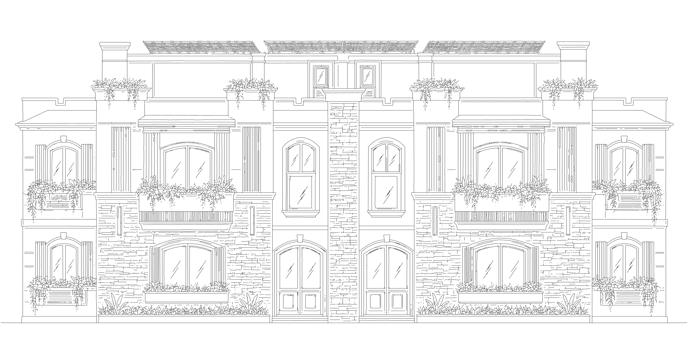

---

# الرسومات والمهارات

## الأحدث — محاولة من الريفرنس الأوضح

**[المعاينة](drawings/palace-reference-redraw/palace_reference_preview.png)** · **[تحميل الحزمة كاملة](drawings/palace-reference-redraw/palace_reference_package.zip?raw=true)**

- [PDF أساسي بدون أبعاد مضافة](drawings/palace-reference-redraw/palace_reference_redraw.pdf?raw=true)
- [AutoCAD DXF](drawings/palace-reference-redraw/palace_reference_redraw.dxf?raw=true)
- [كود AutoLISP مستقل](drawings/palace-reference-redraw/palace_reference_redraw.lsp?raw=true)
- [التشغيل والفحوص وحدود المطابقة](drawings/palace-reference-redraw/README_AR.md)

أُعيد ضبط الوردات والحجر وزخارف الإطارات والقواعد والعنوان. ما زالت بعض الزخارف تقريبية؛ ليست مطابقة حرفية مثبتة للريفرنس. المقاسات تقديرية. تشغيل LSP: **APPLOAD → PALACE**؛ الأبعاد الإضافية اختيارية.

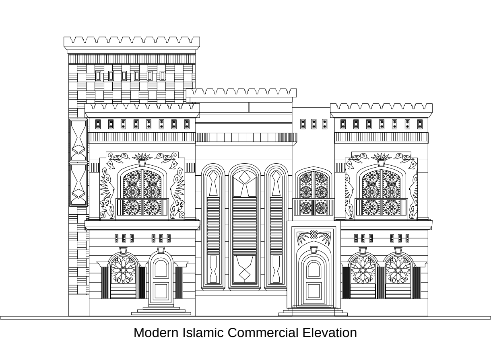

## الأحدث: AutoLISP كامل — واجهة منظّفة وأبعاد تقديرية

- **[تحميل الحزمة كاملة ZIP](drawings/palace-autolisp-clean/palace_autolisp_clean_package.zip?raw=true)**
- [تحميل AutoLISP LSP](drawings/palace-autolisp-clean/palace_facade_clean.lsp?raw=true)
- [تحميل AutoCAD DXF](drawings/palace-autolisp-clean/palace_clean_estimated_mm.dxf?raw=true)
- [تحميل PDF بالأبعاد والجدول](drawings/palace-autolisp-clean/palace_clean_estimated_mm.pdf?raw=true)
- [تعليمات التشغيل وحدود الدقة والفحوص](drawings/palace-autolisp-clean/README_AR.md)

التشغيل: **APPLOAD → اختيار LSP → PALACE**. العرض الافتراضي 14000 مم قابل للتغيير. الأبعاد تقديرية، والزخارف إعادة بناء بصرية. الحواف المشتركة مرسومة مرة واحدة، دون نهايات سائبة. كود AutoLISP مفحوص بالمحلل والمحاكاة، ولم يُشغّل داخل AutoCAD هنا.

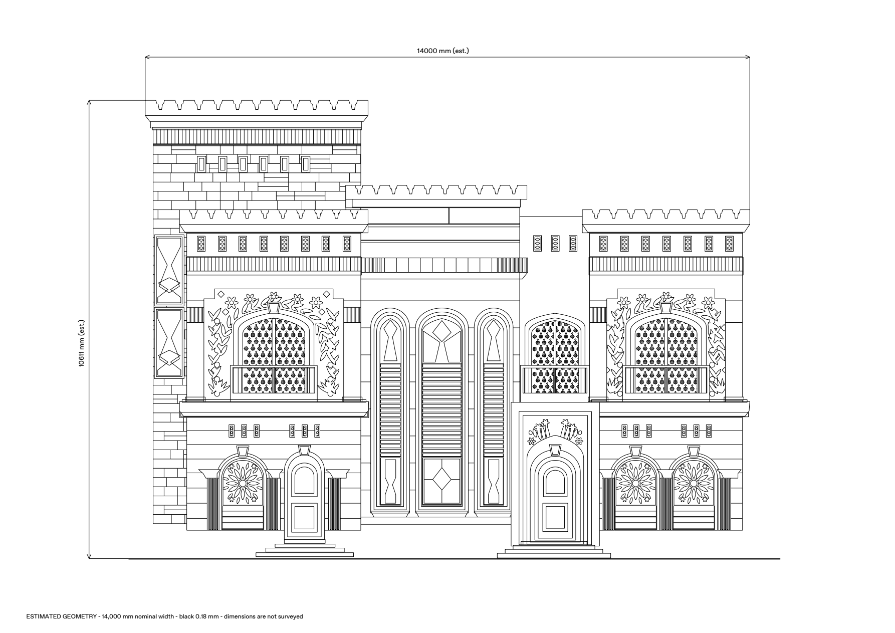

## الواجهة الجديدة — خطوط سوداء موحّدة وخلفية بيضاء

- [تحميل الحزمة كاملة ZIP](drawings/palace-uniform/palace_facade_package.zip?raw=true)
- [تحميل AutoCAD DXF](drawings/palace-uniform/palace_facade_uniform.dxf?raw=true)
- [تحميل PDF متجه](drawings/palace-uniform/palace_facade_uniform.pdf?raw=true)
- [معاينة الرسم](drawings/palace-uniform/palace_facade_preview.png)
- [التفاصيل والطبقات وحدود الدقة](drawings/palace-uniform/README_AR.md)

سُمك موحّد **0.18 مم**، وجميع **2023** مسارًا مغلقة. يتضمن DXF مسطحًا أبيض خلف الحدود السوداء. الرسم واجهة بمقياس نسبي، والزخارف إعادة بناء هندسية تقريبية من الصورة.

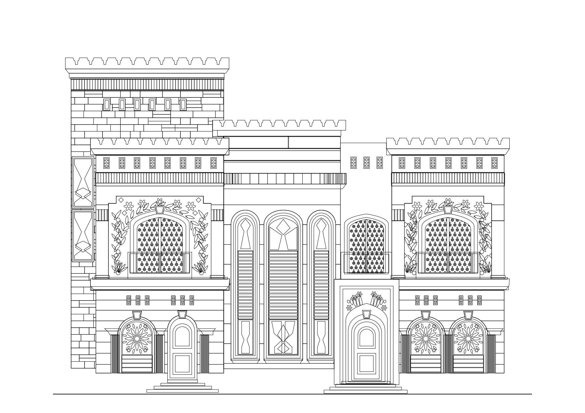

## تحميل الواجهة — النسخة الثانية

- [كل الملفات في ZIP](drawings/elevation-v2/elevation_v2_package.zip)
- [رسم AutoCAD DXF بطبقات وأوزان خطوط](drawings/elevation-v2/elevation_v2_lineweights.dxf)
- [رسم PDF متجه](drawings/elevation-v2/elevation_v2.pdf)
- [معاينة PNG](drawings/elevation-v2/elevation_v2_preview.png)
- [تفاصيل المقياس والتحقق](drawings/elevation-v2/README_AR.md)

افتح الملف المطلوب واضغط زر **Download raw file** (علامة السهم لأسفل) لحفظه على جهازك. ويمكن تنزيل المستودع كاملًا من **Code → Download ZIP**.

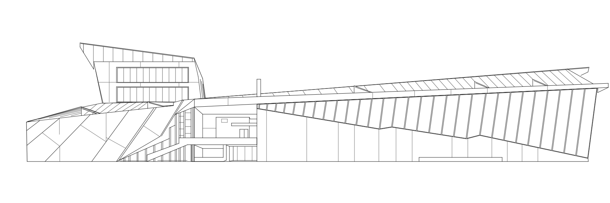

الرسم إعادة بناء بصرية بمقياس نسبي؛ لم يُضبط على أبعاد مساحية. النسخة الثانية تحتوي على 443 خطًا متجهًا، مع فحوص لصحة DXF وPDF واتساق إحداثيات المخرجين. لا تعني هذه الفحوص ضمان المطابقة الكاملة للصورة الأصلية.

## المهارة

[CAD Elevation Vectorizer](.agents/skills/cad-elevation-vectorizer/SKILL.md)
