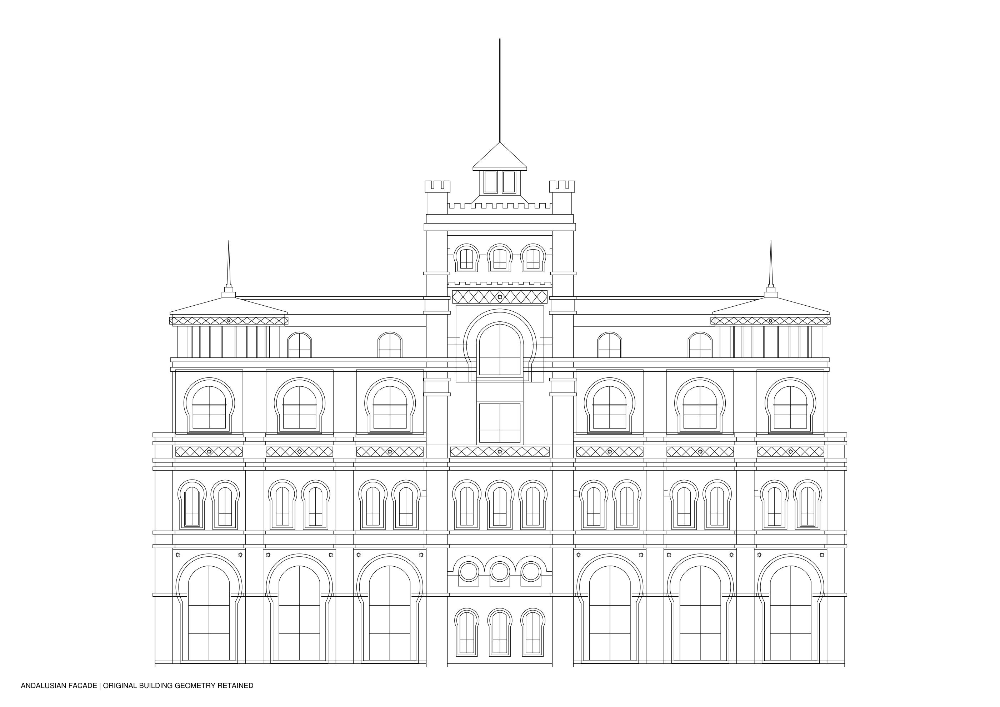

# إعادة تصميم الواجهة بتفاصيل أندلسية

[DWG](andalusian.dwg) · [مقارنة قبل وبعد](before_after.pdf) · [PDF](andalusian.pdf)

استُبدلت الحليات الخارجية المقوسة القديمة ومفاتيح عقودها بحليات مزدوجة على هيئة حدوة الفرس، وإطارات ألفيز مستطيلة، وأحزمة سبكة هندسية متشابكة موزعة حسب بحور المبنى. أُعيد تصميم تقسيمات الزجاج بخطوط رأسية وأفقية مستقيمة. التغيير في المعالجة الخارجية؛ أما مواقع الفتحات وحدود الزجاج الحقيقية والدعامات والتراجعات وحدود الكتل والأسقف فمأخوذة من المصدر الأصلي. حليات حدوة الفرس تحيط بالفتحات الموجودة ولا تمثل فتحات حائط جديدة.

الفتحات الدائرية الثلاث وفتحات الأجنحة العلوية الضيقة وفانوس البرج وحدود البناء باقية. لم تُستبدل كل خطوط الملف: تقرير source_preservation_schedule.json يميز بين العناصر الأصلية المحتفظ بها وبين الحليات وتقسيمات الزجاج التي أزيلت لاستبدالها.

الملف DWG أصلي قابل للتحرير، ومعه DXF وPDF. التفاصيل موزعة على 157 بلوكًا مستقلًا. الخطوط Continuous بلون ACI7 وسمك 0.25 مم، أسود في معاينة الورق وأبيض على خلفية AutoCAD الداكنة. لا يوجد زرع مضاف. وحدة المصدر غير محددة INSUNITS=0، والإحداثيات بمقياسها الرقمي الأصلي. استخدمي ZOOM ثم E وREGENALL عند الفتح.

فحص الهندسة لم يرصد تكرارًا أو تراكبًا في الخطوط المستقيمة أو نهايات غير موصولة مستحدثة. نهايات بروفيلات الأصل الحرة محفوظة ومسجلة منفصلة؛ لا تُوصل آليًا عبر مستويات معمارية مختلفة. جرى التحقق من الخطوط الأصلية المحتفظ بها، ومن معاملات منحنيات المصدر المحتفظ بها، ثم تحويل DWG وإعادة قراءته ومقارنة الإحداثيات والبلوكات. لم يُرصد خطأ Audit أو تحذير تحويل. تقارير الفحص مرفقة، ولم يتوفر AutoCAD Desktop لاختباره داخله.
