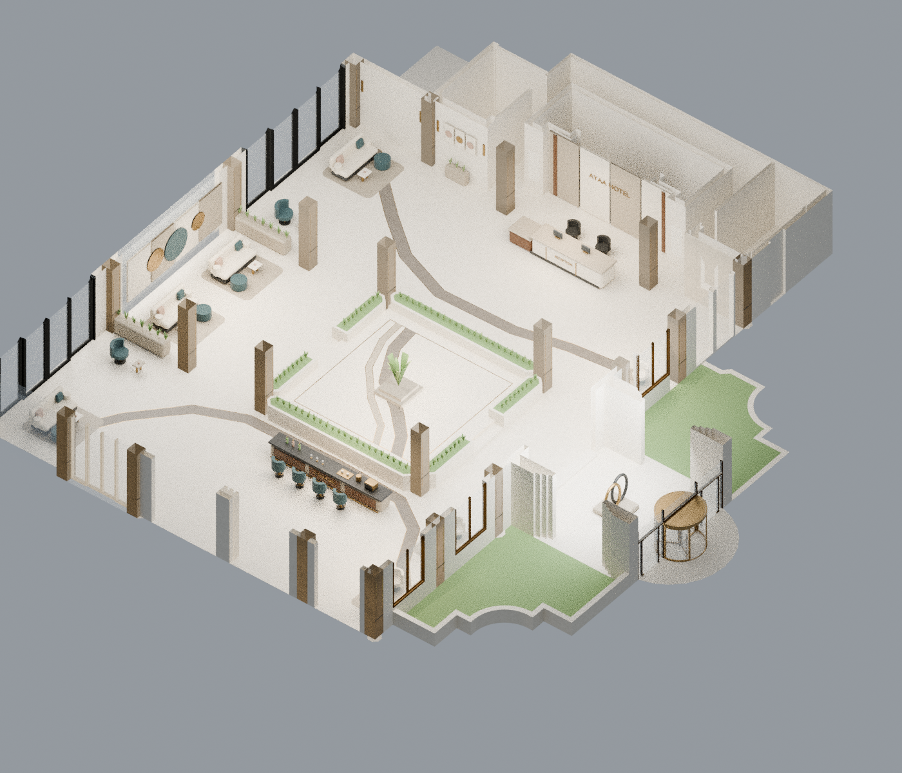

# لوبي الفندق — New Modern V4

[حزمة الاستيراد لـSketchUp بالخامات](SketchUp_New_Modern_V4.zip) · [عرض التصميم PDF](presentation.pdf) · [البلان](plan.png) · [البار](bar.png) · [الريسبشن](reception.png) · [تعليمات الاستيراد](IMPORT_AR.txt)

أُزيلت عناصر التصميم المرجعي القابلة للتغيير واستُبدلت بنماذج جديدة: جلوس مستدير وأرائك وقطع عثمانية، كونتر استقبال حجري، بار منخفض مجهز، حوائط بألواح حجرية وتشكيلات تجريدية، أباليك جديدة، وتعليقات إضاءة قرصية. أُزيلت شرائح الأعمدة القديمة مع الاحتفاظ بأجسامها الأصلية، واستُبدل الباترن الزهري للسنتر بيس بتصميم شرائط حجر ومعدن جديد. أما جسم المبنى والفتحات والدرجات وأحواض السنتر بيس فمحفوظة.

يتبع توزيع الريسبشن والبار والجلوس المرجع المرسل. يحتوي البار على زجاجات وأكواب وصينية تقديم وتجهيز قهوة. لا توجد وحدة خلفية مرتفعة. الخامات تسافر مع DAE داخل الحزمة؛ استيراد ملف DAE وحده دون مجلد textures يفقد الخرائط.

الحزمة تحتوي **DAE للاستيراد وليست SKP أصليًا**، مع9 خرائط لون مرتبطة فعليًا. فيها187 مجموعة عناصر كاملة مستقلة، تشمل الأثاث والتفاصيل والنباتات والإضاءة والأعمدة. مساعد Ruby المرفق يستوردها ويحوّل مجموعات NEW_ إلى Components أصلية داخل SketchUp؛ التشغيل موضح في IMPORT_AR.txt. مساعد Ruby لم يُشغّل هنا لعدم توفر SketchUp Desktop.

التحقق شمل641 شبكة أصلية محمية، وهرمية1577 شبكة مصدّرة، وحدودها بعد إعادة القراءة، وخاماتها ومراجع الصور، واتجاه أوجه الأرضية وتغطيتها، وتداخلات الفرش وممرات11 منطقة فتحات. تقارير الفحص وجدول الاستبدالات مرفقة. تبقى إطارات الأبواب والشبابيك وهندسة الباب الدوار من العناصر المعمارية المحفوظة، مع تنسيق خاماتها.
