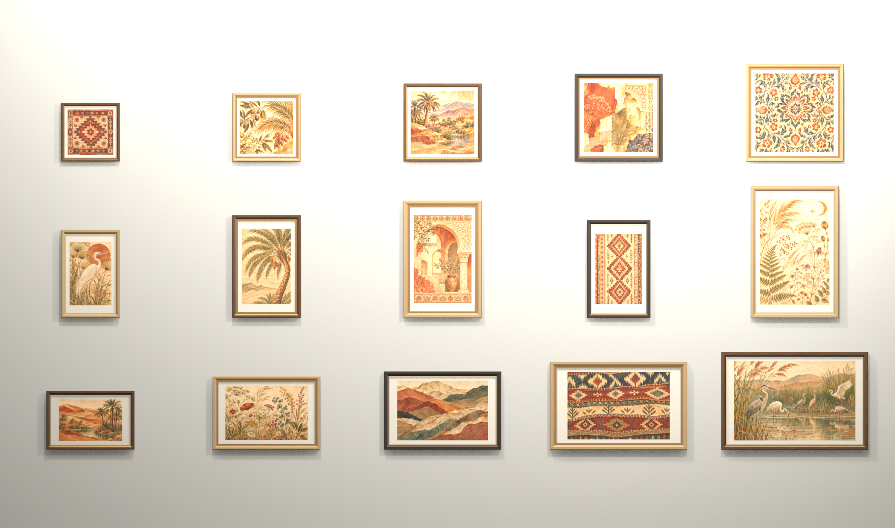

# 15 Bohemian / Heritage Lobby Frames

مكتبة براويز مستقلة للّوبي التراثي البوهيمي، وليست مركّبة في ملف اللوبي.

## الملفات
- Bohemian_15_Frames_Library.skp: المكتبة كاملة، 15 Component مستقلًا.
- Individual_SKP: 15 ملفًا منفصلًا، كل ملف فيه برواز واحد.
- Bohemian_15_Frames_Catalogue.pdf: معاينات من نفس هندسة الملفات مع أكوادها ومقاساتها.
- Gallery_Actual_Models.png: نظرة عامة.
- frame_schedule.json: المقاسات والتشطيبات.
- verification.json: تقرير فحص الملفات الأصلية بعد إعادة قراءتها.

## الاستخدام
افتحي المكتبة وانقلي الـComponent المطلوب، أو استخدمي File > Import لاستيراد ملف البرواز المنفصل.
المقاسات الحقيقية محفوظة: لا تعيدي تحجيم الملف أثناء الاستيراد.
نقطة الإدراج في منتصف أسفل البرواز، Z=0. ظهر البرواز على مستوى Y=0، وواجهته ناحية -Y.
حرّكي ولفّي الـComponent كاملًا حتى يلامس ظهره الحائط. العمق 4.5–6.5 سم حسب البرواز.

الإطارات والبطانات والحوامل مجسّمات ثلاثية الأبعاد. الأعمال الفنية صور مطبوعة بخامات مضمّنة؛ ملمس الرسم أو النسيج داخل الصورة ليس نحتًا مجسّمًا.
الخامات مضمّنة في SKP ولا تحتاج ربط ملفات خارجية. لا توجد لوحات ممتدة خارج حدود البراويز.
حائط وإضاءة المعاينات غير موجودين في ملفات SKP.

## التحقق
تمت إعادة قراءة المكتبة والملفات الـ15 للتحقق من عدد المكونات والمقاسات وإغلاق أوجه القطع وعدم وجود حواف سائبة واتجاه اللوحات ومواضعها وإحداثيات الخامات وعدم تمدد الصور.
لم يتم اختبار الفتح بواجهة SketchUp Desktop؛ الفحص تم بقارئ SKP برمجي مستقل عن مرحلة إنشاء الهندسة.

## تحميل مباشر

- [تحميل المكتبة كاملة SKP](Bohemian_15_Frames_Library.skp)
- [تحميل كل الملفات ZIP](Bohemian_15_Frames_Complete.zip)
- [معاينة PDF](Bohemian_15_Frames_Catalogue.pdf)

| Code | الشكل | المقاس سم | العمق سم |
|---|---|---|---|
| [BF01](Individual_SKP/BF01.skp) | مربع | 60 × 60 | 4.5 |
| [BF02](Individual_SKP/BF02.skp) | مربع | 70 × 70 | 4.5 |
| [BF03](Individual_SKP/BF03.skp) | مربع | 80 × 80 | 4.5 |
| [BF04](Individual_SKP/BF04.skp) | مربع | 90 × 90 | 5.5 |
| [BF05](Individual_SKP/BF05.skp) | مربع | 100 × 100 | 5.5 |
| [BF06](Individual_SKP/BF06.skp) | مستطيل طولي | 60 × 90 | 5.5 |
| [BF07](Individual_SKP/BF07.skp) | مستطيل طولي | 70 × 105 | 5.5 |
| [BF08](Individual_SKP/BF08.skp) | مستطيل طولي | 80 × 120 | 5.5 |
| [BF09](Individual_SKP/BF09.skp) | مستطيل طولي | 65 × 100 | 5.5 |
| [BF10](Individual_SKP/BF10.skp) | مستطيل طولي | 90 × 135 | 6.5 |
| [BF11](Individual_SKP/BF11.skp) | مستطيل عرضي | 90 × 60 | 5.5 |
| [BF12](Individual_SKP/BF12.skp) | مستطيل عرضي | 110 × 75 | 5.5 |
| [BF13](Individual_SKP/BF13.skp) | مستطيل عرضي | 120 × 80 | 5.5 |
| [BF14](Individual_SKP/BF14.skp) | مستطيل عرضي | 140 × 90 | 6.5 |
| [BF15](Individual_SKP/BF15.skp) | مستطيل عرضي | 150 × 100 | 6.5 |

