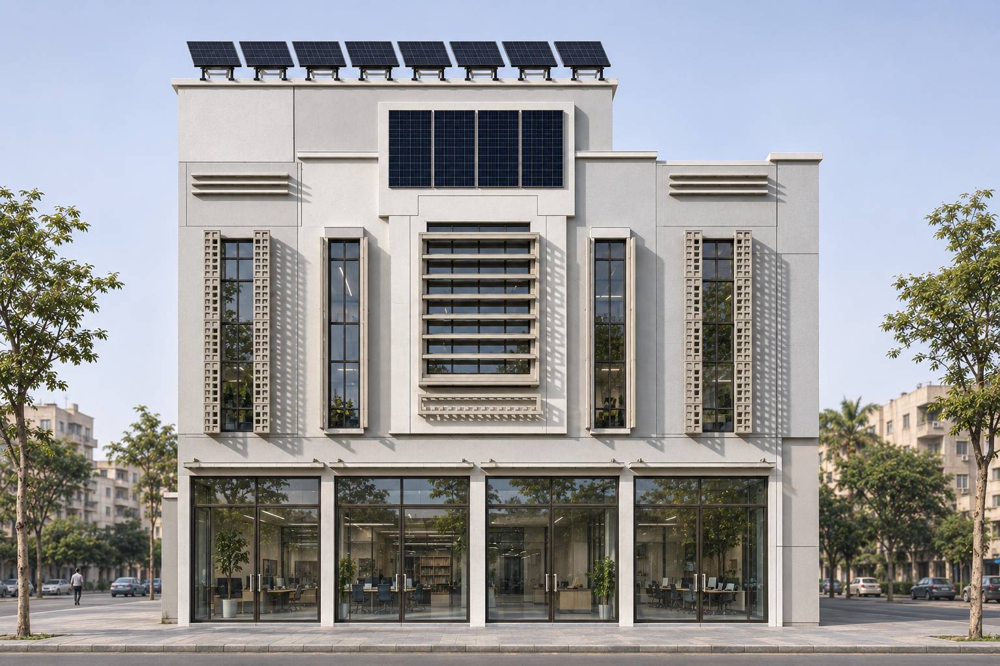
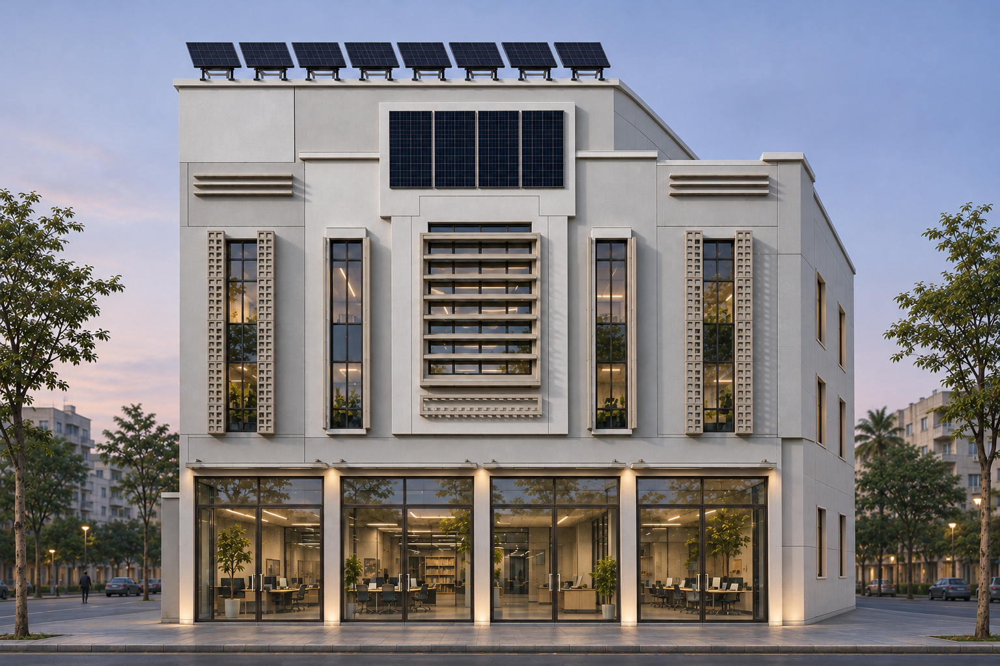
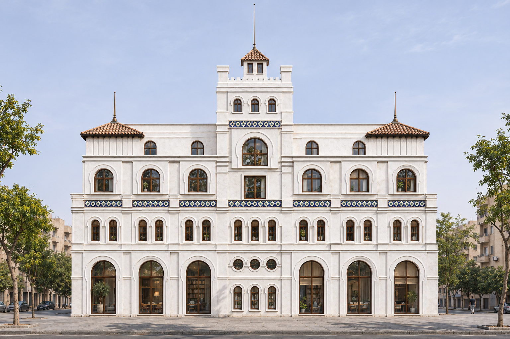
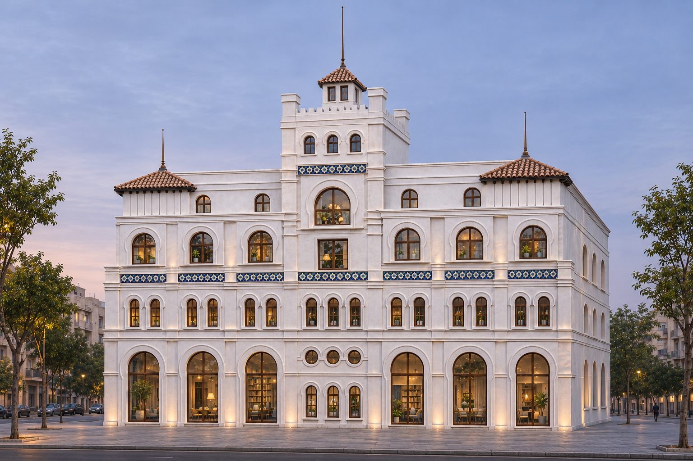
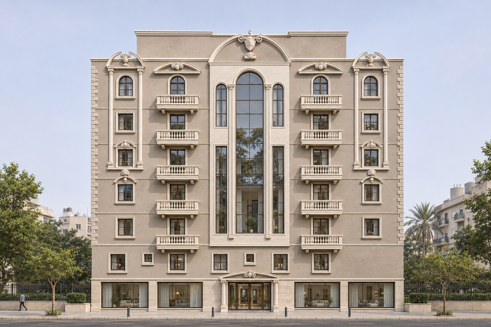
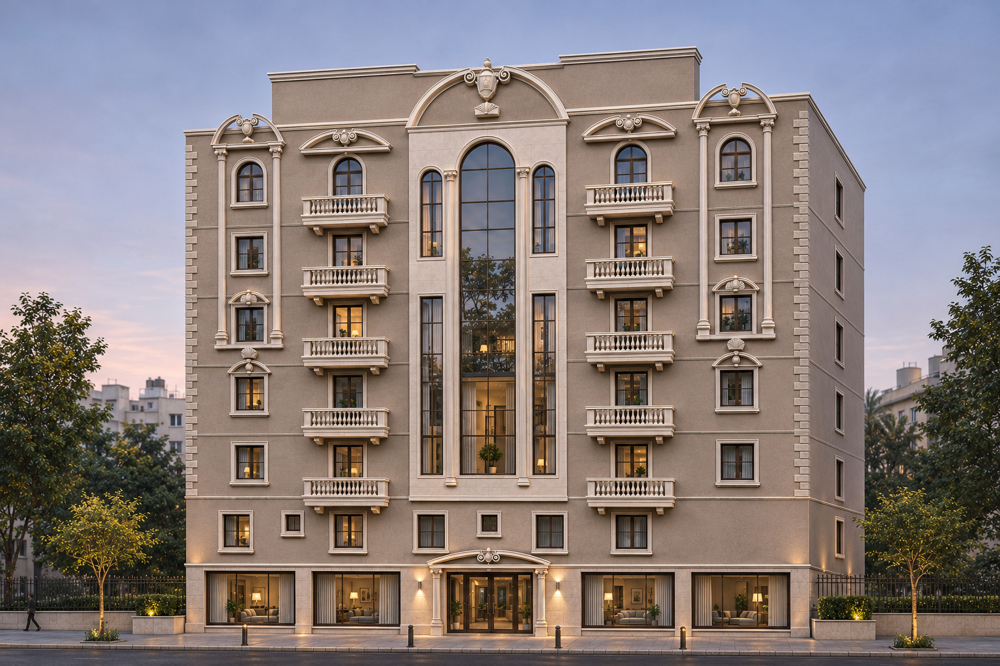
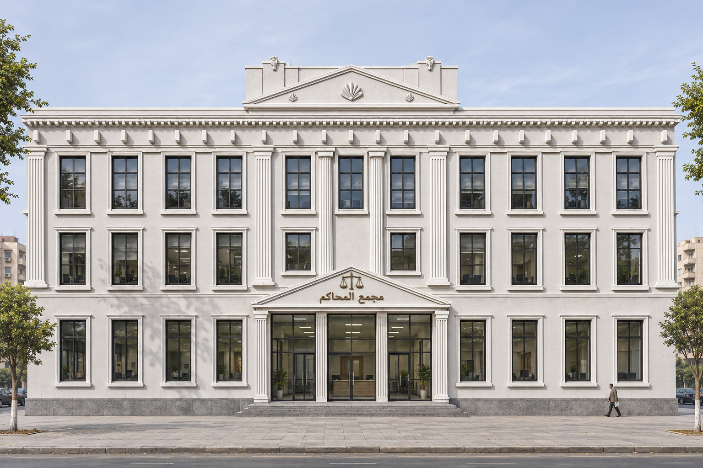
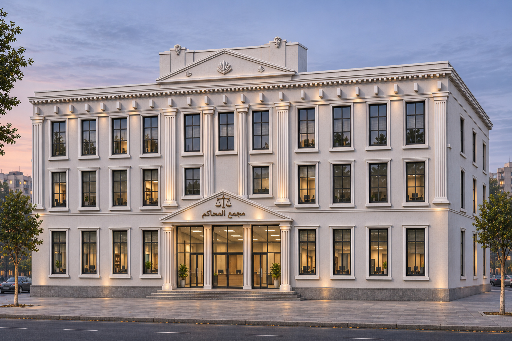

# صور الواجهات الواقعية — الإصدار الثالث — الخامات والوظائف المعدّلة

ثماني صور منفصلة: أمامية بضوء نهاري محايد وزاوية جانبية وقت الشفق بعد الغروب لكل واجهة.

التعديلات: اليوناني مجمع محاكم بخامات فاتحة وجرانيت عند القاعدة؛ الباروك مبنى سكني مع فتحتين يمين المدخل مماثلتين لليسار؛ الأندلسي تشطيب أبيض وزليج أزرق وإطارات خشبية اللون وقرميد؛ الاستدامة بتشطيبات أهدأ وإضاءة طبيعية. الأشخاص قليلون وبعيدون حسب آخر توجيه. لا يوجد بانر أو PDF في هذا التسليم.

الصور محسنة بصريًا بالذكاء الاصطناعي انطلاقًا من معاينات مشتقة من خطوط CAD؛ التفاصيل تحتاج مراجعة عند الاعتماد. أعماق المباني والواجهات الجانبية تصوّر تصميمي لأن المصدر واجهات أمامية فقط. ملفات CAD الأصلية لم تُعدّل.

ملفات PNG هي المخرجات الأصلية، وJPG نسخ أخف للفتح السريع؛ الدقة 1536 × 1024 بكسل.

| الطراز | أمامي | زاوية جانبية |
|---|---|---|
| الاستدامة |  |  |
| الأندلسي |  |  |
| الباروك |  |  |
| اليوناني |  |  |

[تحميل الصور الثمانية بصيغة PNG](Facades_8_Photos_PNG.zip)

[تحميل الصور الثمانية بصيغة JPG](Facades_8_Photos_JPG.zip)
