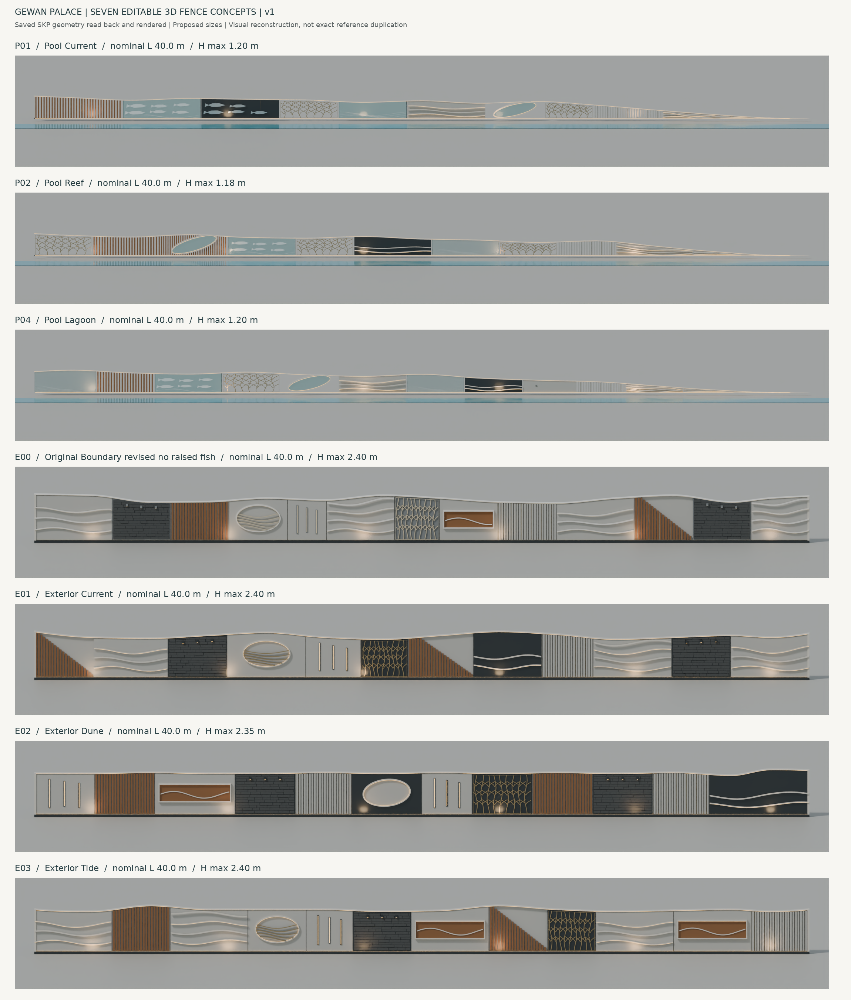

> **تم استبدال هذه النسخة بعد رفضها. [النسخة المصححة v2 والمقارنة مع المراجع](../gewan-fences-seven-reference-v2/README.md).**

# Gewan Palace — Seven Fence Concepts v1

سبعة تصورات أسوار في ملف SketchUp واحد: **3 للبول و4 للسور الخارجي**، كمكونات هندسية قابلة للتحرير. هذا إصدار أول للمراجعة بأبعاد مقترحة، وليس نسخة مطابقة للصور بالمليمتر أو جاهزة للتصنيع.

## التنزيل

- [ملف SketchUp مباشرة](Gewan_Seven_Fence_Concepts_v1.skp?raw=true)
- [الحزمة الكاملة ZIP](Gewan_Seven_Fence_Concepts_v1.zip?raw=true): تشمل SKP والخامات ومعاينات النموذج وتقرير الفحص وملف Blender إضافي لإعداد الرندر والإضاءة.
- [معاينة PDF من النموذج الفعلي](Seven_Concepts_Model_Preview.pdf)
- [شرح الأبعاد والخامات والاختبارات والقيود](README_AR.md)

الطول الاسمي لكل تصميم 40 مترًا، وارتفاع البول نحو 1.2 متر يتناقص للصفر، والخارجي يصل إلى نحو 2.4 متر. الإحداثيات كتبت إلى SKP بتحويل وحدات صريح. الخامات والتفاصيل أعيد إنشاؤها من الصور وليست الملفات الأصلية.

أعيد فتح SKP وفحص المكونات والأوجه والحدود والخامات المضمنة وحواف الأوجه. لم يُختبر داخل SketchUp Desktop. ملف SKP يحتوي هندسة عناصر الإضاءة؛ إعداد إضاءة الرندر الفعلي موجود في ملف Blender داخل ZIP، وليس إعداد V-Ray أو Enscape أصليًا.

تعليمات README_AR.md الخاصة بملفات الخامات وملف Blender والمعاينات الفردية تشير إلى محتويات الحزمة ZIP بعد فكها داخل مجلد Gewan_Fences_v1.

