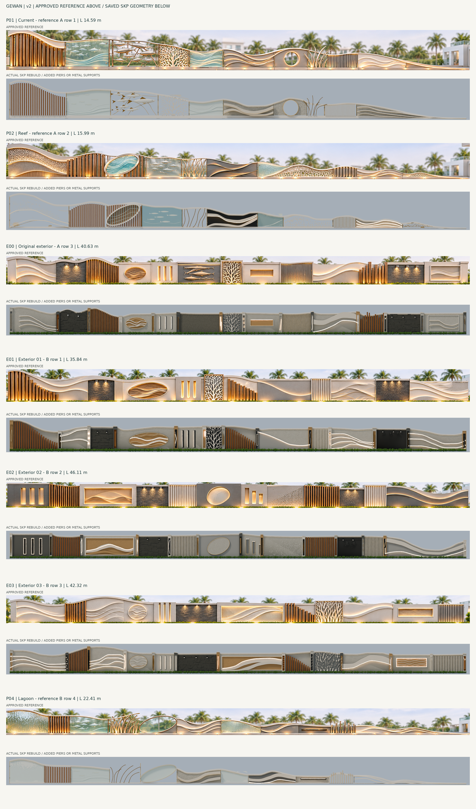

# Gewan Palace — Reference Rebuild v2

إعادة بناء الأشكال السبعة من صور الاختيارات المعتمدة، مع الأعمدة المطلوبة للأسوار الخارجية ودعامات البول المعدنية.

## التنزيل والمراجعة

- [ملف SketchUp: السبعة في ملف واحد](Gewan_Seven_Reference_Fences_v2.skp?raw=true)
- [الحزمة كاملة بالخامات وملف الرندر والمعاينات والتقرير](Gewan_Seven_Reference_Fences_v2.zip?raw=true)
- [مقارنة كل صورة مع نموذجها — PDF](Reference_vs_Model_v2.pdf)
- [لوحة الأعمدة الخارجية الـ53](Columns_53_Geometry.png)
- [فهرس الأعمدة ومواقعها](Columns_53.csv)
- [تفاصيل الأبعاد والتثبيت والخامات والفحص](README_AR.md)

## ما تغير

- لكل اختيار منحنيات وحدود قطاعات ونقوش مستقلة مأخوذة من مرجعه، مع الحفاظ على ترتيبها ونسبها؛ أُلغي ترتيب الوحدات الجاهزة المتكررة في v1.
- 53 عمودًا خارجيًا بواجهات مختلفة، مع فحص عدم تكرار بصمات هندسة تجميعاتها وفحص بقاء الزخارف داخل حدود الأعمدة.
- قاعدة حاملة منخفضة ودعامات ومشابك معدنية للبول، دون أعمدة خرسانية كبيرة.
- أسماك منحوتة ثلاثية الأبعاد منفصلة عن نقوش الأسماك على الزجاج، وتفريغات مرجانية فعلية ونقوش وميداليات ذات عمق.
- خامات خشبية وحجرية ومعدنية وزجاجية منفصلة، وخرائط خامات مضمّنة. إعدادات إضاءة الرندر الفعلي موجودة في ملف Blender داخل ZIP.

أُعيد فتح SKP وفحص الأوجه والحواف والمكونات والأبعاد والخامات. المعاينات مشتقة من هندسة الملف المصدّر. لا تمثل المقاسات المقترحة قياسات للموقع أو شهادة تطابق بالمليمتر مع الصور؛ التفاصيل والاختبارات التي لم تُجر مذكورة في التقرير. لم يتوفر SketchUp Desktop لاختبار التطبيق نفسه.

الصورة المعتمدة فوق، ونموذجها أسفل في لوحة المقارنة. الأعمدة إضافة طلبها المستخدم. أُزيل السمك البارز من الخيار الخارجي E00 طبقًا لتصحيحه السابق.

