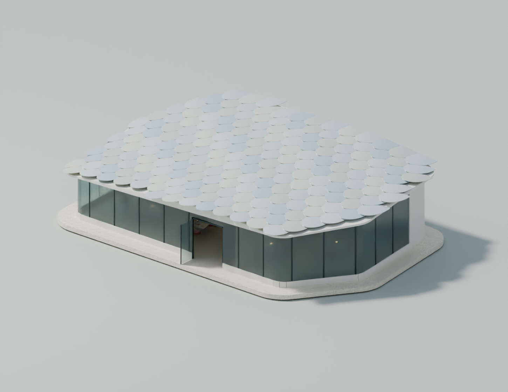
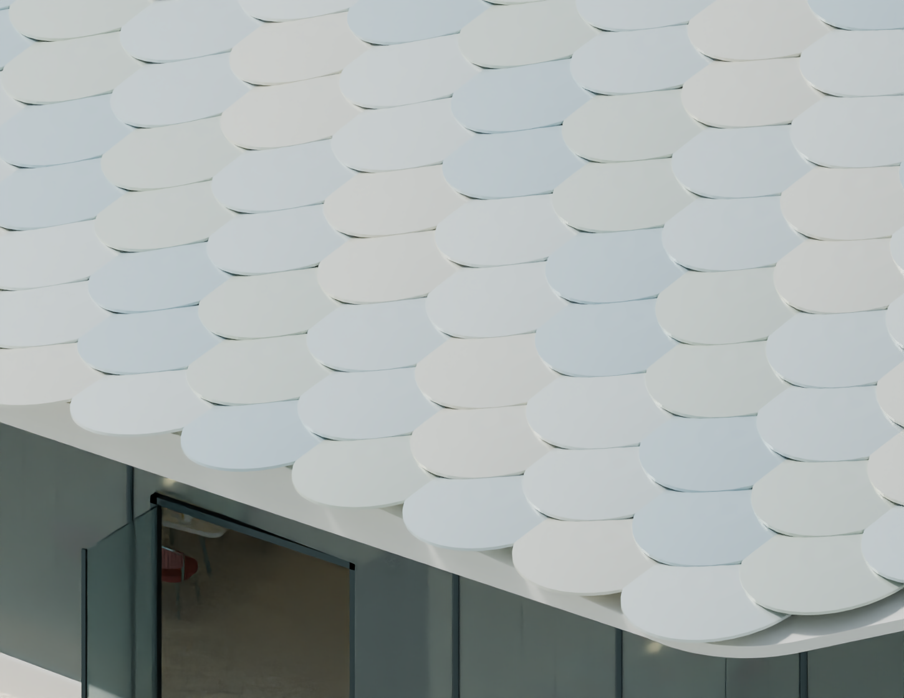

# قشور السمك V5 — نموذج كافيه واحد لمراجعة الاتجاه

[تنزيل ZIP — بداخله ملف SKP واحد](Fish_V5_Cafe_Prototype_One_SKP.zip?raw=true) · [معاينة PDF](Fish_V5_Cafe_Prototype_Preview.pdf)

هذا **نموذج تجريبي لكافيه واحد فقط**، قبل تصميم بقية مجموعة الـ16. النسخة السابقة V4 لم تحقق وضوح مفهوم قشور السمك المطلوب. هذه النسخة تجعل القشور المنحنية المتراكبة هي جلد السقف كله تقريبًا، بدل لوحة صغيرة على الواجهة. لا تتضمن بقية الـ15 وحدة، ولم تُعدّل ملفات السلحفاة أو باقي الكونسبتات أو الموقع.

## محتوى النموذج

- مبنى واحد متصل بأطراف مستديرة وتكوين غير متماثل، مساحته الأرضية المقترحة نحو 235 م².
- سقف واحد متدفق، عليه 192 قشرة مجسمة مستقلة، ذات تقوس وسُمك وحواف دائرية وتراكب حقيقي. تغطي القشور 98.63% من المسقط الأفقي للسقف؛ تتجاوز بعض الحواف حدوده قليلًا.
- ألوان لؤلؤية عاجية وأزرق رمادي وأخضر هادئ، وإطار ألومنيوم داكن وحجر فاتح. لا خامات خشبية أو بامبو.
- 28 كرسي طعام، ترابيزات حجرية غير متماثلة مستديرة الأطراف، جلسة منحنية، كونتر قهوة خزفي، ماكينة وأكواب وأطباق وأدوات مائدة وإضاءات ونباتات وتجهيزات خدمة وحمام داخلي.
- بلوك رئيسي واحد مستقل يمكن تحريكه ونسخه؛ التفاصيل داخل مجموعات ومكونات قابلة للتعديل. إخفاء السقف يُظهر الداخل دون تفكيك البلوك.

هذه معالجة واحدة فقط. تنويع العمارة والألوان والأسقف والأثاث بين الوحدات الأخرى يأتي بعد مراجعة هذا الاتجاه؛ لا يعني هذا النموذج أن الباقي سيكرر نفس السقف أو اللون أو الفرش.

## الفتح في SketchUp 2023

1. نزّلي ZIP واضغطي Extract All / استخراج الكل. داخله ملف SKP واحد فقط.
2. في SketchUp اختاري File → Open وافتحي ملف SKP المستخرج.
3. اضغطي Shift+Z لعرض الموديل كاملًا، أو اختاري مشهد Exterior.
4. استخدمي مشهد Interior أو أخفي Tag الخاص بالأسقف لرؤية الفرش. حرّكي البلوك الرئيسي بضغطة اختيار واحدة.

لا تفتحي رابط SKP الخام داخل المتصفح؛ المتصفح قد يعرض بياناته كنص. رابط ZIP مخصص للتنزيل المباشر، ولا يحتاج إضافة.

## التحقق وحدود التسليم

أُعيدت قراءة ملف SKP المحفوظ؛ طابقت الأوجه والمكونات والمقاسات المصدر، وفُحصت إحداثياته. يحتوي على بلوك رئيسي واحد و115,509 أوجه فريدة في تعريفات المكونات و274 حالة مكوّن. لا حواف سائبة. كل حواف القشور البالغ عددها 154,560 مضبوطة Soft وSmooth، ولا أوجه مكررة داخل تعريفات القشور. كما فُحص أرشيف ZIP وبصمة SKP داخله. النتائج في verification.json.

المعاينات من هندسة الملف المحفوظ، مع إضاءة وأرضية عرض للرندر. صيغة SKP v17 قابلة للقراءة في SketchUp 2023، لكن SketchUp Desktop غير متاح هنا فلم تُجرّب جلسة فتح تفاعلية عليه. الأبعاد والخامات مقترحة للتصميم وليست تفاصيل تنفيذ أو اعتمادًا إنشائيًا؛ تجهيزات الإضاءة مجسمة، وإعدادات محرك الرندر ليست جزءًا من ملف SketchUp.

