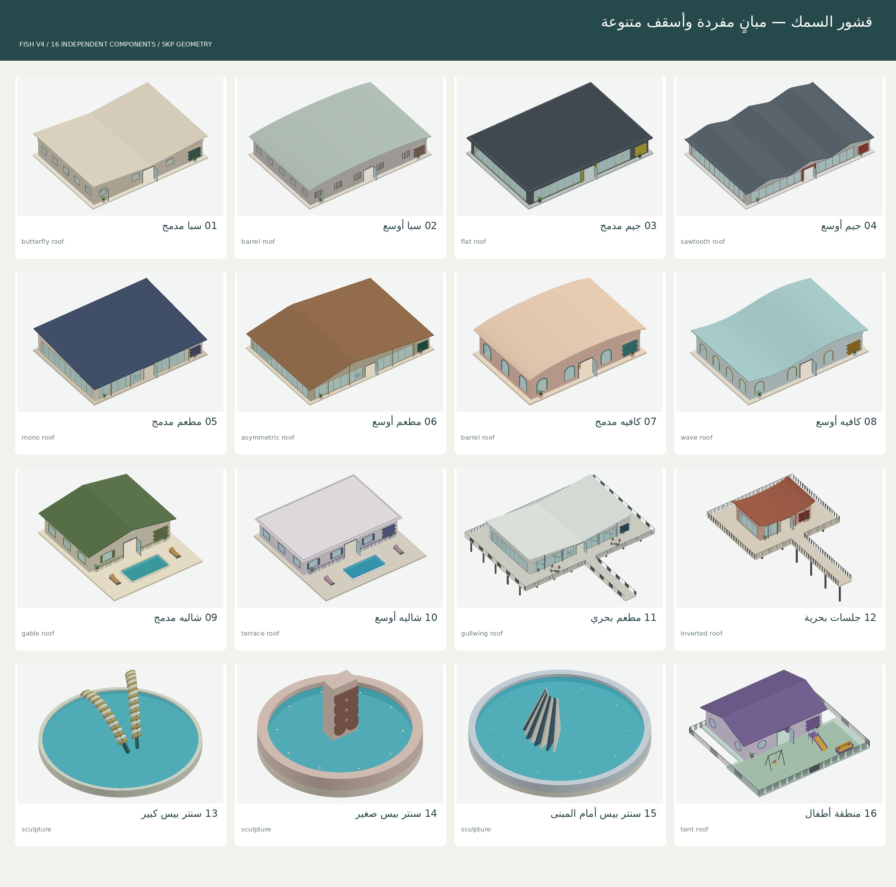
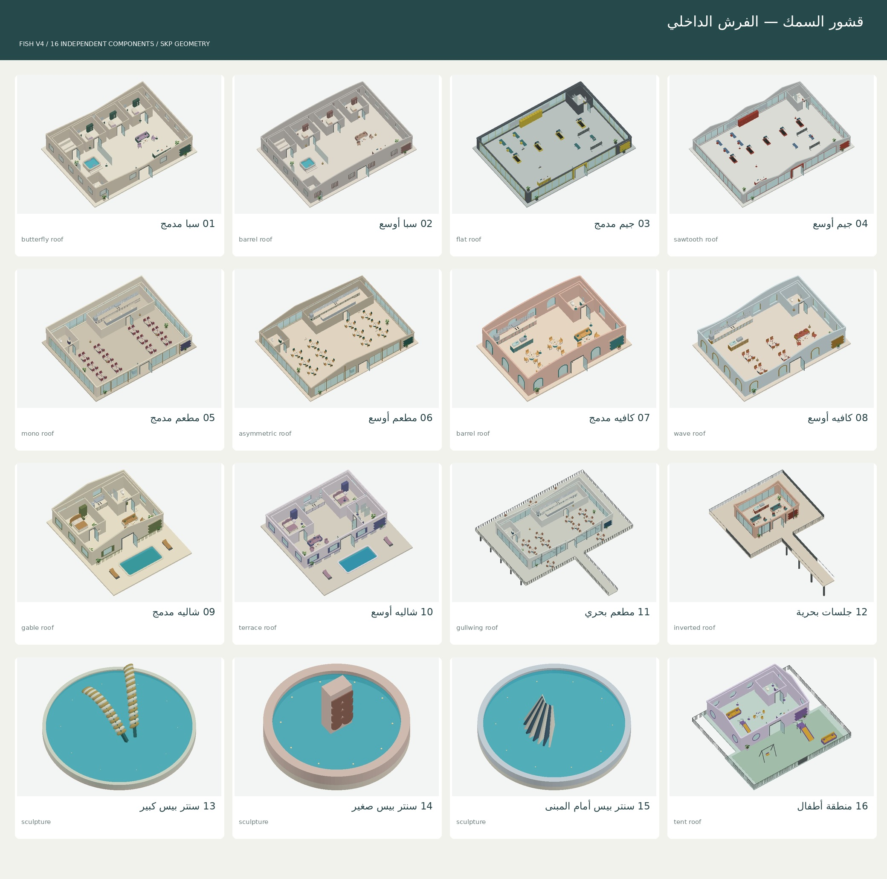

# قشور السمك V4 — مبنى واحد لكل نشاط، وشخصيات متنوعة

[تحميل ZIP — ملف SKP واحد فيه الـ16 بلوك](Fish_V4_All_16_One_SKP.zip?raw=true) · [معاينة الخارج والداخل PDF](Fish_V4_Preview.pdf)

هذه إعادة تصميم لقشور السمك وحدها. مباني السبا والجيم والمطاعم والكافيهات والشاليهات والوحدات البحرية ومنطقة الأطفال أصبح كل منها كتلة واحدة متصلة، بأرضية مستمرة وسقف واحد يغطي البرنامج بالكامل. غرف المساج والساونا والحمامات والمطابخ داخل نفس المبنى. لا توجد كبائن أو قاعات خارجية منفصلة تحتاج إلى التجميع.

الملف يضم 13 مبنى و3 سنتر بيس، وكلها Components مستقلة على مستوى الموديل الرئيسي، في أربع صفوف. عدد المباني والكتل لا يُستدل عليه من عدد الغرف الداخلية. توجد نسختان للسبا والجيم والمطعم والكافيه والشاليه، ومطعم بحري وجلسات بحرية و3 سنتر بيس ومنطقة أطفال.

## اختلاف الوحدات

- السبا: مبنى بفتحات خصوصية وسقف فراشة، وآخر بسقف قبو طويل وألوان هادئة مختلفة؛ غرف العلاج والجاكوزي والساونا داخلهما.
- الجيم: سقف مسطح رمادي داكن وإطار لوني واضح، ونسخة أكبر بسقف متصل متعرج، مع توزيع مفتوح للأجهزة والاستوديو واللوكرز.
- المطاعم: سقف مائل كحلي وفرش هندسي بوسائد داكنة، ونسخة بسقف معدني نحاسي غير متماثل وترابيزات وكراسي بتصميم آخر.
- الكافيهات: فتحات مقوسة، وطراز مختلف بسقف متموج؛ ألوان كورال وأكوا وخردلي، وجلسات متنوعة.
- الشاليهات: سقف جمالوني زيتوني وفرش بغرفة نوم ذات ظهر سرير مقوس، ونسخة بسقف تراس وظهر سرير من ثلاث لوحات وهيكل معدني؛ أحواض سباحة خاصة بفتحات فعلية في الدكات.
- المطعم البحري والجلسات: كل وحدة مبنى واحد على منصة واحدة؛ السقف والتوزيع والفرش واللون مختلفان.
- منطقة الأطفال: مبنى واحد بسقف خيمة متصل، مع مساحة ألعاب خارجية وأرضية لينة وسور وبوابة.

رابط قشور السمك يظهر في ألواح خزفية بارزة على الواجهات وفي النحت، دون تحويل كل مبنى إلى قبة أو تكرار قاعات منفصلة. لا خشب أو بامبو أو خامات بتجزيعات خشبية. الأسقف البنية في بعض الوحدات تمثل معدناً مطلياً/نحاسياً، والمفروشات بالأوكر تمثل قماشاً، وليست أخشاباً. الجاكوزي داخل السبا فقط.

## الاستخدام

1. نزّلي ZIP ثم Extract All / استخراج الكل. بداخله **ملف SKP واحد فقط**.
2. من SketchUp 2023 اختاري File → Open وافتحي ملف SKP المفكوك.
3. اضغطي Shift+Z (Zoom Extents) أو اختاري مشهد Exterior لعرض البلوكات كلها.
4. اختاري بلوك بضغطة واحدة للتحريك والنسخ. مشاهد Interior وTag `02_Roofs_Hide_For_Interiors` لإظهار الفرش.

المعاينات من الهندسة المقروءة من ملفات SKP، مع إضافة أرضية/إضاءة للعرض فقط في الرندرات. تمت مراجعة الملف الأصلي والأرشيف وبصماتهما وعدد الأوجه والمكونات ومقياس ومواقع البلوكات. فُحص هندسيًا أن السقف يغطي مساحة كل مبنى وأن الغرف الداخلية تقع داخل حدوده، وأن أرضيته متصلة. `single_building_audit.json` يسجل النتائج. ملفات v17 تستهدف SketchUp 2023؛ لم يتوفر SketchUp Desktop لتجربة الفتح التفاعلي.

المقاسات تصميمية مقترحة وتحتاج المطابقة مع الموقع. هذه موديلات تصميم قابلة للتعديل وليست رسومات تنفيذية أو اعتمادًا هندسيًا للمنشآت البحرية أو تجهيزات اللعب. تجهيزات الإنارة مجسمة؛ إعدادات رندر V-Ray/Enscape ليست جزءًا من الملفات. باقي الكونسبتات وملفات الموقع السابقة لم تتغير.

