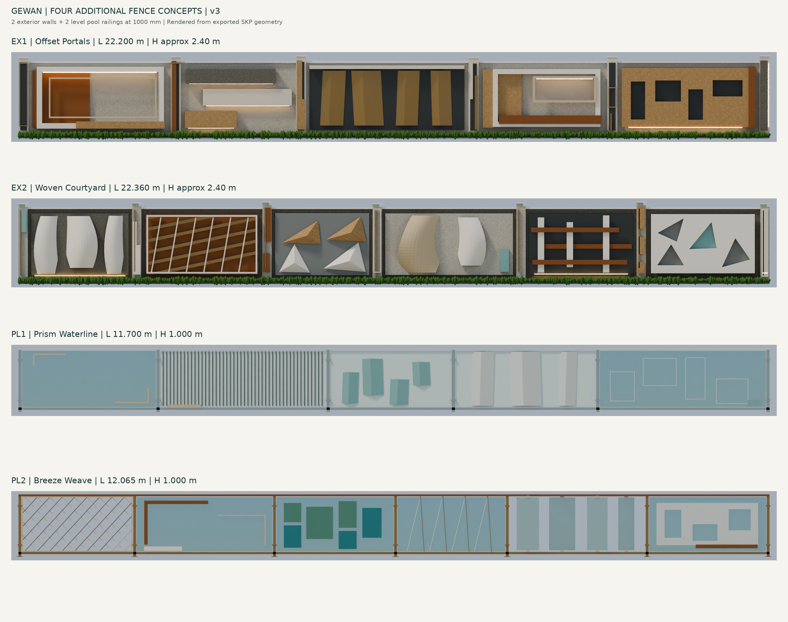

# Gewan — Four Additional Fence Concepts v3

ملف مستقل يضم **اختيارين للسور الخارجي واختيارين للبول**، بخامات ومكونات وأجسام ثلاثية الأبعاد قابلة للتحرير. هذه خيارات إضافية ولا تستبدل v2 المعتمد.

- [تحميل ملف SketchUp: الأربعة في ملف واحد](Gewan_Four_New_Fence_Concepts_v3.skp?raw=true)
- [تحميل الحزمة بالخامات والرندر والتقرير](Gewan_Four_Additional_Concepts_v3.zip?raw=true)
- [المعاينات والتفاصيل — PDF](Four_New_Fence_Concepts_v3.pdf)
- [الأبعاد والخامات وطريقة التحرير والفحص](README_AR.md)

الخارجي الأول يعتمد الإطارات المستطيلة والكتل المتدرجة؛ الثاني يعتمد النحت الرأسي والنسيج المعدني. اختيارات البول بزجاج منشوري وخزف بحري أو نسيج معدني وزجاج ملوّن. كل اختيارات البول بارتفاع 1000 مم من منسوب الأرض ونهايات قائمة، دون هبوط إلى الصفر.

لم تُستورد وحدات زخرفية أو أعمدة أو أشكال من ملفات v1/v2. الخامات تتبع لغة المراجع، مع تكوينات هندسية جديدة. فُحصت هندسة الملف بإعادة القراءة من القرص، وقيست ارتفاعات قوائم البول من الملف الناتج. تفاصيل نطاق الفحص وما لم يختبر موجودة في التقرير.

