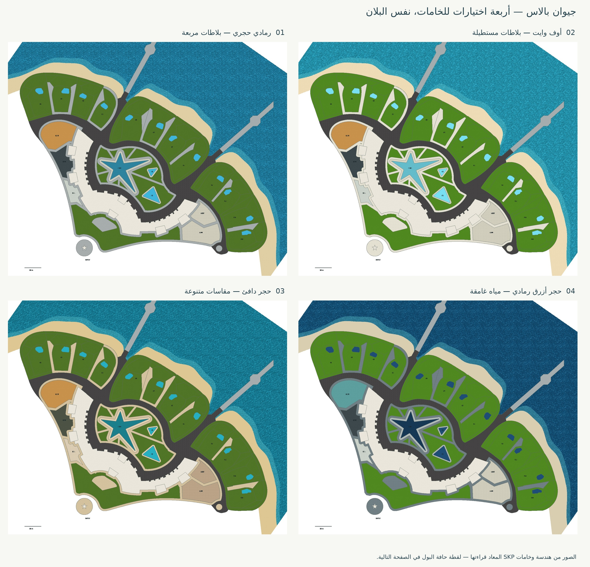
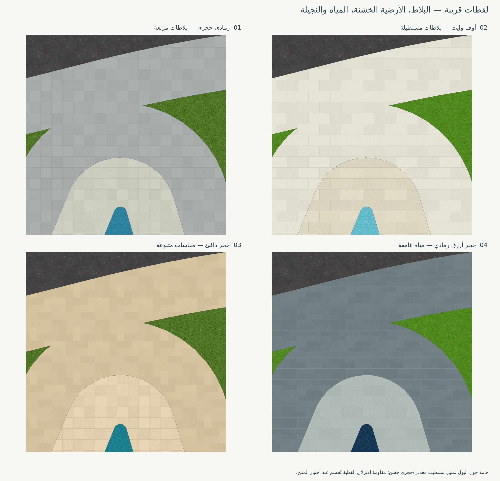

# جيوان بالاس — أربعة اختيارات بخامات صور داخل ملف SketchUp واحد

[تحميل ZIP — ملف SKP واحد فيه الأربع نسخ](Gewan_Four_Textured_Options_One_SKP.zip?raw=true) · [معاينة البلان والخامات واللقطات القريبة PDF](Four_Textured_Options_Review.pdf)

نفس المخطط المعتمد، بأربع مجموعات مستقلة لخامات مختلفة، داخل ملف واحد. كل مجموعة تحتوي نفس الـ117 مكوّنًا المفصولًا، بما فيها البحر والشاطئ والتشريح والتسميات. المبنى والنجمة والمسابح والممرات والشاطئ لم يُعد تصميمها أو تغيير مقاساتها؛ الإزاحات بين النسخ لتنظيم العرض فقط، في صفين وعمودين.

## الاختيارات

1. **01 Grey Coastal**: بلاط حجري رمادي بمربعات 60×60 سم، وحافة بول فاتحة ذات حبيبات حجرية، ونجيلة مصوّرة ومياه زرقاء صافية.
2. **02 Pearl Ivory**: بلاط أوف وايت مستطيل 60×120 سم بترتيب متبادل، حواف فاتحة مات، نجيلة مختلفة، ومياه فاتحة تركواز.
3. **03 Warm Stone**: أرضية حجر دافئ بمقاسات 40×40 و40×80 سم وتوزيع متنوع، حافة فاتحة بنقشة حجرية متعرقة، ومياه أكوا.
4. **04 Blue Slate**: بلاط أزرق رمادي شرائح 90×30 سم، حافة بول رمادية فاتحة، ومياه أغمق كحلية.

الخامات صور فعلية داخل Materials، مع فواصل البلاط، والحبيبات والمسام والتدرجات. صور النجيلة والرمل والحجر الأساسية من مسوح فوتوغرافية CC0، وبعض الخرائط مركبة ومعدلة للمشروع. صور المياه صُممت لتمثيل التموج وانعكاس الضوء وبلاط أرضية المسبح. صور الرمل والبحر والنجيلة موجودة في جميع الاختيارات؛ لا اعتماد على ألوان سادة في تلك المناطق.

تشطيب محيط البول مقترح بصري لحجر/بلاط خارجي خشن ومات. صورة الخامة لا تمنح منتجًا حقيقيًا تصنيف مقاومة انزلاق؛ يُحدد المنتج ومواصفاته عند الاختيار التنفيذي. مواد الجيم تمثل حبيبات أرضية مطاطية، والسبا والمطاعم لها بلاطات معدنية/حجرية مختلفة؛ لا خشب في هذه الخيارات.

## افتحي ملفًا واحدًا

1. نزّلي ZIP واختاري Extract All / استخراج الكل. داخله **Gewan_Four_Textured_Material_Options.skp** فقط، دون ملفات صور خارجية مطلوبة.
2. افتحيه في SketchUp 2023 عبر File → Open.
3. **مهم لظهور الصور:** View → Face Style → **Shaded with Textures**. عرض Monochrome أو Shaded وحده قد يخفي صور الخامات.
4. من Scenes اختاري **01 Grey Coastal** أو **02 Pearl Ivory** أو **03 Warm Stone** أو **04 Blue Slate**. المشهد **00 Four Material Options** يُظهر الأربع معًا.
5. لكل خيار مشهد **Pool Materials Closeup** لفحص المقياس والتفاصيل، ومشهد **With Anatomy** لإظهار التشريح. المشاهد الأساسية تخفي التشريح لعرض الخامات بوضوح.

كل اختيار Component رئيسي مستقل، وجواه المساحات المفصولة. ادخلي الاختيار ثم المساحة بدبل كليك، واستخدمي B لتغيير خامتها. تعريفات المكونات والخامات مستقلة بين الأربع، فتعديل خامة اختيار لا يغير بقية الاختيارات. داخل كل اختيار، المناطق التي تستخدم نفس التشطيب تشترك في خامة ذلك التشطيب طبيعيًا. التشريح على Tag **90_Anatomy_DELETE** والتسميات على **99_Labels**.

البلان يظل مسطحًا عند Z=0، مع ارتفاعات العرض الصغيرة للتشريح والتسميات كما في النسخة السابقة. لم تُرفع المباني. أحجام صور الخامات محسوبة بالمتر: على سبيل المثال صورة بلاط 2.4×2.4م تضم أربع بلاطات 60 سم في الاتجاه، وليست بلاطة واحدة 2.4م. البلاط الأزرق ضمن صورة سطح المياه له تكرار 1.2م. البحر والشاطئ سياق بصري مقترح كما اعتمد سابقًا، وليس رفعًا مساحيًا للساحل.

## ما تم التحقق منه

- أربع مجموعات رئيسية، 117 مكونًا داخل كل منها، وتعريفات مستقلة تمامًا: 472 تعريف مكوّن إجمالًا و4264 وجهًا.
- **60 خامة صور بدقة 1024×1024 مدمجة**؛ استُخرجت الصور من SKP المحفوظ وطوبقت بكسلاتها على الصور الأصلية التي استُخدمت في الكتابة، دون فقد.
- فحص UV أمامي وخلفي على جميع الأوجه ذات الخامات الصورية الـ456، مع التحقق من مقاس التكرار واتجاه التوزيع؛ أكبر خطأ UV نحو 7.96×10^-13.
- نفس هندسة النموذج السابق في النسخ الأربع؛ أكبر فرق رأس نحو 5.69×10^-14 متر، وقطر دائرة المدخل 25.000م في كل نسخة بعد إزالة إزاحة العرض.
- لا حواف سائبة، وإحداثيات المكونات والـTags سليمة. فُحص ZIP وبصمة ملف SKP داخله.

هذه خامات bitmap مرئية في عرض SketchUp 2023 العادي، ولا تتطلب V-Ray أو Enscape. ليست إعدادات PBR مخصصة أو خرائط normal/displacement نشطة في محرك رندر، والمياه ليست متحركة. المعاينات من هندسة SKP وصور الخامات وUV المعاد قراءتها من الملف؛ ليست صورًا بديلة مولدة عن الموديل. صيغة SKP v17 تستهدف SketchUp 2023؛ لم يتوفر SketchUp Desktop لتجربة الفتح التفاعلي.

مصادر الصور وتعديلاتها في TEXTURE_CREDITS.md. الخامات مدمجة ولا تحتاج وصولًا لأي مصدر عند فتح الملف.

