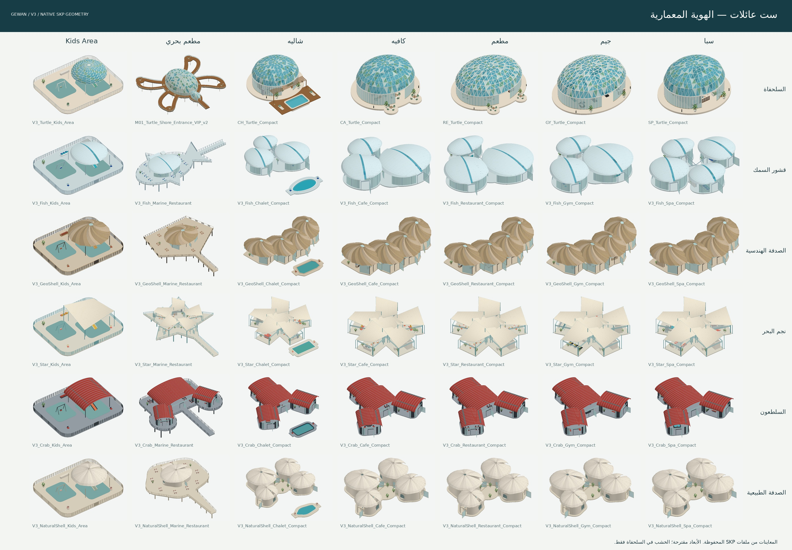

# Gewan V3 — 96 بلوك مستقل / 6 كونسبتات

[معاينة كل البلوكات PDF](Preview_Catalog_V3.pdf) · [مقارنة الخارج](Previews/Six_Families_Comparison.jpg) · [مقارنة الداخل](Previews/Six_Families_Interiors.jpg)

| العائلة | تحميل SKP والكتالوج المحلي |
|---|---|
| قشور السمك — بدون خشب | [Fish ZIP](Gewan_V3_Fish.zip?raw=true) |
| السلحفاة — بالأبواب المصححة | [Turtle ZIP](Gewan_V3_Turtle.zip?raw=true) |
| الصدفة الهندسية — طيات حلزونية | [Geometric Shell ZIP](Gewan_V3_GeoShell.zip?raw=true) |
| نجم البحر — أجنحة ومظلات | [Starfish ZIP](Gewan_V3_Star.zip?raw=true) |
| السلطعون — معدن قرمزي وجرافيت | [Crab ZIP](Gewan_V3_Crab.zip?raw=true) |
| الصدفة الطبيعية — جدران وأقواس حجرية | [Natural Shell ZIP](Gewan_V3_NaturalShell.zip?raw=true) |

[إضافة SketchUp المحلية RBZ](Gewan_Six_Families_Loader.rbz?raw=true) — ثبّتيها ثم اختاري مجلد العائلة المفكوك أو المجلد الأب للعائلات الست. ملفات الموديلات خارج الإضافة لتختاري الحزم التي تحتاجينها.

تحميل مباشر للأولوية: [مطعم السمك الجديد SKP](SKP/V3_Fish_Marine_Restaurant.skp?raw=true) · [السلحفاة بالمدخل والرأس المتصل SKP](SKP/M01_Turtle_Shore_Entrance_VIP_v2.skp?raw=true).

التعليمات والتفاصيل: [README_AR.md](README_AR.md).
