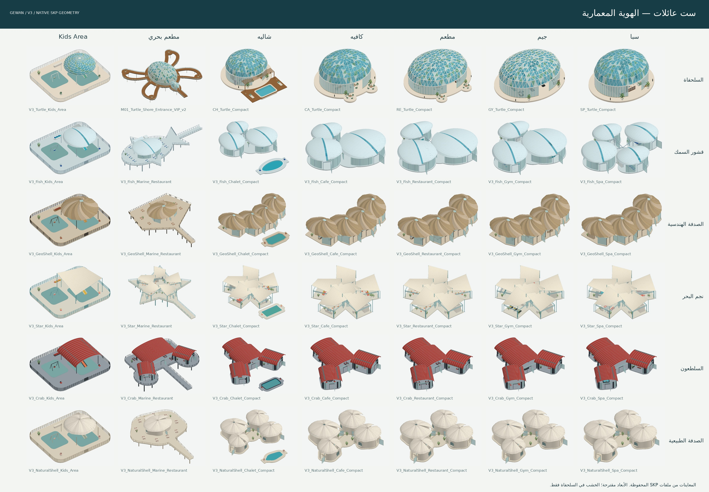

# Gewan V3 — 96 بلوك مستقل / 6 كونسبتات

[معاينة كل البلوكات PDF](Preview_Catalog_V3.pdf) · [مقارنة الخارج](Previews/Six_Families_Comparison.jpg) · [مقارنة الداخل](Previews/Six_Families_Interiors.jpg)

| العائلة | تحميل SKP والكتالوج المحلي |
|---|---|
| قشور السمك — بدون خشب | [Fish ZIP](Gewan_V3_Fish.zip?raw=true) |
| السلحفاة — بالأبواب المصححة | [Turtle ZIP](Gewan_V3_Turtle.zip?raw=true) |
| الصدفة الهندسية — طيات حلزونية | [Geometric Shell ZIP](Gewan_V3_GeoShell.zip?raw=true) |
| نجم البحر — أجنحة ومظلات | [Starfish ZIP](Gewan_V3_Star.zip?raw=true) |
| السلطعون — معدن قرمزي وجرافيت | [Crab ZIP](Gewan_V3_Crab.zip?raw=true) |
| الصدفة الطبيعية — جدران وأقواس حجرية | [Natural Shell ZIP](Gewan_V3_NaturalShell.zip?raw=true) |

[إضافة SketchUp المحلية RBZ](Gewan_Six_Families_Loader.rbz?raw=true) — ثبّتيها ثم اختاري مجلد العائلة المفكوك أو المجلد الأب للعائلات الست. ملفات الموديلات خارج الإضافة لتختاري الحزم التي تحتاجينها.

تحميل مباشر للأولوية: [مطعم السمك الجديد SKP](SKP/V3_Fish_Marine_Restaurant.skp?raw=true) · [السلحفاة بالمدخل والرأس المتصل SKP](SKP/M01_Turtle_Shore_Entrance_VIP_v2.skp?raw=true).

# مكتبة Gewan — ست عائلات، 96 بلوك

## الملفات
لكل عائلة 16 بلوك: سبا وجيم ومطعم وكافيه وشاليه، بمقاسين لكل منها؛ Kids Area؛ مطعم بحري؛ جلسات/تصوير بحرية؛ وثلاثة سنتر بيس. الجاكوزي داخل السبا. كل ملف SKP يحتوي مكوّنًا مستقلاً، والفرش والأسقف متداخلة كمكونات قابلة للتحريك والتعديل.

السلحفاة تحتفظ بهويتها الزجاجية الزرقاء والخضراء والدكات المسموحة. المطعم الرئيسي له رأس مغلق ناحية الشاطئ، مدخل أمامي، باب بين الرأس والجسم وباب خلفي للتراس البحري. نموذج الرأس المعدّل هو الملف نفسه المنشور في حزمة turtle-connected-v2.

قشور السمك: وحدات منحنية متعددة، أسقف زعانف بقشور خزفية، فرش منحوت، لؤلؤي وكوبالت وأكوا. الصدفة الهندسية: طيات حادة وفرش مضلع وسيينا وشامبين. نجم البحر: خمسة أجنحة ومظلات قماشية مشدودة وكورال وتيرازو. السلطعون: بدن ومخالب وأضلاع ألمنيوم قرمزية وفرش معدني صناعي. الصدفة الطبيعية: قبو عضوي مفلوت وفرش حجري ناعم ولؤلؤي ووردي وزيتوني. لا خشب أو بامبو في العائلات الخمس الأخيرة؛ النباتات لها سيقان طبيعية.

## التشغيل المباشر
1. فكّي ZIP العائلة. افتحي Catalog.html للمعاينات أو افتحي أي SKP من مجلد SKP.
2. داخل SketchUp 2023، افتحي SKP مباشرة أو حمّليه كـ Component داخل مشروعك. اختاري Exterior أو Interior أو Plan من Scenes.
3. لإخفاء السقف استخدمي Tag: 02_Roofs_Hide_For_Interiors. بعض عناصر الهيكل العلوية تظل ظاهرة لأنها منفصلة عن الغطاء.

## الإضافة الاختيارية
ثبّتي Gewan_Six_Families_Loader.rbz من Extension Manager → Install Extension. من Extensions → Gewan Six Families اختاري Open Library، ثم مجلد العائلة المفكوك أو المجلد الأب الذي يحتوي مجلدات العائلات الست. الإضافة تقرأ الملفات محليًا؛ لا تحتاج اتصالًا أو تحميل موديلات عبر الإنترنت. يمكن وضع بلوك منفرد أو إدراج العائلات في صفوف منفصلة، داخل Group جديد يمكن حذفه بـ Undo. لا تعدّل الإضافة مباني المشروع القائمة.

## حدود التسليم والتحقق
الموديلات تصاميم مفهومية تفصيلية قابلة للتعديل، وليست رسومات تنفيذية معتمدة. المقاسات مقترحة، ولم تتم مطابقة بصمات المباني مع رفع مساحي للموقع. الخامات المعدنية والمعدنية المركبة تحدد اتجاه التصميم؛ تحديد السبائك والطلاءات والتثبيت للأجواء البحرية يحتاج مواصفات المشروع. قواعد الوحدات البحرية تعتمد على الأعماق والأمواج. تجهيز Kids Area يحتاج اعتماد المورد ومسافات الأمان والتثبيت للموقع الفعلي.

تمت إعادة قراءة ملفات SKP، ومراجعة عدد الأوجه والمكونات وخلوّها من الحواف المنفصلة والإحداثيات غير الصالحة، وفحص مقياس عرض جهاز جري معروف حيث يوجد. verification.json وmanifest.json يتضمنان النتائج والبصمات. الصيغة SKP v17 القديمة القابلة للقراءة في SketchUp 2023؛ لا يتوفر SketchUp Desktop في بيئة الإنتاج، ولذلك لم يُجرَ اختبار تفاعلي داخله. الإضاءة المجسمة موجودة، ومعالجة الرندر الضوئية في صور المعاينة لا تعني تجهيز إعدادات V-Ray أو Enscape.

المكتبة الأصلية ذات 60 بلوك وملفات الموقع لم تُستبدل. هذه الحزمة V3 هي البديل التصميمي الجديد؛ مسودة السمك الخشبية V2 مستبعدة.
