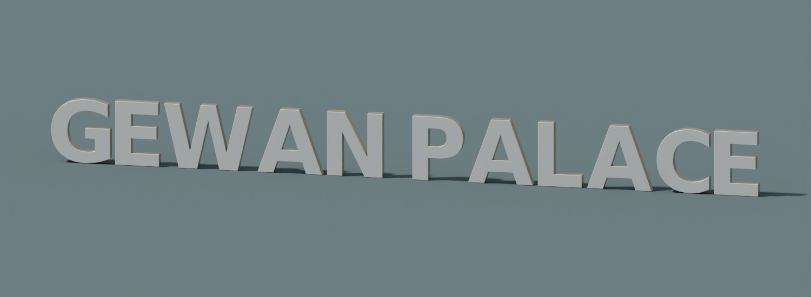

# GEWAN PALACE — حروف واقفة مستقلة

[تحميل ZIP، ملف SketchUp واحد فقط](GEWAN_PALACE_Standing_11_Letters.zip?raw=true)

اسم GEWAN PALACE كامل، 11 حرفًا واقفًا على الأرض، وكل حرف Component مستقل على مستوى الملف الرئيسي. الحروف المتكررة أيضًا لها تعريفات وخامات مستقلة. لا يحتاج تجميعًا أو Rotate أو إضافة.

ارتفاع كل حرف 1.50 متر، السُمك 0.20 متر، العرض الكامل نحو 16.57 متر. القاعدة عند Z=0، والكتابة قائمة في مستوى XZ، وتُقرأ من جهة Y السالبة. خط DejaVu Sans Bold محوّل إلى هندسة فعلية؛ لا يحتاج تثبيت خط. الواجهة أوف وايت والجوانب برونزية، مع شطف حافة مجسم 8 مم. لا توجد أرضية أو مبانٍ أو قواعد إضافية في ملف SKP؛ الأرضية الظاهرة بالرندر للعرض فقط.

## الاستخدام

1. حمّلي ZIP ثم Extract All / استخراج الكل.
2. افتحي ملف SKP المستخرج من File → Open في SketchUp 2023، ثم اختاري مشهد 01 Front - Upright، أو اضغطي Shift+Z لعرض الكل.
3. لإضافته لمشروعك: File → Import واختاري نوع SketchUp Files ثم الملف المستخرج. ضعيه على الأرض؛ الحروف واقفة مسبقًا. بعد الاستيراد يمكن دخول المكون الحاوي للوصول للحروف المستقلة.
4. لتغيير لون حرف: دبل كليك عليه، ثم B، واختاري اللون واضغطي على وجهه. للجوانب اختاريها بنفس الطريقة. كل حرف له خامات خاصة، فتعديل خامته من Materials → Edit لا يغيّر خامات الحروف الأخرى.
5. لتصغير الاسم كله: حددي الحروف الـ11 معًا واستخدمي Scale من أحد الأركان، أو اصنعي Group مؤقتًا لتغيير الحجم والتحريك معًا. راجعي مكانه من جهة القراءة الأمامية قبل إدراجه.

## التحقق

أُعيدت قراءة ملف SKP من القرص، وفُحص استقلال المكونات وعددها وارتفاع كل حرف وسُمكه ومنسوب قاعدته، والأوجه والثقوب والإحداثيات وعدم وجود حواف سائبة. فُحص ZIP والبصمة. الصيغة v17 لاستعمالها في SketchUp 2023؛ SketchUp Desktop غير متاح هنا، لذلك لم تُختبر جلسة فتح تفاعلية. الحروف موديل تصميمي وليست تفاصيل تثبيت أو اعتمادًا إنشائيًا.

