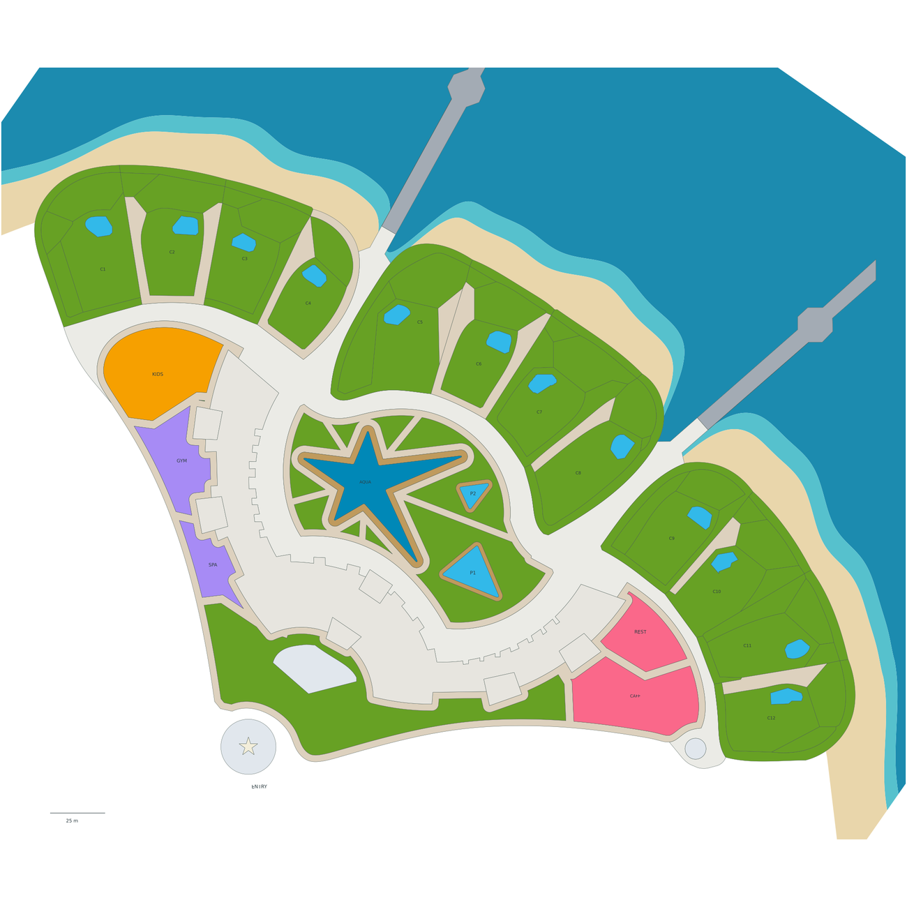

# جيوان بالاس — SketchUp ملوّن ومفصول مع البحر والشاطئ

[تحميل ZIP — ملف SKP واحد فقط](Gewan_Colored_Separated_One_SKP.zip?raw=true) · [معاينة الألوان PDF](Gewan_Colored_Plan_Review.pdf)

تحويل بلان نجم البحر الأخير إلى SketchUp 2023، مع أوجه حقيقية مستقلة متلوّنة حسب الاستخدام، وإضافة بحر وشريط رمل متموج. الجزء المعتمد أمام المبنى محفوظ في إحداثيات الكاد، وبلوكات التشريح مستقلة وقابلة للمسح. لم تتغير ملفات الأوتوكاد الأصلية أو أوبشنا قشور السمك والصدفة أو بلوكات 3D السابقة.

## محتويات الملف

**117 مكوّنًا مستقلاً على مستوى الملف الرئيسي**: 114 منطقة تخطيط/سياق، ومكوّنان لتشريح الجانبين، ومكوّن للتسميات. كل منطقة Face أو Faces بحدود وثقوب فعلية قابلة للتلوين والتعديل؛ لا صورة مسطحة ملصوقة ولا خطوط كاد بلا أوجه. الخامات مخزنة داخل SKP ولا تحتاج ملفات خارجية أو إضافة.

الألوان: المبنى أوف وايت، المسابح سماوي، الأكوا أزرق أغمق، النجيلة أخضر، الجيم والسبا بنفسجي، الأطفال برتقالي، المطعم والكافيه وردي، الجلسات بني فاتح، الممرات ترافرتين #DDD1BE، الطرق والمدخل واللسانان درجات رمادي. البحر أزرق، والمياه القريبة من الشاطئ تركواز فاتح، والرمل بيج دافئ. المفتاح اللوني في PDF يوضح الألوان المستخدمة.

أُضيف الشاطئ على الجانب البحري خارج حدود الموقع: حافة متموجة بدرجات مياه مختلفة وشريط رمل. هذا سياق بصري مقترح لإظهار علاقة المشروع بالشاطئ، وليس رفعًا مساحيًا للساحل أو تغييرًا لحدود المشروع. لم يُدخل الرمل أو البحر إلى المباني أو المساحات المحمية أو الطرق؛ اللسانان وطرق الوصول لهما ظلا ظاهرين ومتصلين.

## الفتح والاستخدام

1. نزّلي ZIP واضغطي Extract All / استخراج الكل. داخله **Gewan_Starfish_Colored_Separated_With_Beach.skp** فقط.
2. من SketchUp 2023 استخدمي File → Open، ثم اختاري تبويب **01 Colored Masterplan**. إن لم يظهر كاملًا، Shift+Z لعرض الكل.
3. اختاري أي منطقة بضغطة واحدة للتحريك، وادخليها بدبل كليك لتغيير لون الوجه بـB أو رفعه بأداة Push/Pull.
4. المشهد **02 Site Detail** يقرّب المخطط. المشهد **03 Clean - No Anatomy** يخفي التشريح تلقائيًا. المشهد **04 Oblique** للرؤية المائلة، و**05 Beach** للشاطئ.
5. التشريح مكوّنان مستقلان باسمَي LEFT_STAR_ANATOMY_DELETE وRIGHT_STAR_ANATOMY_DELETE، على Tag **90_Anatomy_DELETE**. امسحيهما أو أخفي الـTag بعد العرض. التسميات مستقلة على Tag **99_Labels**.

الملف مخطط مسطح: الأوجه التخطيطية عند Z=0، والمباني لم تُرفع في هذه النسخة. خطوط التشريح ممثلة بأشرطة أوجه رفيعة عند Z=0.05م، والتسميات عند 0.07م لتجنب تداخل العرض، داخل مكونات مستقلة. لا حاجة لرفع هذه الأجزاء مع المباني. حدود مباني الشاليهات غير موجودة في مصدر CAD، ولذلك لم تُخترع بصمات مبانٍ مكان C1–C12؛ مواقعها ومساحات حدائقها ومسابحها الأصلية محفوظة.

## ما تم التحقق منه

قُرئت هندسة بلان CAD الفعلي وطُوبقت المساحات بأسمائها واستخداماتها؛ التقريب الهندسي لمنحنيات CAD عند اشتقاق الأوجه مضبوط بخطأ وتر 0.5 مم. بعد حفظ SKP أُعيدت قراءته وفحص كل مكوّن وFace وثقوبه وخامته وTag وإحداثياته، مقارنةً بأوجه المصدر. عدد الأوجه 1066، بما فيها حروف التسميات وأشرطة التشريح. لا حواف سائبة داخل المكونات، واتجاه الأوجه لأعلى. أكبر فرق رأس بعد القراءة نحو 6.36×10^-14 متر، وقطر دائرة المدخل المقروء **25.000 م**. هذه أرقام دقة التحويل والقراءة، لا دقة رفع مساحي للموقع.

المقاسات مؤلفة بالأمتار ثم حُوّلت صراحة إلى إنش داخليًا حسب صيغة SketchUp. صيغة SKP v17 تستهدف القراءة في SketchUp 2023. فُحص ZIP ومحتواه وبصماته. لم يتوفر SketchUp Desktop لتجربة الفتح التفاعلي؛ الفحص قراءة ملف وهندسة. المعاينات مستخرجة من الأوجه المعاد قراءتها من SKP، وليست صورة مولدة بديلة عن الموديل.

