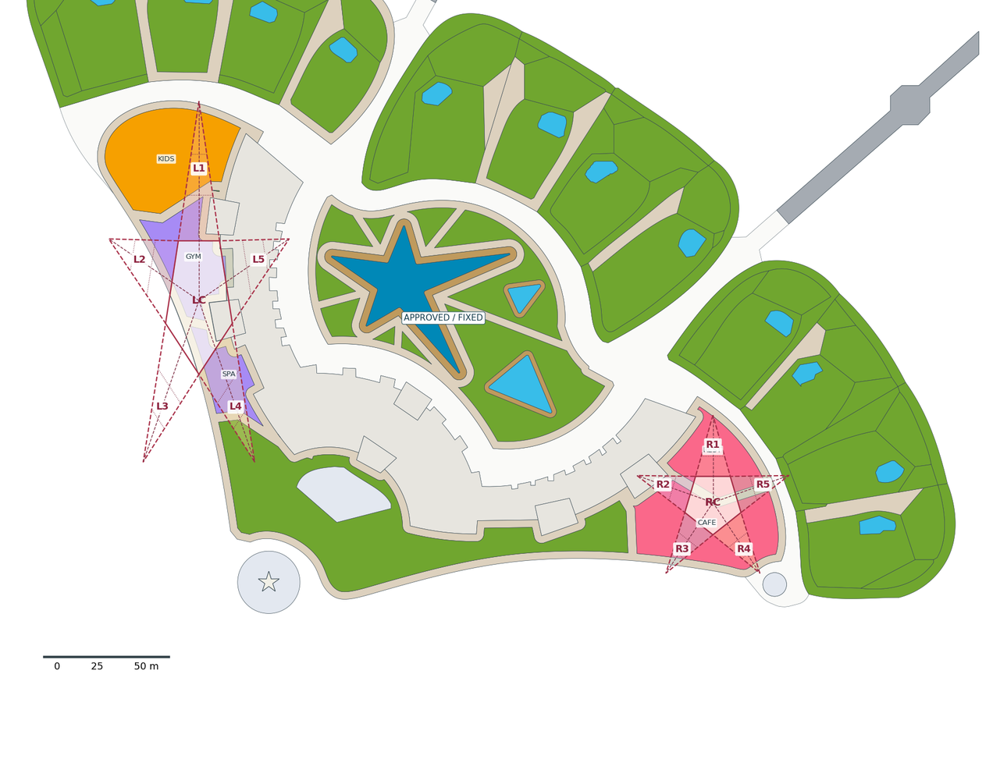

# جيوان بالاس — تشريح نجم البحر في الجانبين للعرض

[تحميل ZIP — ملف CAD واحد](Starfish_V3_Anatomy_One_CAD_File.zip?raw=true) · [معاينة PDF من صفحتين](Starfish_Anatomy_Review.pdf)

الجزء أمام المبنى من نسخة V2، بما فيه حوض النجمة المائل لليسار والمسابح والممرات، ثابت بلا أي تعديل. هذه نسخة عرض أُضيف فيها **تشريح تكويني للجانبين** لتوضيح الكونسبت للدكتور، مع إمكانية مسح الإضافة بعد العرض، كما طُلب. لا إعادة توزيع تشغيلية للخدمات ولا تغيير للأوبشنين الآخرين أو بلوكات 3D.

## ماذا توضح الخطوط؟

قلب خماسي تتصل به خمسة أذرع عريضة عند القاعدة وتتدرج حتى الأطراف، والتجاويف بين الأذرع. الجانب الأيسر يستخدم نفس البنية مع إطالة رأسية لتناسب الشريط الطويل، والجانب الأيمن أقصر وأعرض. LC وRC للقلبين، وL1–L5 وR1–R5 للأذرع. المحاور والقطاعات العرضية خطوط شرح، وليست ممرات أو غرفًا جديدة.

المخطط المتقطع يوضح التكوين المثالي الكامل، وقد يمتد خارج الأرض أو فوق المبنى بوصفه خط شرح فقط. الأجزاء الملونة في PDF تظهر تقاطعه مع أرض الخدمات المتاحة؛ ليست بصمات مبانٍ قابلة للتنفيذ أو ادعاءً بأن شكل الخدمة الحالي يطابق جميع حدود النجمة. التشريح هندسي للكونسبت، وليس رسمًا للأعضاء الحيوية لنجم البحر.

## المسح أو الإخفاء

كل الإضافات على Layer واحد: **CONCEPT_STAR_ANATOMY_DELETE**.

- **LEFT_STAR_ANATOMY_DELETE**: بلوك مستقل للجانب الأيسر.
- **RIGHT_STAR_ANATOMY_DELETE**: بلوك مستقل للجانب الأيمن.

اختاري البلوك المناسب وامسحيه، أو أخفي طبقة التشريح كلها للعودة إلى البلان الأساسي دون المساس به. كل خطوط البلوكين ونصوصهما، وكذلك الـINSERT على مستوى الرسم، على نفس الطبقة. لا تفجّري البلوكات قبل الاستيراد لو أردتِ بقاء التشريح مجتمعًا. الحفاظ على المكونات/الطبقات عند استيراد DXF إلى SketchUp يعتمد على خيارات وإمكانات الاستيراد؛ لم يُختبر الاستيراد داخل SketchUp Desktop هنا.

## الفتح والتحقق

فكّي ZIP، بداخله ملف واحد **Starfish_V3_Anatomy_Presentation.dxf**، ثم File → Open في AutoCAD. الرسم بالمليمتر INSUNITS=4 وZ=0، ويضم نفس إحداثيات البلان السابق. لا يحتاج إضافة. يمكن حفظه DWG من AutoCAD باستخدام Save As.

أُعيدت قراءة الملف المحفوظ: كل عناصر البلان الأساسي الـ292 محفوظة بنفس الـHandles والخصائص وبيانات vertices/bulges، دون عنصر أصلي معدّل أو محذوف. الإضافة فقط INSERTان لبلوكين مستقلين. كُل تشريح يحتوي محيط نجمة مغلقًا وقلبًا خماسيًا مغلقًا وخمسة محاور وأقسامًا عرضية وتسميات. فُحصت صلاحية المخططات وإغلاقها ومنسوبها وصحة فصل الطبقة، وAudit الكاد دون أخطاء أو إصلاحات. فُحص أرشيف ZIP والبصمة. النتائج في verification.json.

هذه قراءة ملف وفحص هندسة؛ AutoCAD Desktop وSketchUp Desktop لم يتوفرا لاختبار الفتح والاستيراد التفاعلي. PDF يضم صفحة تطبيق على الموقع وصفحة تفكيك وشرح، والملف إضافة عرض للكونسبت وليس مخطط تنفيذ جديدًا.

