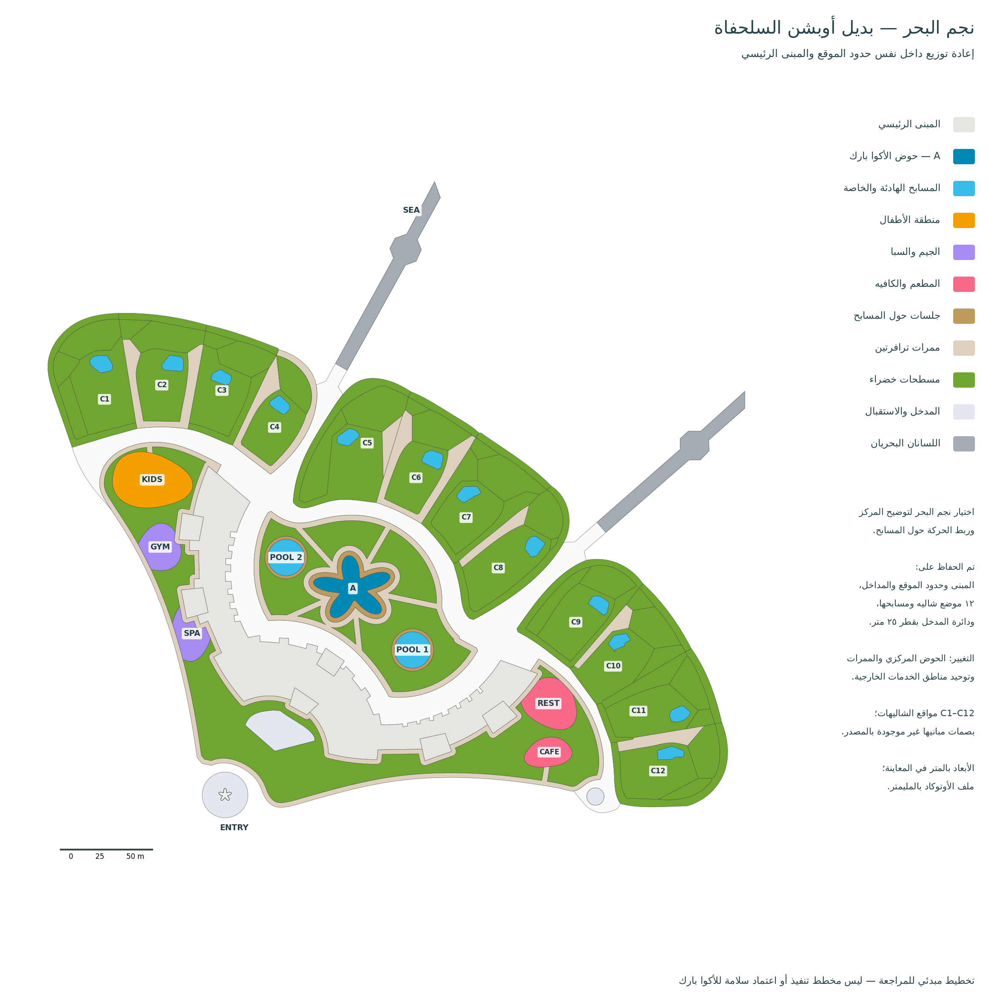

# جيوان بالاس — نجم البحر بدل أوبشن السلحفاة

[تحميل ZIP — ملف CAD واحد](Starfish_Option_One_CAD_File.zip?raw=true) · [معاينة PDF](Starfish_Review.pdf)

تعديل تخطيطي لأوبشن السلحفاة فقط، باختيار **نجم البحر**. قشور السمك والصدفة الهندسية لم يتغيرا، وكذلك بلوكات 3D السابقة. ملفات المصدر الأصلية محفوظة؛ التسليم نسخة مشتقة جديدة.

## لماذا نجم البحر؟

الفناء المحاط بالمبنى المنحني يناسب مركزًا واضحًا وخمسة اتجاهات للممرات والجلسات، مع الحفاظ على مسار حركة دائري حول الماء. تشكيل السلطعون في نفس المساحة سيحتاج أطرافًا ضيقة والتفافات إضافية. هذا اختيار تصميمي للموقع الحالي، وليس مقارنة تشغيلية أو هندسية مع بلان سلطعون آخر.

## ما تغير

- استبدال تقسيمات ظهر السلحفاة في الفناء بحوض مركزي متصل ذي خمسة أذرع منحنية، نحو 645 م². الأزرق الغامق مخصص للأكوا بارك، ومعداته وأحواض الهبوط لم تُصمم في هذا البلان.
- حوضان دائريان أهدأ، كل واحد قطره 20 مترًا ومساحة مائه نحو 314 م²، في موضعين منفصلين حول المركز.
- جلسات حول الماء ومسار حلقي وخمس وصلات، بعرض اسمي 3 أمتار للممر الرئيسي والحلقي والوصلات. الجلسات حول الحوض المركزي بعرض 2.5م، وحول الحوضين الهادئين بعرض 1.6م. هذه أبعاد تصميمية وليست اعتماد إخلاء أو تفاصيل صرف وتشغيل.
- إزالة تقسيمات الخدمات الخارجية القديمة واستبدالها بخمس مناطق متصلة: الأطفال نحو 1039 م²، الجيم 437 م²، السبا 332 م²، المطعم 620 م²، والكافيه 327 م². كل نشاط منطقة واحدة، وليست كبائن منفصلة. تمثل حدود استخدامات تخطيطية؛ ليست مخططات فرش أو مباني خدمات تفصيلية.
- سنتر بيس صغير بنجم البحر داخل دائرة المدخل الأصلية دون تغيير قطرها.

## ما حُفظ

حدود المبنى الرئيسي وملحقاته القائمة، المسارات الخارجية بين الفندق ومجموعات الشاليهات، التقسيمات الخارجية لمجموعات الشاليهات الثلاث و12 موضع شاليه والمسابح الخاصة الـ12، دائرة المدخل ذات قطر 25م والدائرة الصغيرة. اللسانان والطريق من وجه الطريق في ملف SketchUp المقابل، بعد مطابقته بدائرة المدخل؛ لم يُخترع مكان بديل لهما.

C1–C12 مواقع الشاليهات وليست بصمات مبانٍ جديدة: بصمات مباني الشاليهات غير موجودة في مصدر CAD المستخدم، ولذلك لم تُرسم بصمات تخمينية مكانها.

## الملف والاستخدام

داخل ZIP ملف واحد: **Starfish_Option_Replaces_Turtle.dxf**، قابل للتحرير والفتح في AutoCAD. فكّي الضغط ثم File → Open. الوحدات مليمتر وINSUNITS=4، والمنسوب Z=0. الألوان ByLayer، وطبقات منفصلة للمبنى والماء والأكوا والخدمات والممرات والزرع والتسميات؛ لا HATCH أو SOLID أو TRUECOLOR. يمكن حفظ نسخة DWG من AutoCAD باستخدام Save As. لا يوجد DWG محوّل ضمن هذا التسليم.

المعاينة الملونة توضح الاستخدامات فقط، والـPDF وصورة CAD_Readback من نفس هندسة التصميم. الحوض النجمي والسنتر بيس منحنيات SPLINE مغلقة، والمسابح الدائرية والدائرتان الأصليتان CIRCLE؛ باقي شبكة المصدر محفوظة في خطوطها المتعددة، وأجزاء الممرات الجديدة تستخدم مسارات ناعمة كثيفة النقاط. لم يُجرَ تنعيم عام للمبنى أو قطع الشاليهات.

## المراجعة

أُعيدت قراءة DXF المحفوظ وإجراء Audit: لا أخطاء ولا إصلاحات. مناطق التعديل مغلقة وصحيحة بلا فجوات أو تداخلات مساحية بينها، ومسارات المشاة المركزية متصلة. أُزيل تكرار الحدود المشتركة في الشبكة المرئية. شبكة التصميم تضم 138 مساحة مغلقة دون حواف متدلية أو حلقات غير صحيحة. قورنت حدود المصدر المحفوظة بالملف المصدر، ولا أجزاء منها خارج سماحية 6 مم؛ أكبر فرق بين المنحنيات الأصلية الحسابية وتقريبها/قراءتها من DXF نحو 4.01 مم. تقرير design_report.json يسجل المقاسات والتحقق والبصمات.

لم يتوفر AutoCAD Desktop لاختبار الفتح التفاعلي؛ الفحص قراءة ملف وهندسة. هذا تخطيط مقترح للمراجعة، وليس مخطط تنفيذ. لا تتضمن النسخة تصميم الإنشاءات البحرية أو المرافق الميكانيكية أو تفاصيل الأكوا بارك.

