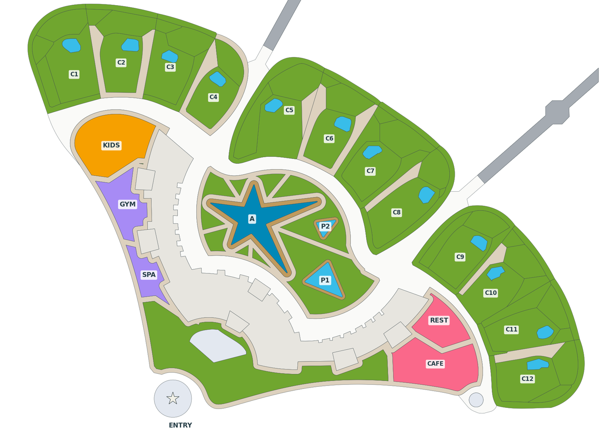

# جيوان بالاس — نجم البحر V2، تكوين مائل لليسار وخدمات متجاورة

[تحميل ZIP — ملف CAD واحد](Starfish_V2_One_CAD_File.zip?raw=true) · [معاينة PDF](Starfish_Review.pdf)

إعادة تصميم للأوبشن بعد رفض نسخة نجم البحر الأولى: شكلها كان أقرب للزهرة، مركزية أكثر من المطلوب، ومناطق الخدمات بدت كأشكال منفصلة لا تكوّن توزيعًا مترابطًا. هذه نسخة جديدة مشتقة من نفس مصدر الموقع؛ لا تعدّل ملفات المصدر ولا أوبشني قشور السمك والصدفة الهندسية أو بلوكات 3D.

## التكوين الجديد

- نجم بخمسة أذرع متدرجة طويلة، ذات أطوال مختلفة، وأطراف صغيرة مستديرة؛ لا بتلات بيضاوية. مركز تشكيل النجم عند (53،120) مترًا، مائل نحو اليسار بنحو 22.3 مترًا، ولأعلى بنحو 11.3م، عن مركز الفناء المحسوب. مركز الفناء نفسه لم يُحرّك.
- الحوض الغامق على شكل النجم، نحو 959 م²، للأكوا بارك. التفاصيل التشغيلية والمعدات لم تُصمم. الحوضان الأفتح على اليمين يتبعان اتجاه أذرع مدببة، نحو 265 و78 م²، بعلامتي P1 وP2؛ لا مسابح دائرية مكررة.
- مسار حلقي متصل ووصلات، بعرض اسمي 3م، وجلسات حول الحوض النجمي 2.7م وحول الحوضين الهادئين 1.8م. الأبعاد تخطيطية، ولا تثبت استيفاء اشتراطات الحركة أو الإنقاذ.
- الخدمات أصبحت قطاعات متجاورة تستغل نفس الأرض، بواجهات مائلة وأطراف متدرجة متأثرة بتكوين الأذرع، تفصلها ممرات متصلة. لا توجد أيقونات نجوم أو أشكال بيضاوية صغيرة موضوعة وسط فراغات خضراء. كل نشاط منطقة واحدة متصلة، وله حدود وصول مباشرة على شبكة المشاة.
- اليسار: أطفال نحو 1610 م²، جيم 788 م²، سبا 453 م². اليمين: مطعم 718 م²، وكافيه وتراسات خارجية نحو 1456 م². المساحات تخص مناطق الاستخدام، وليست مساحات مبانٍ تفصيلية؛ الكافيه يشمل ساحته وتراساته المقترحة.

حدود المبنى الرئيسي وملحقاته، والشاليهات/قطعها ومسابحها الخاصة الـ12، ودائرتا المدخل، وقطر الدائرة الكبرى 25م، ومسارات الحركة الخارجية واللسانان، محفوظة من المصدر نفسه. اللسانان وطرق الوصول لهما من وجه الطريق في ملف SketchUp المقابل بعد محاذاته بدائرة المدخل. C1–C12 مواقع شاليهات فقط؛ بصمات مباني الشاليهات غير موجودة في مصدر CAD، فلم نُضف بصمات مفترضة.

## افتحي الملف

فكّي ZIP ثم File → Open من AutoCAD. بداخله ملف واحد **Starfish_V2_Offset_Connected_Plan.dxf**؛ الرسم بالمليمتر وINSUNITS=4، بمقياس 1:1 عند Z=0. يمكن حفظه DWG من Save As داخل AutoCAD. طبقات منفصلة وتلوين ByLayer، دون HATCH أو SOLID أو TRUECOLOR. المعاينة الملونة توضح الاستخدامات وليست تعبئة لونية مخزنة داخل DXF.

الزوايا المنحنية المناسبة في النجمة والأحواض مكتوبة كأقواس bulge داخل LWPOLYLINE مغلق، والدائرتان الأصليتان CIRCLE. المنحنيات لا تُنعّم على حساب الأطراف المدببة أو حدود المبنى. بعض أجزاء الشبكة تستخدم نقاطًا كثيفة محفوظة من المصدر أو من قص الحدود، ولا ندعي أن كل منحنٍ قوس واحد.

## الفحص

أُعيدت قراءة DXF المحفوظ وإجراء Audit دون أخطاء أو إصلاحات. مناطق التعديل صحيحة ومغلقة، دون فجوات أو تداخلات مساحية بينها؛ شبكة المشاة متصلة، وكل خدمة تتصل مباشرة بها. أُزيل تكرار الحدود المشتركة في شبكة الرسم. فُحص احتواء التعديل داخل حدوده وعدم دخوله في المبنى. قورنت حدود المصدر المحفوظة مع الملف المُصدّر ضمن سماحية 6 مم؛ أكبر فرق تقريب منحنى جديد نحو 3.46 مم. تقرير design_report.json يسجل النتائج والبصمات.

هذه مراجعة ملف وهندسة؛ AutoCAD Desktop لم يتوفر لاختبار الفتح التفاعلي. التخطيط مقترح للمراجعة، وليس رسومات تنفيذ أو تصميمًا إنشائيًا/تشغيليًا للأكوا بارك والخدمات واللسانين.

