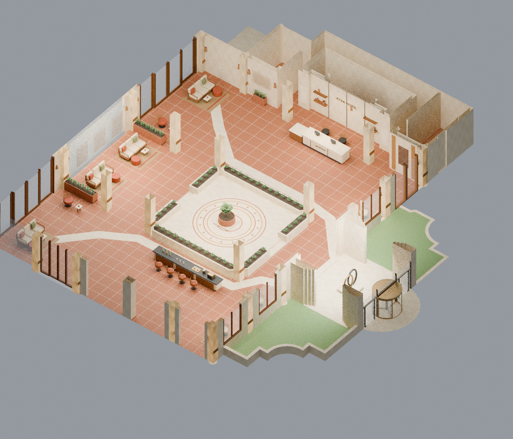

# لوبي الفندق — البوهيمي

[حزمة الاستيراد بالخامات](hotel_bohemian_v1.zip) · [PDF](presentation.pdf) · [البلان](plan.png) · [السنتر بيس](entry.png) · [الحوض والتفاصيل الجانبية](side_planter_detail.png) · [تعليمات SketchUp](IMPORT_AR.txt)

أوبشن بوهيمي كامل: أرضية تيراكوتا مع مسارات حجرية وباترن دائري داخل السنتر بيس الأصلية، كراسي خوص وأرائك تيك بوسائد كتان وسجاد كليم وجوت، أباليك وتعليقات منسوجة، ماكراميه وأرفف خشب وأوانٍ فخارية، تشطيبات جيرية وأشرطة بامبو للأعمدة، وخشب وبامبو عند الشبابيك. شجرة زيتون صغيرة كثيفة الأوراق داخل حوض فخاري مفتوح، بدل الشكل النباتي السابق. الفرش والديكورات غنية مع إبقاء الممرات واضحة.

المحمي: نفس البناء والفتحات وأجسام الأعمدة ومواقع الريسبشن والبار ومجموعات الجلوس وحدود السنتر بيس والأحواض ومناسيب السلالم. جرى فحص 598 شبكة أصلية محمية، دون تغيير إحداثيات أو عدد أوجه. العناصر الأصلية الإضافية التي أزيلت هنا هي تشطيبات وقطع ديكور محددة، وليست حوائط أو فتحات. جدول الاستبدال مرفق.

الحزمة DAE وخاماتها، وليست ملف SKP أصليًا. فيها157 مجموعة عناصر كاملة مستقلة. create_skp.rb يستوردها في SketchUp ويحوّل NEW_ إلى Components ويحفظ SKP تلقائيًا على جهازك. لم يُشغّل المساعد هنا لعدم توفر SketchUp Desktop؛ ملف DAE جرى التحقق من هندسته وخاماته وهرميته بإعادة قراءة مستقلة.
