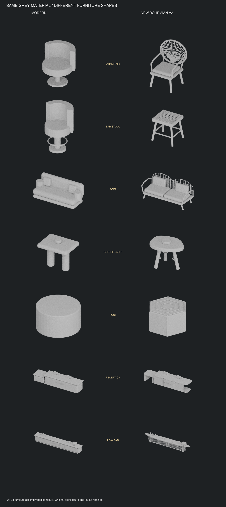

# البوهيمي V2 — تغيير أشكال الفرش

[الحزمة بالخامات](hotel_bohemian_v2.zip) · [مقارنة الشكل PDF](shape_comparison.pdf) · [صور التصميم](presentation.pdf) · [البلان](plan.png) · [تعليمات SketchUp](IMPORT_AR.txt)

إعادة بناء أجسام33 قطعة أثاث، وليس إعادة تلوين: كراسي مروحية بأربع أرجل، مقاعد بار خوص دون قاعدة دائرية، كنب قوسي بهيكل مفتوح، ترابيزات عضوية بثلاث أرجل، بوفات سداسية، وريسبشن مقسم بواجهات خوص وبار بيضاوي مفتوح. لا تبقى أجسام الفرش السابقة؛ المحتفظ به فقط تجهيزات الخدمة كالشاشات والمشروبات. مقارنة الشكل تستخدم نفس الخامة الرمادية في الطرفين.

المبنى وفتحاته وأجسام الأعمدة والسنتر بيس والأرضيات والمناسيب والتوزيع الوظيفي محفوظة. الفحص لم يرصد تداخلات أو عوائق أمام مناطق الفتحات المحددة، والتحقق من598 شبكة معمارية لم يرصد تغييرًا في الإحداثيات أو عدد الأوجه. الخامات والهرمية والإحداثيات المصدّرة فُحصت بإعادة قراءة DAE.

الحزمة DAE وخاماتها، وليست ملفSKP أصليًا. create_skp.rb يستوردها ويحوّل كل قطعة كاملة إلى Component ويحفظ SKP داخل SketchUp. لم يتوفر SketchUp Desktop لتشغيل المساعد أو اختبار الاستيراد هنا.
