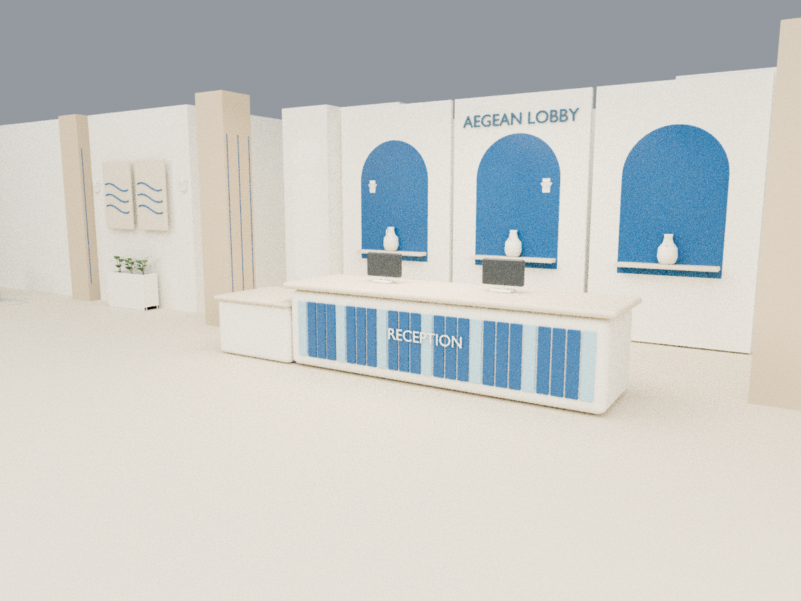

# Greek Coastal / الأوبشن الساحلي اليوناني

[تحديث الإضافة بالثلاثة أوبشنز](../hotel-native-builder/Ayaa_Lobby_Components_v1_1_0.rbz) · [معاينة PDF](greek_coastal_preview.pdf) · [البلان](plan.png)

أوف وايت ورملي وبيبي بلو وأزرق إيجي. أشكال جديدة فعلًا للـ33 قطعة أثاث: كراسي Klismos بظهر خشب منحني وأرجل مائلة، كنب بقواعد بيضاء ووسائد زرقاء، ترابيزات حجرية بأرجل ألواح، بوفات مربعة، كراسي بار خشب مطلي، وريسبشن وبار بواجهات بلاط أزرق. إضاءة خزفية بيضاء، أمفورات خزف، لوحات أمواج وألواح حائط مزينة بعقود، وخط مياندر يوناني داخل السنتر بيس المربع.

كل نسخة تُبنى مفروشة بالكامل في ملف SKP واحد، وكل قطعة كاملة Component مستقل في مكانها. تم الحفاظ على598 شبكة معمارية أصلية، وكل الفتحات والأعمدة والمناسيب وتوزيع المناطق. فحص التوزيع لم يرصد تداخلات أثاث أو عوائق أمام مناطق الفتحات المحددة. تم الحفاظ على أرضية المنصة مربعة والدرجتين، والمدخل بدرجة واحدة، والبار المنخفض.

## تحديث الإضافة

Extensions > Extension Manager > Install Extension، ثم اختاري ملف v1_1_0.rbz من غير فك الضغط. اقفلي جميع نوافذ SketchUp وافتحيه تاني. في مشروع جديد اختاري Extensions > Ayaa Lobby > Build GREEK COASTAL - separate components. انتظري، ثم احفظي SKP الكامل في المكان المطلوب. ظهور الإضافة يكون في نفس السطر، ورقمها1.1.0. النيو مودرن والبوهيمي القديمان موجودان دون تغيير بياناتهما.

كود البناء يحتفظ بإصلاح refresh من الإصدار1.0.1. أُجريت مراجعة صياغة Ruby، وتغطية الشبكات، وتطابق إحداثيات وUVs كل المثلثات، والتحويلات والخامات وملف الحزمة. SketchUp Desktop غير متاح هنا؛ تمت مراجعة بيانات الأوبشن الجديد ولم يتم تشغيله داخل البرنامج هنا. الحزمة إضافة RBZ تبني SKP داخل SketchUp، وليست SKP جاهزًا.
