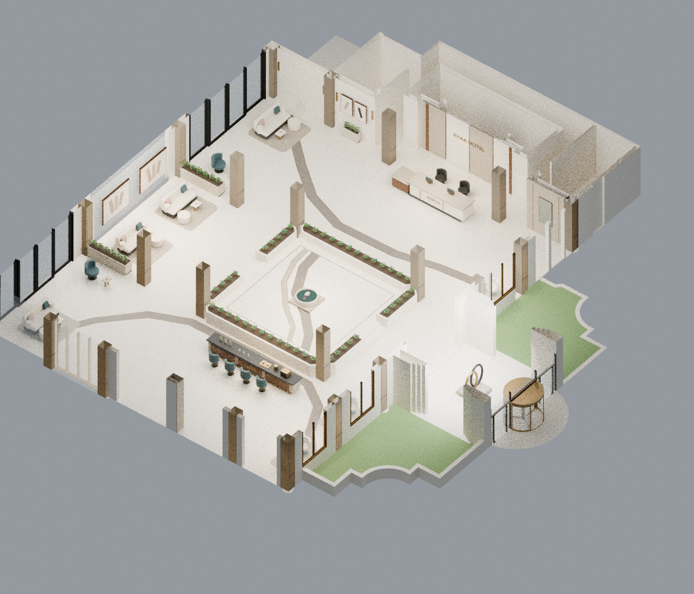

# لوبي الفندق — المودرن المصحّح

[حزمة الاستيراد بالخامات](hotel_modern_corrected_v5.zip) · [PDF](presentation.pdf) · [البلان](plan.png) · [السنتر بيس](entry.png) · [الحوض والتفاصيل الجانبية](side_planter_detail.png) · [تعليمات SketchUp](IMPORT_AR.txt)

نسخة مصححة تستبدل لوح المراية القديم وتشطيب الحائط المعدني المتموج، مع لوحات حائط معاصرة ونباتات طبيعية المظهر في أحواض صلبة مفتوحة بتربة ظاهرة. أُزيلت النباتات المدببة والقطعة الشبيهة بالوردة من السنتر بيس واستُبدلت بطبق حجري منخفض بمياه وحصوات. القطع الصغيرة الزرقاء في مجموعات الجلوس أصبحت محايدة اللون.

المحمي: نفس البناء والفتحات وأجسام الأعمدة ومواقع الريسبشن والبار ومجموعات الجلوس وحدود السنتر بيس والأحواض ومناسيب السلالم. جرى فحص 598 شبكة أصلية محمية، دون تغيير إحداثيات أو عدد أوجه. العناصر الأصلية الإضافية التي أزيلت هنا هي تشطيبات وقطع ديكور محددة، وليست حوائط أو فتحات. جدول الاستبدال مرفق.

الحزمة DAE وخاماتها، وليست ملف SKP أصليًا. فيها141 مجموعة عناصر كاملة مستقلة. create_skp.rb يستوردها في SketchUp ويحوّل NEW_ إلى Components ويحفظ SKP تلقائيًا على جهازك. لم يُشغّل المساعد هنا لعدم توفر SketchUp Desktop؛ ملف DAE جرى التحقق من هندسته وخاماته وهرميته بإعادة قراءة مستقلة.
