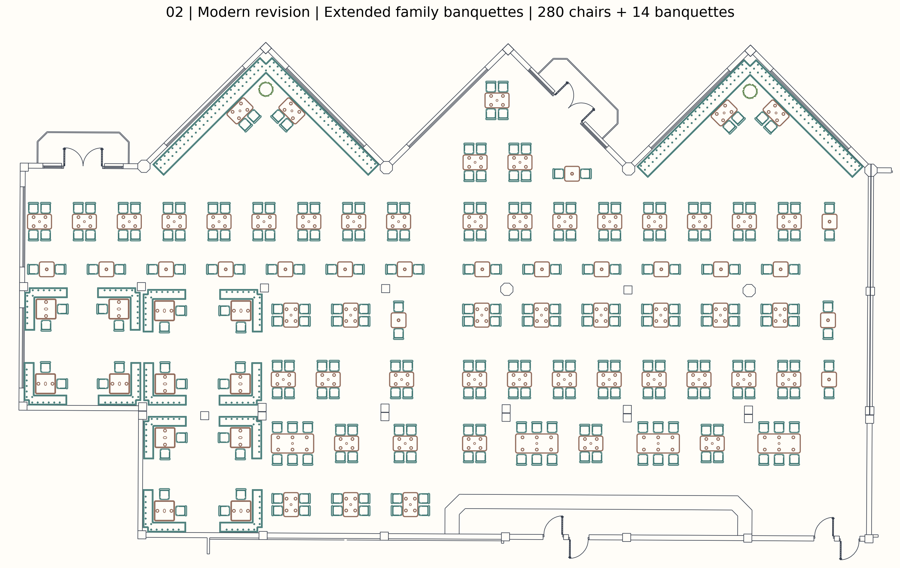
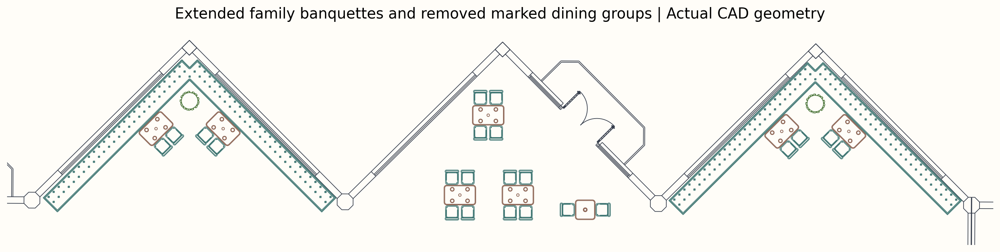

# تعديل الأوبشن المودرن حسب العلامات

- [تحميل DWG المعدّل](02_Modern_Extended_Family_Benches.dwg)
- [تحميل DXF](02_Modern_Extended_Family_Benches.dxf)
- [معاينة PDF](Modern_Bench_Revision_Preview.pdf)
- [تحميل الحزمة كلها ZIP](Modern_Bench_Revision_CAD.zip)

تم مد ضلعي الكنبة في المثلث الأيسر والمثلث الأيمن، بنفس العمق والتفصيل ولون طبقة الكنب، حتى قبل أعمدة نهايات المثلثين. طول الضلع النهائي 7.89 متر بدل 4.35 متر، والعمق محفوظ.

تم حذف الترابيزات المحددة بالأحمر وكراسيها. الصورة المرسلة كانت لنسخة 308 كراسي؛ إحدى المجموعات السبعة المحددة كانت محذوفة بالفعل في آخر ملف مسلّم الذي يحتوي على 304 كراسي، ولذلك حُذفت منه المجموعات الست الباقية (24 كرسيًا). حُذفت أيضًا جلستان قديمتان مرسومتان في طبقة 0 على خط امتداد الكنبة اليسرى؛ كانتا تعترضان الامتداد.

العدد النهائي 280 كرسيًا منفصلًا، بالإضافة إلى 14 كنبة ركنية. لم تُضف كراسي أو ترابيزات لتعويض الحذف. باقي الرصّة والبار والعمارة والممرات محفوظة. الأوبشنان الآخران لم يتغيرا.

DWG أصلية بصيغة AutoCAD 2000، وDXF بنفس الهندسة، والوحدات متر. الكنب الممتد بلوكان مستقلان في نفس طبقة الكنب. RP_ROUTES وRP_IDS مخفيتان افتراضيًا.

الفحص: تطابق الهندسة بعد قراءة DWG، صفر أخطاء أو إصلاحات في القراءة الراجعة، وعدم تسجيل تداخلات للفرش مع بعضه أو مع الأعمدة أو مع المحور الرئيسي المحجوز. جميع حدود الكنب المعدّلة مغلقة. الفحص برمجي؛ لم يُختبر فتح الملف داخل AutoCAD Desktop.

