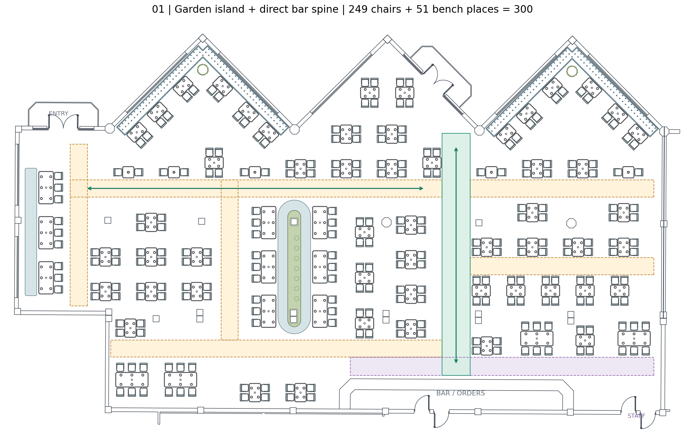
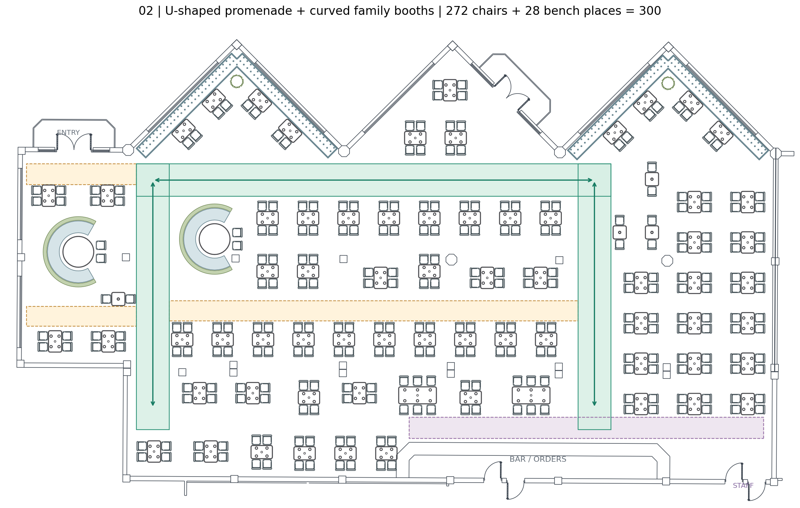
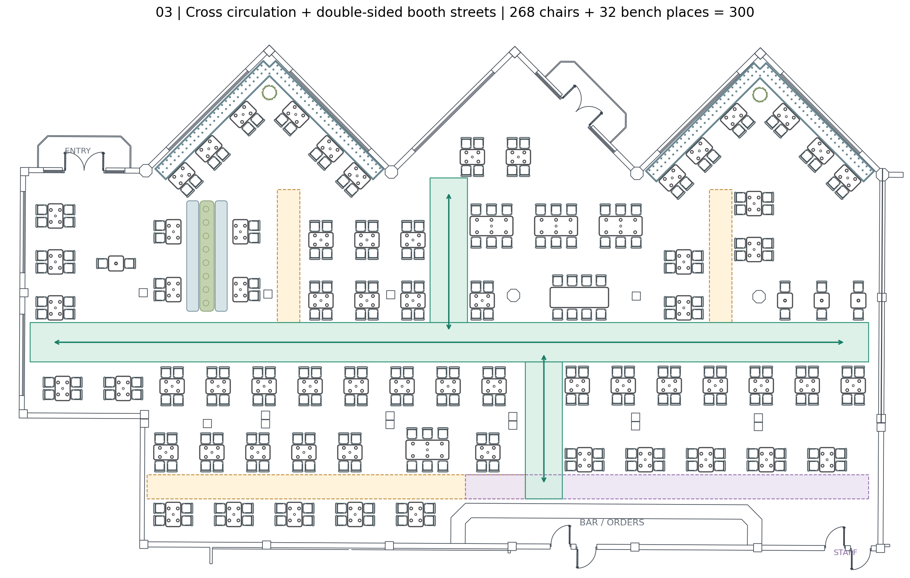

# ثلاثة بدائل مختلفة لحركة وفرش المطعم

[معاينة المقارنة PDF](Restaurant_Spatial_Concepts_Comparison.pdf) · [تحميل CAD كامل ZIP](Restaurant_Spatial_Concepts_CAD.zip)

| الفكرة | كراسي منفصلة | أماكن الكنب المرتبطة بالترابيزات | إجمالي الجلوس |
|---|---:|---:|---:|
| A: جزيرة زرع ومقعد ملتف، ومحور مباشر من البار | 249 | 51 | 300 |
| B: حركة U وبوثات عائلية منحنية | 272 | 28 | 300 |
| C: ممر عرضي وجناحان، وبوثات ظهر لظهر مع زرع | 268 | 32 | 300 |

**أساس العدد هنا إجمالي مقاعد الجلوس، وليس 300 كرسي منفصل.** هذا افتراض واضح للمعاينة إلى حين إجابة المستخدم عن طريقة احتساب العدد. لم يُحتسب الكنب الذي لا تخدمه ترابيزة.

## التغيير الفعلي

الممرات الرئيسية والفرعية مختلفة في كل بديل. أزيلت الركنيات الصغيرة الاثنتا عشرة من قاعدة التصميم، وأعيد ترتيب مجموعات الثنائي والرباعي والعائلات. حُفظت العمارة الأصلية والبار وموضع خروج الستاف وكنب المثلثين الممتد. توجد ترابيزات مرتبطة بامتداد الكنب في المثلثين.

المساقط مسطّحة من أعلى، من دون رندر أو إضاءة. PDF يستعمل ألوانًا مسطّحة لتوضيح المقعد والزرع والمسارات. CAD بخطوط فقط، بلا صور خارجية أو هاتش مدمج في الفرش. كل كرسي وترابيزة بلوك مستقل؛ الكنب المستقيم والجزيرة والجلسات المنحنية وحدات مستقلة.

## فتح الملفات

DWG بصيغة AutoCAD 2000، وDXF بنفس الهندسة. الوحدات متر. طبقات SC_MAIN_ROUTE وSC_BRANCH_ROUTE وSC_STAFF_ROUTE مخفية افتراضيًا؛ أظهريها لمراجعة المسارات. الأخضر رئيسي، البرتقالي فرعي، البنفسجي للخدمة في صور المقارنة.

عرض المحور الرئيسي 1.8 متر، والعرضي في C بعرض 1.9 متر. الفروع المرسومة 1.1 متر تقريبًا، وشريط الخدمة 1.16 متر. القياسات بحسب الفرش المرسوم، مع فحص شبكة توزيع بعرض متر واقتراب فردي إلى المقاعد بعرض 0.6 متر؛ ليست محاكاة لسحب كل الكراسي في وقت واحد.

## الفحص

فحص برمجي لعدم تداخل الفرش والأعمدة والمسارات، اتصال المداخل والخدمة، واقتراب الخدمة والجلوس. أعيدت قراءة DWG ومقارنة كل بصمات الهندسة مع DXF. لم يُختبر الفتح داخل AutoCAD Desktop. الرسومات بدائل فرش وليست شهادة إخلاء أو سعة تشغيلية.

## 01_Garden_Spine

[DWG](01_Garden_Spine.dwg) · [DXF](01_Garden_Spine.dxf)

## 02_U_Promenade

[DWG](02_U_Promenade.dwg) · [DXF](02_U_Promenade.dxf)

## 03_Cross_Booth_Streets

[DWG](03_Cross_Booth_Streets.dwg) · [DXF](03_Cross_Booth_Streets.dxf)

