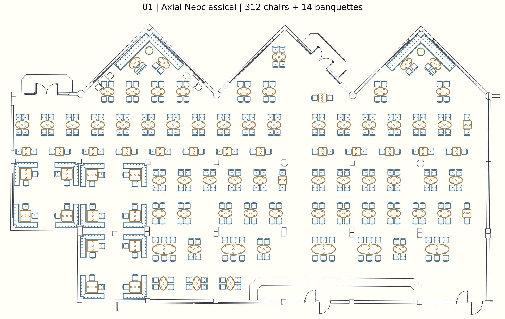
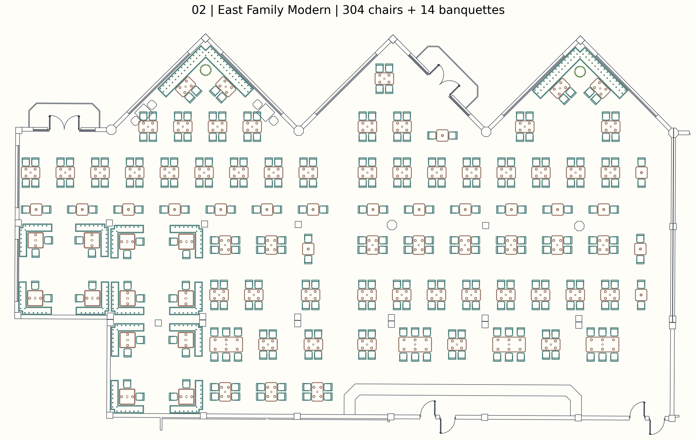
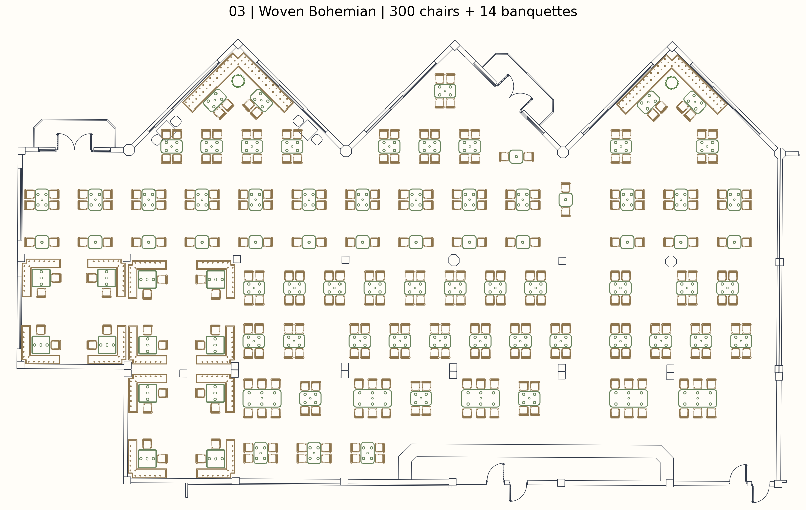

# مطعم آية، ثلاثة أوبشنات CAD

| الأوبشن | الكراسي المنفصلة | الطابع |
|---|---:|---|
| 01 | 312 | نيوكلاسيك ومحور حركة أوسط |
| 02 | 304 | مودرن وصفوف متعامدة |
| 03 | 300 | بوهيمي ومحور جانبي وبنوك عرضية |

كل أوبشن يحتوي أيضًا على 14 كنبة ركنية خارج عدد الكراسي أعلاه.

- [تحميل كل ملفات الكاد ZIP](Restaurant_Three_Options_CAD.zip)
- [معاينة ومقارنة PDF](Restaurant_Three_Options_Comparison.pdf)

الملفات DWG أصلية بصيغة AutoCAD 2000، ومعها DXF بنفس الهندسة. الوحدات متر. كل كرسي وترابيزة بلوك مستقل، بلا هاتش أو صور خارجية. البلوكات مساقط 2D، وليست مجسمات 3D.

الحوائط والأعمدة والأبواب والشبابيك والبار محفوظة في مواقعها الأصلية. البار للطلبات والمشروبات، والفتحة السفلية المجاورة للخدمة. تم إبقاء اقتراب الخدمة خاليًا وربطه بممرات الصالة.

المحور الرئيسي 1.8 متر. شبكة توزيع فرعية بعرض يقارب 1.0 متر، مع اقتراب فردي أخير إلى المقاعد بعرض 0.6 متر؛ القياسات حسب الفرش المرسوم، وليست محاكاة لسحب جميع الكراسي. طبقتا RP_ROUTES وRP_IDS مخفيتان افتراضيًا. كل PNG وPDF صادر من هندسة ملفات CAD نفسها.

الفحص برمجي: صفر تداخلات مسجلة بين الفرش، أو مع الأعمدة، أو داخل المسارات الرئيسية. العدد والمقياس وبصمات الهندسة محفوظة بعد قراءة DWG. ملفات verification.json توثق حدود الاختبار ونتائجه. لم يُختبر الفتح داخل AutoCAD Desktop، والتوزيع ليس اعتماد إخلاء أو سعة تشغيلية.

## 01_Axial_Neoclassical

[DWG](01_Axial_Neoclassical.dwg) · [DXF](01_Axial_Neoclassical.dxf)

## 02_East_Family_Modern

[DWG](02_East_Family_Modern.dwg) · [DXF](02_East_Family_Modern.dxf)

## 03_Woven_Bohemian

[DWG](03_Woven_Bohemian.dwg) · [DXF](03_Woven_Bohemian.dxf)

