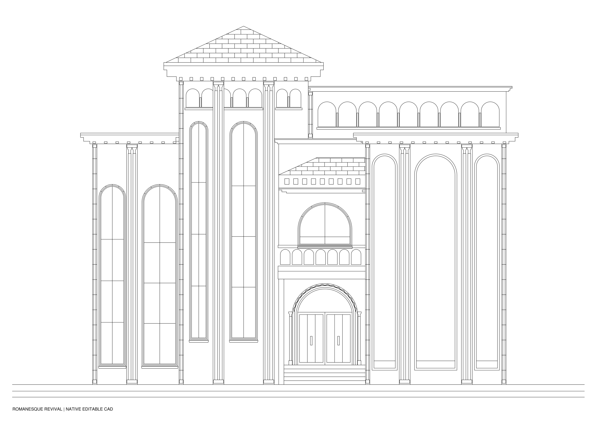

# الواجهة بالطراز الرومانيسكي الإحيائي

إعادة تصميم الواجهة التي سبق تطويرها بالطراز الفرعوني، بالطراز Romanesque Revival. التغيير في العقود وتكوين التفاصيل المعمارية، مع إخراج كاد أسود على أبيض.

## الملفات

- romanesque_facade.dwg: أوتوكاد أصلي AC1015، قابل للتعديل، ومتوافق مع إصدارات AutoCAD الحديثة.
- romanesque_facade.dxf: نسخة تبادل قابلة للتحرير.
- romanesque_facade.pdf: الواجهة الجديدة، بخطوط متجهية.
- before_after.pdf: مقارنة الواجهة الأصلية بالتصميم الجديد.
- details.pdf: تكبير المدخل والبلكونة، ونهاية البرج، ومعالجة الجزء المصمت.
- validation.json وromanesque_facade_dwg_validation.json: نتائج مراجعة الهندسة وإعادة قراءة DWG.

## التصميم

العقود نصف الدائرية تحيط بالشبابيك، مع أعمدة مزدوجة صغيرة وتيجان كتلية، وصف عقود صغيرة تحت نهاية البرج وفي الجزء العلوي الخلفي. المدخل بعقود متدرجة وزخرفة شيفرون رومانيسكية، والدرابزين بتفريغات مقوّسة. الكرانيش متدرجة بكوابيل، وكسوة السقف المائل بتقسيمات ألواح متبادلة.

العقود الكبيرة في الكتلة اليمنى **عقود عمياء وتجاويف في حائط مصمت**، وليست شبابيك أو فتحات جديدة.

## الأصل والمقاسات

المصدر: «واجهه تعديل 1.dwg»، من النسخة الأصلية المحفوظة. بقيت مواقع الكتل وحدود السقفين المائلين ومناسيب الدرج والبلكونة. بقي القوس الصافي للمدخل على مركزه ونصف قطره وموقعي التقاء القوس بالجانبين.

الشبابيك أعيد تفصيل رؤوسها بعقود نصف دائرية داخل نطاق الفتحات المستطيلة الأصلية؛ تُفهم الأركان العلوية كحشو داخل نطاق الفتحة. حدود الفتحات الأصلية محفوظة أيضًا في ملف original_opening_reference.dxf منفصل للمراجعة عند الحاجة، دون إضافة خطوط مرجعية إلى الواجهة النهائية.

لم تُغيَّر الإحداثيات أو المقياس الرقمي. ملف المصدر يحمل رمز وحدة INSUNITS=1 (إنش)، وقد احتُفظ به؛ لم يُفترض تحويل إلى المتر أو اعتماد قياس موقعي من الصور. هذه دراسة إعادة تصميم واجهة، وليست اعتمادًا إنشائيًا أو تفصيلة تنفيذية للجدران الحاملة.

## التنظيم والفحص

٣٥ بلوكًا مستقلًا للشبابيك والعقود والأعمدة والتيجان والكرانيش والبلكونة والأسقف. خط البناء الأساسي في Model Space. الألوان ACI7، وسُمك الخط ٠٫٢٥ مم، وخطوط Continuous. العقود منحنيات دائرية حقيقية داخل Polylines، وليست تتبعًا نقطيًا لصورة.

فُحصت التكرارات، والنهايات غير المتصلة، والهندسة الأساسية المحفوظة، وحدود الفتحات المرجعية. أُعيد تحويل DWG إلى DXF ومقارنة الكيانات والبلوكات والإحداثيات والأقواس وأعلام الإغلاق. لم يُختبر داخل AutoCAD Desktop هنا؛ فرق التحويل العددي ليس ادعاء لدقة مقياس ميداني.
