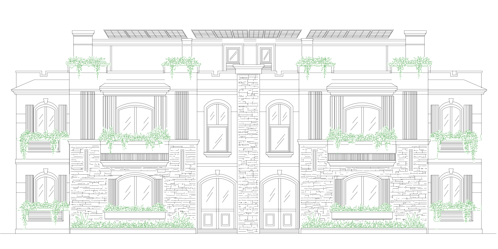

# الواجهة المستدامة — تصحيح هندسي للاستقامة، V2

هذه النسخة تعالج تعرّج الحواف الذي ظهر في AutoCAD في النسخة السابقة. أُعيد بناء العمارة بخطوط LINE وأقواس ARC من الصورة، بدل مسارات تتبع البكسلات. المصدر: [IMG_3106.PNG](../../IMG_3106.PNG).

- [تحميل الكاد والـPDF بالزرع الأخضر](facade_green.zip)
- [تحميل الكاد فقط داخل ZIP](facade_straight_v2_cad.zip)
- [DXF مباشر](facade_straight_v2.dxf?raw=true)
- [PDF متجهي](facade_straight_v2.pdf?raw=true)
- [AutoLISP مستقل](facade_straight_v2.lsp?raw=true)
- [الحزمة كاملة](facade_straight_v2_package.zip)
- [معاينة كاملة](preview.png) و[تكبير التفاصيل](detail.png)

للتنزيل من GitHub: افتحي صفحة ZIP واضغطي **Download raw file / السهم لأسفل**، ثم فكّي الضغط بـ **Extract All**.


## ما تغيّر

- الكرانيش وحواف الأحواض والأعمدة والفواصل المعمارية أُعيد بناؤها بمقاطع مستقيمة. كل منسوب أفقي له قيمة Y واحدة، وكل خط رأسي له قيمة X واحدة. الميول المقصودة مثل ميول السقف والحواف المشطوفة تبقى مائلة، لكنها مستقيمة.
- إطارات الشبابيك المنحنية أصبحت أقواسًا دائرية حقيقية؛ لم تُستبدل بكسور البكسلات أو مضلعات متعرجة.
- قُصّت خطوط خلفية كانت تمر داخل الشبابيك، وقُصت الأقواس عند حجر المفتاح. نُودت تقاطعات الخطوط ووصلات LINE/ARC إلى نقاط هندسية مشتركة. عولجت فجوات قصيرة إضافية حين دعمها الخط الظاهر في الصورة.
- تفاصيل الحجر أُخذت من التتبّع السابق ثم فُرضت عليها الاستقامة الأفقية والرأسية. الزرع يحتفظ بمسارات مستخرجة من المرجع، مع B-spline للتفاصيل الأطول ومسارات قصيرة للتفاصيل الصغيرة.
- سمك الطباعة موحّد **0.13 مم**، دون سماكة هندسية للمسارات. الزرع باللون الأخضر RGB (0,127,0)، وفهرس ACI 94 في الكاد. باقي العمارة سوداء في PDF ذي الخلفية البيضاء، وتستخدم ACI 7 في الكاد ليتكيّف مع لون الخلفية.

## الفحص وحدوده

- **6,151** عنصر LINE، و**67** قوس ARC.
- جميع العناصر المعمارية من نوع LINE أو ARC؛ لا توجد Spline أو Polyline معمارية متعرجة. SPLINE وLWPOLYLINE محصورتان في طبقة PLANTS.
- اجتاز **24** فحصًا للاستقامة على مناسيب الكورنيشين والأحواض.
- فحص المقاطع المستقيمة المتطابقة: **0**، والأقواس المتطابقة: **0**. فحص DXF: **0** أخطاء. لا توجد خطوط LINE بطول صفر أو ميول طفيفة غير مقصودة ضمن فحص الزوايا المحدد في validation.json.
- جرى فحص مواضع منحنيات SPLINE الأصلية في DXF مقابل مشهد التصدير، وفحص بيانات **14,167** كيان في AutoLISP مقابل DXF. زوايا AutoLISP بالراديان كما تتطلب entmake؛ زوايا DXF بالدرجات.
- الـPDF متجهي بلا صور مضمّنة وبسمك واحد.

**هذه إعادة بناء هندسية من صورة، وليست ضمانًا بأن عدد الخطوط وكل تفصيلة مطابقان 100%. تفاصيل الزرع والحجر ما زالت تحمل حدود التتبّع، ولم يُغلق كل خط مفتوح فيها.** لم تُفحص كل تفصيلة نبات يدويًا. الحفاظ على المنحنيات والفتحات المقصودة في هذه التفاصيل يختلف عن استقامة الحواف المعمارية. لا يُفترض أن كل الرسم شبكة مغلقة صالحة لملء HATCH دون مراجعة.

المقاسات تقديرية: عرض خط الأرض المفترض **20,000 مم**، ومقياس الـPDF الاسمي **1:50** على A3. لم يتم فتح هذه النسخة داخل AutoCAD فعليًا؛ فُحص الملف والهندسة حسابيًا، وليس باختبار واجهة AutoCAD.

## الفتح والتشغيل

- فكّي ضغط ZIP وافتحي **facade_straight_v2.dxf** من AutoCAD → Open. الصيغة DXF 2000 / AC1015، والوحدة مليمتر. عند عدم ظهور الرسم: Z ثم Enter ثم E ثم Enter.
- يمكن حفظه DWG من AutoCAD باستخدام SAVEAS. لم يُنتج DWG أصلي هنا.
- لخلفية كاد بيضاء: OPTIONS → Display → Colors → 2D model space → Uniform background → White.
- لتشغيل الكود: APPLOAD → facade_straight_v2.lsp، ثم اكتبي **FACADE2** واختاري نقطة الإدراج. عرض خط الأرض الافتراضي 20000 مم.
- AutoLISP يدرج بلوكًا واحدًا. EXPLODE يحوّله لعناصر قابلة للتحرير منفردة. إعادة تشغيل الأمر تضيف نسخة أخرى.

## الطبقات

| الطبقة | المحتوى |
| --- | --- |
| ARCH | الحواف والجدران والكرانيش والأحواض |
| WINDOWS | الإطارات والأقواس والموليونات |
| LOUVERS | الخطوط الرأسية للتكسية والشبكات |
| SOLAR | حدود ألواح الشمس وخطوطها المستقيمة |
| MASONRY | فواصل الحجر المستقيمة |
| GLASS | خطوط انعكاس الزجاج المستقيمة |
| PLANTS | التفاصيل النباتية باللون الأخضر ACI 94 |
| GROUND | خط الأرض |



## مصادر التوليد

البرامج في tools، والبيانات الهندسية في scene.json، ونتائج الفحص في validation.json. إعادة التوليد تحتاج نسخة كاملة من المستودع تشمل صورة المصدر وdrawings/sustainable-facade/geometry_pixels.json لتفاصيل النبات والحجر المستخرجة سابقًا. بعد تثبيت requirements.txt، شغّلي:

```bash
python tools/redraw.py
python tools/lisp.py
python tools/verify.py
```

تخرج الملفات في tools/output. متطلبات النظام تشمل Cairo. لا يحتاج كود AutoLISP المقدم للمستخدم إلى هذه الملفات الخارجية؛ يحتوي بيانات الرسم كاملةً.
