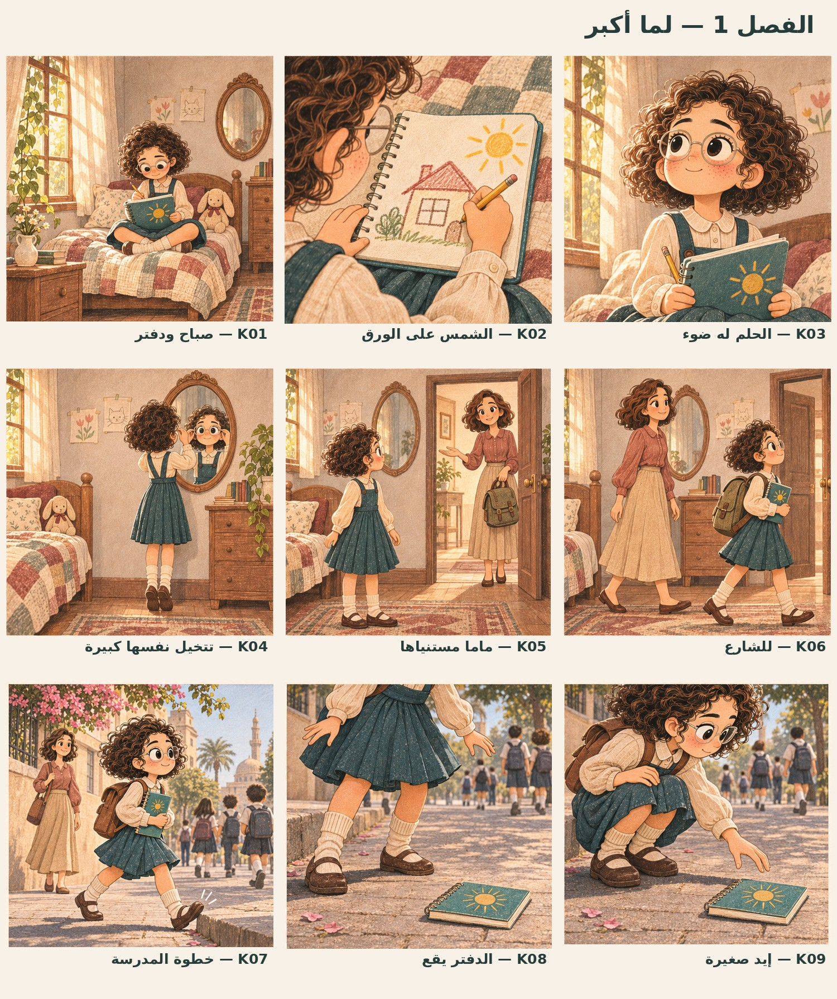
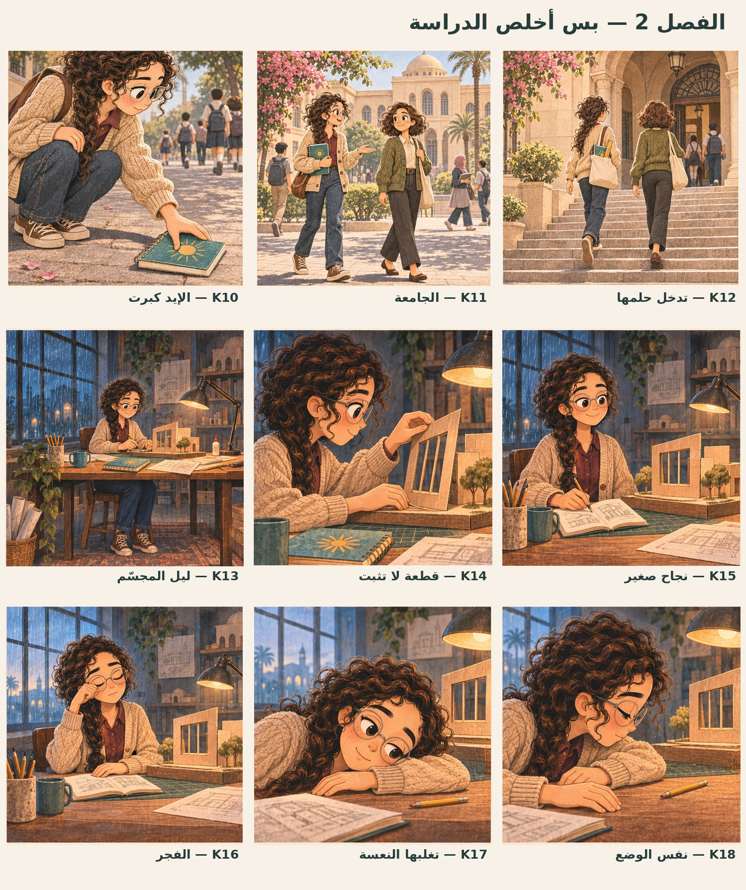
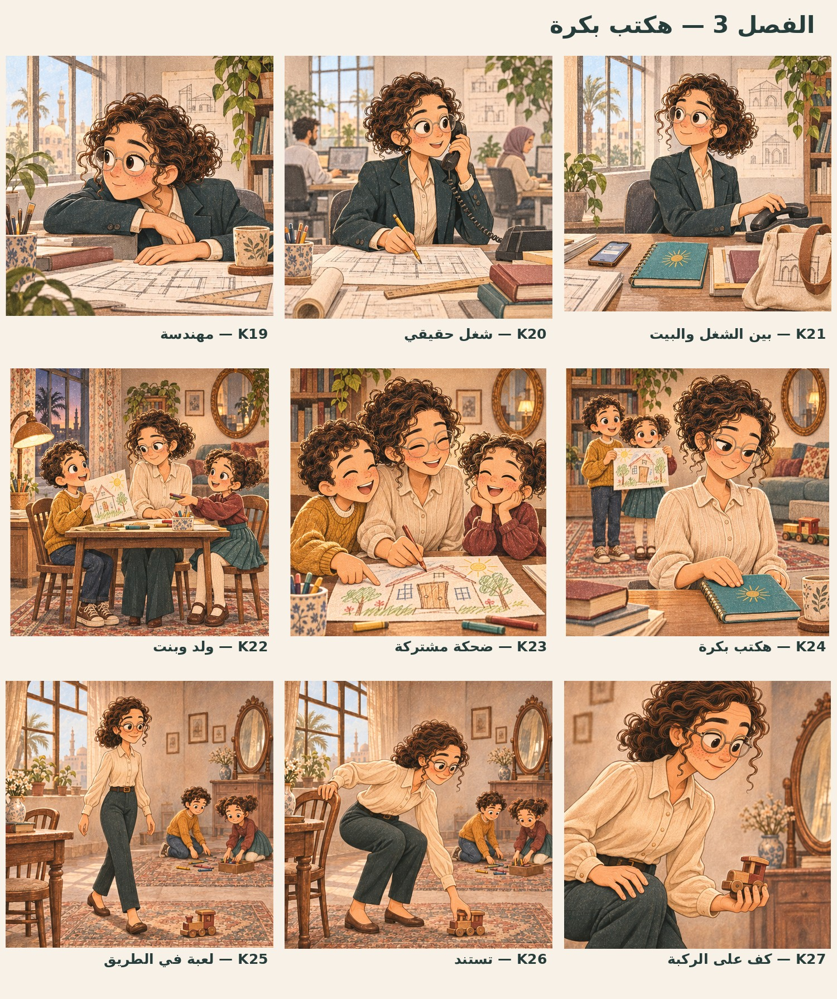
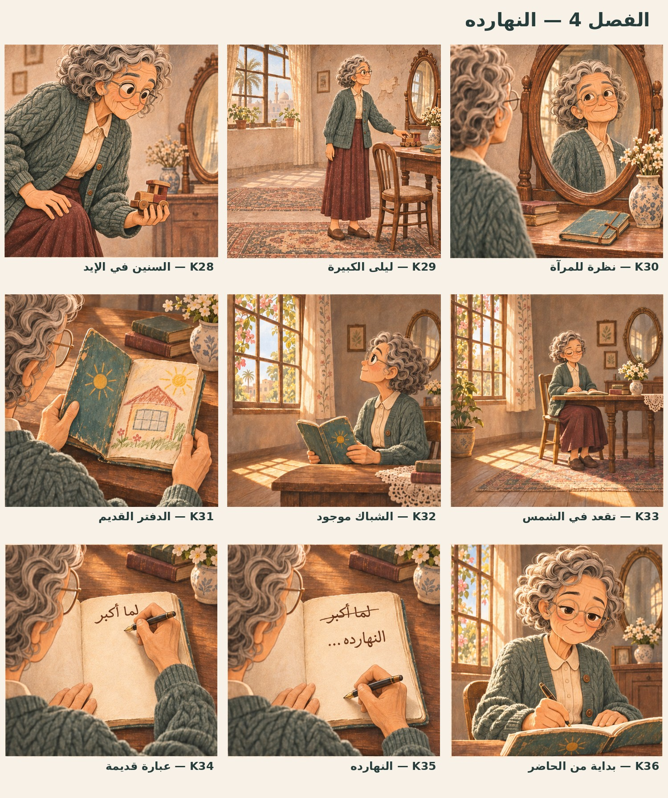
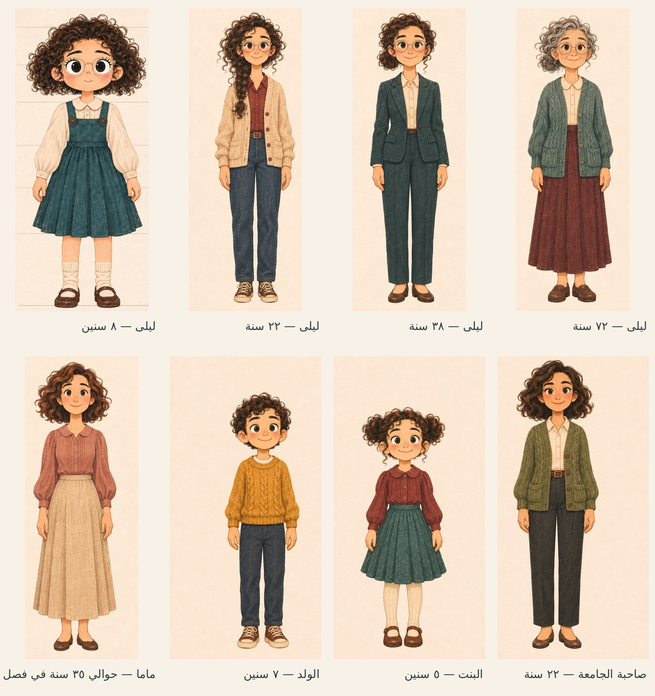

# لما أكبر — القصة والستوريبورد كاملًا

نسخة مراجعة ٢: ٤ فصول، ١٢ مشهدًا، ٣٦ كادرًا، ٩٠ ثانية تقريبًا. كل الكادرات مرقمة K01 إلى K36، ومع كل كادر التوقيت والكاميرا والتكوين والفعل والحوار والصوت والانتقال والاستمرارية.

## التحميل

- [PDF القصة والستوريبورد كاملًا — ٤٢ صفحة](Lama-Akbar-Complete-Storyboard-v2.pdf)
- [صور الكادرات — كل كادر في صورة مستقلة](Lama-Akbar-36-Storyboard-Frames.zip)
- [الشخصيات — ٨ صور أمامية مستقلة](Lama-Akbar-8-Front-Characters.zip)
- [قراءة القصة والتفاصيل كنص عربي](Story-and-Shots-AR.md)

## الفصول

١. **لما أكبر — ٠ إلى ٢١ ثانية:** ليلى ٨ سنين ترسم حلمها ببيت وشباك واسع تدخل منه الشمس. تظهر مامتها في الغرفة ثم يصطحبان حقيبة المدرسة. يقع دفترها في الشارع وتمد إيدها تلمه.

٢. **بس أخلص الدراسة — ٢١ إلى ٤٢ ثانية:** نفس الإيد تكمل الحركة وهي شابة ٢٢ سنة. تدخل كلية العمارة مع صاحبتها، وتحاول ليلًا بناء المجسّم. تصلح قطعة وتفرح باستقامتها، ثم يغلبها النوم فوق المكتب.

٣. **هكتب بكرة — ٤٢ إلى ٦٨ ثانية:** ترفع رأسها مهندسة عندها ٣٨ سنة باللبس الرسمي. في البيت نراها مع ولدها وبنتها؛ يرسمون ويضحكون، ثم تؤجل دفترها. تنحني تجمع لعبة وتسند على ركبتها.

٤. **النهارده — ٦٨ إلى ٩٠ ثانية:** تكمل النهوض ليلى عندها ٧٢ سنة. تلتقي بعينيها في المرآة، تفتح الدفتر، وتلاحظ أن الشباك والشمس موجودان فعلًا. تجلس في الضوء وتشطب «لما أكبر» وتكتب «النهارده…».

## الشخصيات

ليلى في أربعة أعمار (٨، ٢٢، ٣٨، ٧٢)، مامتها، ولدها، بنتها، وصاحبة الجامعة. الكومبارس والزملاء يظهرون في المشاهد بتفاصيل أخف. الصور كاملة بالملابس، وليست أجزاء الريج السابق أو ملفات Photoshop بطبقات.

## حدود المراجعة

الصور مرسومة للتصور والمراجعة. اللوحات الأصلية مربعة وتحافظ على كامل الأفعال والأطراف؛ تأطير الفيلم العريض يحتاج توسيع الخلفيات وضبط Layout قبل التحريك. وصلات الأعمار محددة كتابيًا وبصريًا، لكنها ليست مطابقة بكسلية منفذة أو مختبرة داخل After Effects. الصوت خطة مكتوبة وليس تسجيلات. لا موسيقى ولا ترجمة تفسيرية على الشاشة.

لم يبدأ تنفيذ الفيديو؛ المطلوب اعتماد القصة والكادرات أولًا. التفاصيل الحالية لا تمثل ملف AEP أو رندر تحريك. الصور مولّدة بمراجع الشخصيات، واستُخرجت اللوحات والشخصيات كصور كاملة للتسليم؛ لا ادعاء بفرش أو طبقات رسم أصلية مسترجعة.

## معاينات الفصول

