# لما أكبر

نسخة مراجعة ٢ — ٤ فصول، ١٢ مشهدًا، ٣٦ كادرًا، ٩٠ ثانية تقريبًا.

الفكرة: ليلى بتؤجل الكتابة عن حياتها لحد ما تخلص المرحلة اللي فيها. الدفتر والشباك بيربطوا الأعمار، وفي النهاية تختار تبدأ من النهارده؛ حياتها مش ضاعت، لكنها بدأت تلاحظ اللي موجود.

## الفصل 1: لما أكبر — من 0 إلى 21 ثانية

ليلى طفلة بتحب الرسم، وبتحلم تبقى مهندسة وتبني بيت بشباك واسع للشمس. بنشوف علاقتها بمامتها واستعجال الصبح. وهي رايحة المدرسة تتعثر تعثّرًا بسيطًا؛ يقع دفترها، وتمد إيدها تلمه.

## الفصل 2: بس أخلص الدراسة — من 21 إلى 42 ثانية

نفس الإيد تكمل الحركة لكن ليلى بقت طالبة عمارة عندها ٢٢ سنة. صاحبتها تستعجلها على المحاضرة. بالليل تحاول تبني مجسّم البيت اللي حلمت بيه، تفشل قطعة وتصلحها وتفرح بنجاحها الصغير. يغلبها النوم فوق المكتب.

## الفصل 3: هكتب بكرة — من 42 إلى 68 ثانية

ترفع رأسها من نفس الوضع وقد أصبحت مهندسة عندها ٣٨ سنة بلبس رسمي. بعد الشغل نلاقيها في البيت مع ولدها وبنتها؛ تساعدهما ويضحكوا سوا، ثم تؤجل الكتابة في دفترها. وهي بتجمع لعبة من الأرض تسند على ركبتها عشان تقوم.

## الفصل 4: النهارده — من 68 إلى 90 ثانية

تكمل النهوض امرأة في الثانية والسبعين، في البيت نفسه بعد مرور الزمن. تلاحظ صورتها في المرآة ثم دفترها القديم. تكتشف أن الشباك والشمس اللي كانت بتحلم بيهم موجودين بالفعل. تقعد في الضوء، وتشطب عبارة «لما أكبر» وتكتب «النهارده…» وتبدأ صفحة جديدة.

## الكادرات بالتفصيل

### K01 — صباح ودفتر

المشهد S01، من 0 إلى 3 ثانية، المدة 3 ثوانٍ.

**الكاميرا:** عامة ثابتة بمستوى عين الطفلة، 35 مم

**التكوين والشخصيات:** غرفة ليلى صباحًا؛ الشباك يسار الكادر، سرير خشبي يمينه، ليلى جالسة ترسم، والدفتر التركواز مفتوح على رجليها.

**الفعل:** ليلى تبدأ بالقلم ثم ترفع نظرها ناحية الضوء.

**الحوار:** ليلى: «لما أكبر هبقى مهندسة…»

**الصوت:** قلم، ملاية، عصافير بعيدة.

**الانتقال:** قطع إلى تفصيل الصفحة.

**الاستمرارية:** نثبت الشباك يسار الصورة والدفتر التركواز والشمس الصفراء.

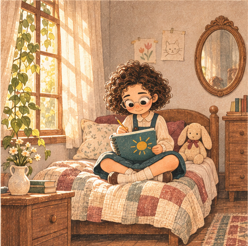

### K02 — الشمس على الورق

المشهد S01، من 3 إلى 5 ثانية، المدة 2 ثوانٍ.

**الكاميرا:** تفصيل مائل من فوق كتفها، 85 مم

**التكوين والشخصيات:** يد الطفلة تكمل رسمة بيت وشباك مستطيل وشمس صفراء، وجزء من وجهها ونظارتها ظاهر عند الحافة.

**الفعل:** طرف القلم يكمل ضلع الشباك، لا كتابة مولدة مطلوبة في الصورة.

**الحوار:** تكملة: «وهبني بيت فيه شباك كبير…»

**الصوت:** احتكاك القلم بالورق.

**الانتقال:** قطع على نظرتها.

**الاستمرارية:** نفس اتجاه الصفحة وإيدها اليمنى والقلم الخشبي.

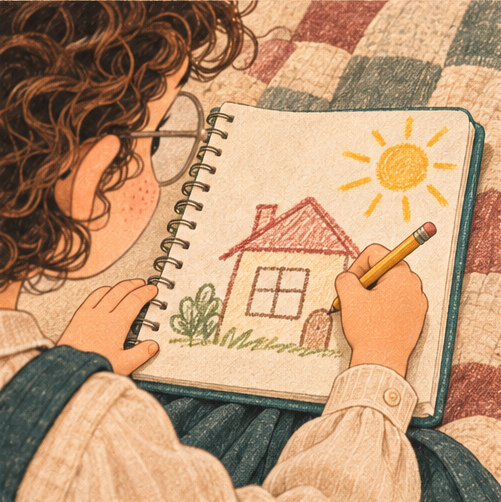

### K03 — الحلم له ضوء

المشهد S01، من 5 إلى 8 ثانية، المدة 3 ثوانٍ.

**الكاميرا:** قريبة للوجه، 50 مم، اقتراب خفيف

**التكوين والشخصيات:** وجه ليلى بالشعر الكيرلي القصير والنظارة والبلاشر؛ شريط الشمس على خدها والدفتر أسفل الصورة.

**الفعل:** ابتسامة صغيرة وهي تتخيل البيت.

**الحوار:** تكملة: «تدخل منه الشمس.»

**الصوت:** نفس هواء الغرفة، دون موسيقى.

**الانتقال:** قطع إلى المرآة في الغرفة نفسها.

**الاستمرارية:** ملامح الطفلة المعتمدة؛ لا تغيير للشعر أو ألوان الزي.

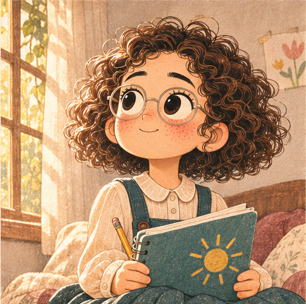

### K04 — تتخيل نفسها كبيرة

المشهد S02، من 8 إلى 10 ثانية، المدة 2 ثوانٍ.

**الكاميرا:** متوسطة عبر الكتف، 50 مم

**التكوين والشخصيات:** ليلى أمام مرآة خشبية بيضاوية؛ نرى انعكاس وجهها الطبيعي مطابقًا لوضع رأسها، ونظارتها نفسها.

**الفعل:** ترفع كعبيها قليلًا ثم تضبط نظارتها.

**الحوار:** لا حوار.

**الصوت:** نقرة خفيفة في إطار النظارة.

**الانتقال:** قطع أوسع يكشف الأم.

**الاستمرارية:** لم تعد ترتدي نظارة ثانية؛ المرآة في المكان نفسه الذي سيعود بالنهاية.

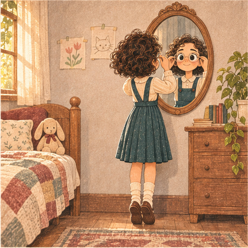

### K05 — ماما مستنياها

المشهد S02، من 10 إلى 13 ثانية، المدة 3 ثوانٍ.

**الكاميرا:** متوسطة واسعة، 35 مم

**التكوين والشخصيات:** الأم واضحة بكامل هيئتها عند باب الغرفة، بلوزة وردية مطفية وتنورة بيج؛ ليلى تلتفت لها قرب المرآة.

**الفعل:** الأم تمسك شنطة المدرسة وتبتسم وهي تستعجلها.

**الحوار:** الأم: «يلا يا ليلى، هنتأخر!» ليلى: «جاية!»

**الصوت:** قماش الحقيبة وخطوتان من عند الباب.

**الانتقال:** قطع على إغلاق الدفتر.

**الاستمرارية:** الأم شخصية كاملة ظاهرة، وليست صوتًا فقط.

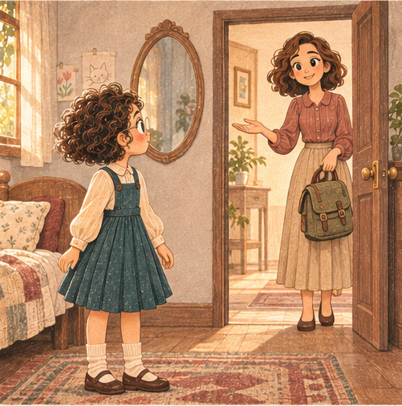

### K06 — للشارع

المشهد S02، من 13 إلى 15 ثانية، المدة 2 ثوانٍ.

**الكاميرا:** متوسطة جانبية، 50 مم

**التكوين والشخصيات:** ليلى تضم الدفتر التركواز وتلبس حقيبة المدرسة؛ الأم في الخلف عند الباب.

**الفعل:** تغلق الدفتر وتتحرك من اليسار لليمين نحو الخروج.

**الحوار:** لا حوار جديد.

**الصوت:** انغلاق الدفتر ومقبض الباب.

**الانتقال:** وصل حركي إلى المشي في الشارع.

**الاستمرارية:** اتجاه الحركة ثابت؛ نفس الحقيبة والدفتر.

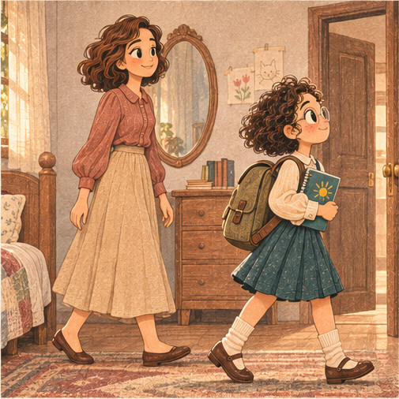

### K07 — خطوة المدرسة

المشهد S03، من 15 إلى 17 ثانية، المدة 2 ثوانٍ.

**الكاميرا:** عامة منخفضة جانبية، 28 مم

**التكوين والشخصيات:** شارع مدرسة صباحي هادئ؛ ليلى تمشي يسارًا إلى يمين، أطفال وأم بعيدة بتفاصيل أخف.

**الفعل:** تسرع خطوتها، فتمس القدم حافة صغيرة بالأرض.

**الحوار:** لا حوار.

**الصوت:** خطوات وشارع هادئ.

**الانتقال:** قطع قريب على سقوط الدفتر.

**الاستمرارية:** لا إصابة ولا سقطة عنيفة؛ الأم موجودة في الخلف.

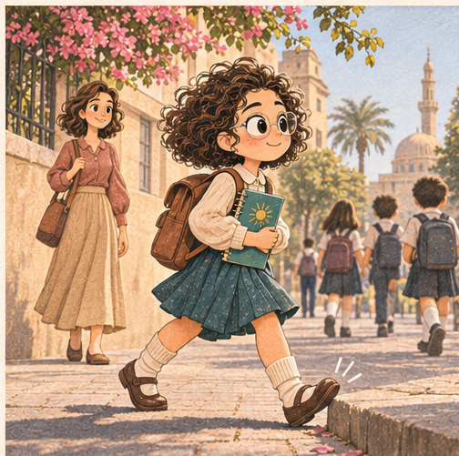

### K08 — الدفتر يقع

المشهد S03، من 17 إلى 19 ثانية، المدة 2 ثوانٍ.

**الكاميرا:** تفصيل منخفض بوجود جزء من الطفلة، 50 مم

**التكوين والشخصيات:** الدفتر يلامس الأرض وغلافه التركواز والشمس لأعلى؛ جزمة ليلى البنية وساقاها تظهران بطبيعية.

**الفعل:** تستعيد توازنها وتمسك الحقيبة كي لا تقع.

**الحوار:** لا حوار.

**الصوت:** خبطة دفتر واحتكاك الحقيبة.

**الانتقال:** قطع إلى انحنائها.

**الاستمرارية:** الغلاف لأعلى والقلم لا يختفي أو يتضاعف.

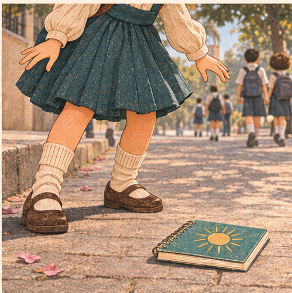

### K09 — إيد صغيرة

المشهد S03، من 19 إلى 21 ثانية، المدة 2 ثوانٍ.

**الكاميرا:** قريبة منخفضة، 85 مم

**التكوين والشخصيات:** جانب وجه ليلى المنحني أعلى يسار الكادر؛ كفها اليمنى تصل إلى الدفتر أسفل الوسط.

**الفعل:** أصابعها تقترب من ركن الدفتر من غير أن ترفعه بعد.

**الحوار:** لا حوار.

**الصوت:** هدوء نصف ثانية وصوت القماش.

**الانتقال:** وصل زمني مطابق إلى كادر 10.

**الاستمرارية:** هدف التطابق: ركن الدفتر عند 60% عرض و75% ارتفاع الكادر؛ اليد تدخل من أعلى يسار.

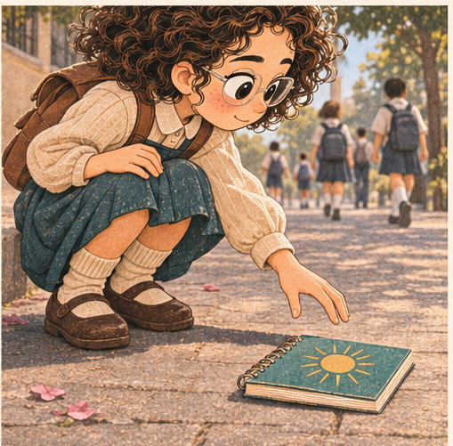

### K10 — الإيد كبرت

المشهد S04، من 21 إلى 23 ثانية، المدة 2 ثوانٍ.

**الكاميرا:** نفس القريبة والمحور، 85 مم

**التكوين والشخصيات:** يد شابة بكم كارديجان أوتميل تكمل التقاط الدفتر في نفس موضع اليد الصغيرة؛ طرف وجهها بالنظارة ظاهر.

**الفعل:** تغلق أصابعها على الركن وتبدأ الرفع.

**الحوار:** صاحبتها من خارج الصورة: «ليلى…»

**الصوت:** احتكاك ورق ثم زحام جامعة خفيف.

**الانتقال:** رفع الكاميرا لكشف الجامعة.

**الاستمرارية:** نفس موضع الدفتر؛ لا ذوبان ولا مؤثر سحري. مطابقة بصرية نهائية تُضبط بعد الاعتماد.

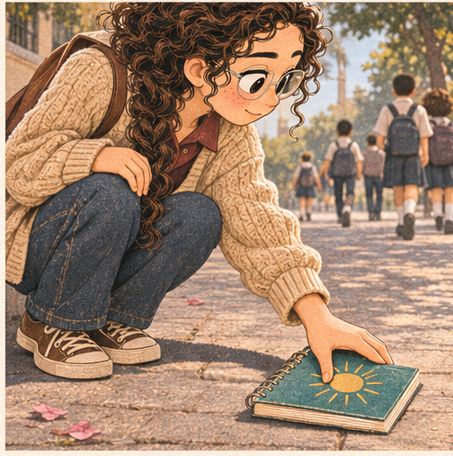

### K11 — الجامعة

المشهد S04، من 23 إلى 25 ثانية، المدة 2 ثوانٍ.

**الكاميرا:** متوسطة واسعة، 35 مم

**التكوين والشخصيات:** ليلى الشابة بالضفيرة الكيرلي والكارديجان والجينز تنهض عند كلية عمارة، وصاحبتها بالكارديجان الزيتي تنتظرها؛ طلبة بالخلف.

**الفعل:** تضم الدفتر إلى شنطة قماش بها مسطرة رسم.

**الحوار:** الصاحبة: «المحاضرة بدأت!»

**الصوت:** خطوات وطلبة من بعيد.

**الانتقال:** قطع إلى دخولهما.

**الاستمرارية:** اختلاف العمر واضح في نسب الوجه والجسم، مع بقاء هوية ليلى.

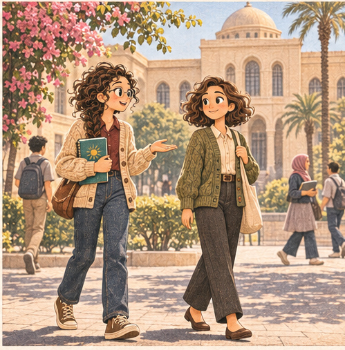

### K12 — تدخل حلمها

المشهد S04، من 25 إلى 27 ثانية، المدة 2 ثوانٍ.

**الكاميرا:** عامة من الخلف بزاوية 45، 35 مم

**التكوين والشخصيات:** ليلى وصاحبتها تصعدان درجات مدخل الكلية يمين الصورة، لوحة مدخل بلا نص مقروء وطلبة يتحركون.

**الفعل:** ليلى تسرع خطوتين وتلحق بصاحبتها.

**الحوار:** لا حوار جديد.

**الصوت:** أقدام وصوت باب خفيف.

**الانتقال:** قطع زمني من نهار الجامعة إلى ليل الاستوديو.

**الاستمرارية:** تظل حركة الدخول يسارًا إلى يمين.

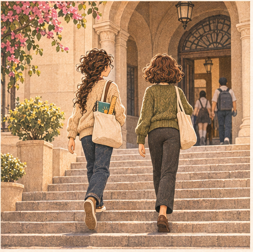

### K13 — ليل المجسّم

المشهد S05، من 27 إلى 30 ثانية، المدة 3 ثوانٍ.

**الكاميرا:** عامة داخلية، 35 مم

**التكوين والشخصيات:** استوديو عمارة ليلًا؛ ليلى وحدها على مكتب خشبي، مجسّم بيت وشباك مستطيل، أوراق ودفتر تركواز تحت مصباح؛ المطر وراء نافذة يسارًا.

**الفعل:** ترتب قطعة الكرتون وتجرب تثبيتها.

**الحوار:** ليلى بهدوء: «بس أخلص الدراسة…»

**الصوت:** قص كرتون ومطر خفيف.

**الانتقال:** قطع إلى يدها والمجسّم.

**الاستمرارية:** المصباح مصدر دافئ والنافذة مصدر أزرق؛ الزي الجامعي نفسه.

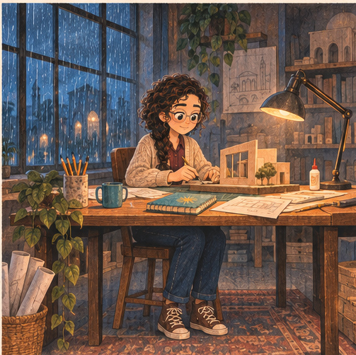

### K14 — قطعة لا تثبت

المشهد S05، من 30 إلى 33 ثانية، المدة 3 ثوانٍ.

**الكاميرا:** قريبة جانبية تشمل الوجه واليدين، 85 مم

**التكوين والشخصيات:** ليلى تحاول تركيب ضلع الشباك في المجسّم، فيميل بدل ما يستقيم.

**الفعل:** تتنفس ثم تسند القطعة بيد وتعدل القاعدة بالأخرى.

**الحوار:** لا حوار.

**الصوت:** حك كرتون وسحب مسطرة.

**الانتقال:** قطع أقرب للحظة النجاح.

**الاستمرارية:** ليس انهيار المجسّم كله؛ فشل صغير مفهوم وقابل للإصلاح.

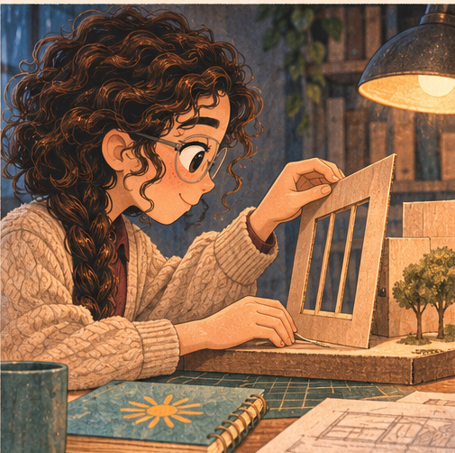

### K15 — نجاح صغير

المشهد S05، من 33 إلى 37 ثانية، المدة 4 ثوانٍ.

**الكاميرا:** متوسطة مائلة، 50 مم

**التكوين والشخصيات:** المجسّم أمام ليلى والشباك استقام؛ نرى وجهها والنظارة والدفتر بجواره.

**الفعل:** تبتسم ابتسامة رضا، ثم تفتح صفحة لتكمل الرسم.

**الحوار:** لا حوار.

**الصوت:** ورقة تتقلب ونقرة قلم.

**الانتقال:** قطع إلى فجر نفس المكان.

**الاستمرارية:** الشباك مطابق لفكرة رسمة الطفولة، والعمل له متعة وليس إنهاكًا فقط.

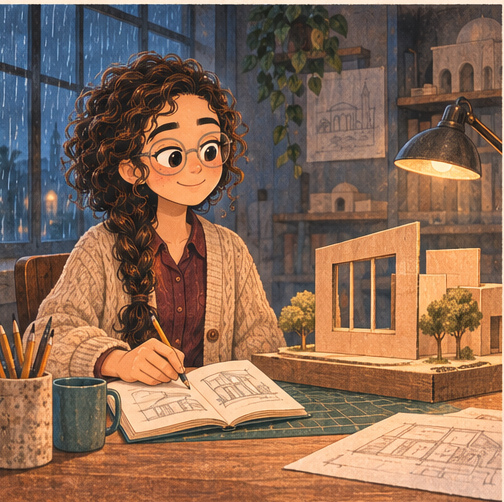

### K16 — الفجر

المشهد S06، من 37 إلى 39 ثانية، المدة 2 ثوانٍ.

**الكاميرا:** متوسطة جانبية، 50 مم

**التكوين والشخصيات:** نفس المكتب والمجسّم، المصباح ما زال مضاءً والنافذة أزرق فاتح.

**الفعل:** ليلى تفرك عينها من وراء النظارة وتستند بكوعها.

**الحوار:** لا حوار.

**الصوت:** المطر يقل، نفس مسموع.

**الانتقال:** قطع إلى قرب الرأس والذراع.

**الاستمرارية:** المكتب والدفتر لا يغيران أماكنهما بين الكادرات.

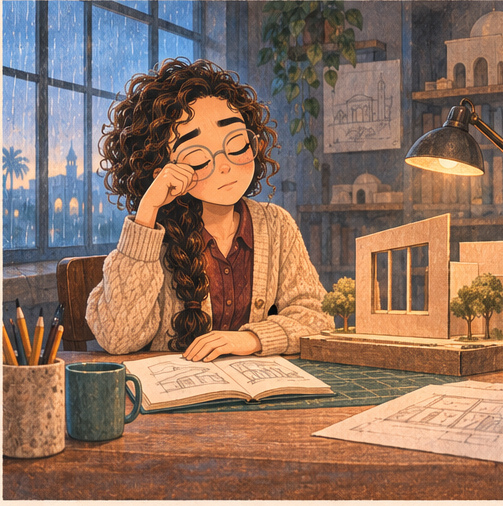

### K17 — تغلبها النعسة

المشهد S06، من 39 إلى 40 ثانية، المدة 1 ثوانٍ.

**الكاميرا:** قريبة جانبية، 85 مم

**التكوين والشخصيات:** ليلى رأسها قريب من ساعدها فوق المكتب، العينان مثقلتان بالنعاس، والقلم قريب من يدها.

**الفعل:** تغلبها النعسة وتغلق عينيها استعدادًا للسكون التالي.

**الحوار:** لا حوار.

**الصوت:** القلم يتدحرج مسافة صغيرة.

**الانتقال:** قطع أكثر قربًا إلى نهاية الحركة.

**الاستمرارية:** الكوع الأيمن نقطة الارتكاز، والوجه متجه يسارًا.

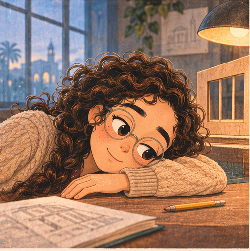

### K18 — نفس الوضع

المشهد S06، من 40 إلى 42 ثانية، المدة 2 ثوانٍ.

**الكاميرا:** قريبة ثابتة، 85 مم

**التكوين والشخصيات:** ليلى نائمة على ساعدها، الرأس وسط الكادر والمجسّم خلفها.

**الفعل:** سكون قصير مع النفس.

**الحوار:** لا حوار.

**الصوت:** نفَس وهدوء فجر.

**الانتقال:** وصل زمني مطابق إلى كادر 19.

**الاستمرارية:** هدف التطابق: مركز الرأس عند 48% عرض و45% ارتفاع، وحافة المكتب عند72% ارتفاع.

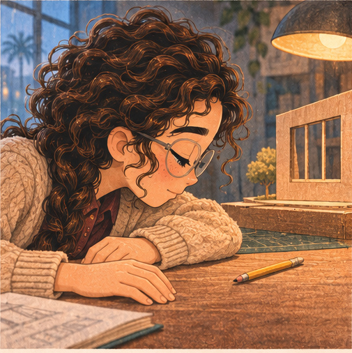

### K19 — مهندسة

المشهد S07، من 42 إلى 44 ثانية، المدة 2 ثوانٍ.

**الكاميرا:** نفس القريبة والمحور، 85 مم

**التكوين والشخصيات:** ليلى 38 سنة في البدلة التركواز الرسمية ترفع رأسها من الساعد على مكتب عمارة نهاري.

**الفعل:** تفتح عينيها وتستقيم مع رنة الهاتف.

**الحوار:** لا حوار بعد.

**الصوت:** رنة هاتف واحدة.

**الانتقال:** اتساع إلى مكتب العمل.

**الاستمرارية:** وضع الرأس والذراع يطابق18، والعمر واضح لا مجرد تغيير ملابس.

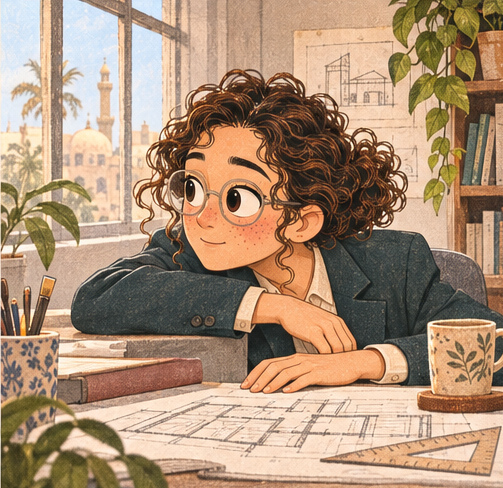

### K20 — شغل حقيقي

المشهد S07، من 44 إلى 47 ثانية، المدة 3 ثوانٍ.

**الكاميرا:** متوسطة، 50 مم

**التكوين والشخصيات:** ليلى الرسمية ترد الهاتف وتشير بقلم إلى رسومات مشروع على مكتبها؛ زميلان بالخلف ملامحهما خفيفة.

**الفعل:** تراجع ورقة وتدوّن ملاحظة قصيرة.

**الحوار:** ليلى: «الرسومات هتكون عند حضرتك الصبح.»

**الصوت:** قلب ملف وطابعة بعيدة.

**الانتقال:** قطع إلى نظرتها للشباك.

**الاستمرارية:** لا مبالغة في الأوراق ولا تصوير مهنتها كفشل.

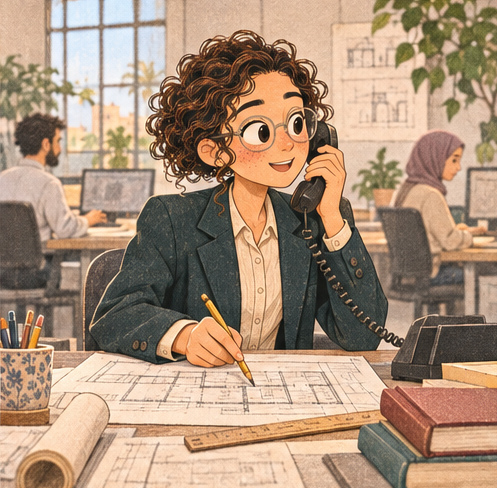

### K21 — بين الشغل والبيت

المشهد S07، من 47 إلى 49 ثانية، المدة 2 ثوانٍ.

**الكاميرا:** متوسطة جانبية، 50 مم

**التكوين والشخصيات:** ليلى تضع الهاتف، تنظر لحظة إلى نافذة المكتب؛ دفترها القديم بين الملفات.

**الفعل:** تلمح رسالة مدرسية على هاتفها الصامت وتلمّ الشنطة.

**الحوار:** لا حوار.

**الصوت:** تنبيه قصير واحد وحركة كرسي.

**الانتقال:** صوت طفل يسبق دخول البيت بربع ثانية.

**الاستمرارية:** الملفات تبقى في المكتب، والدفتر يذهب معها في الشنطة.

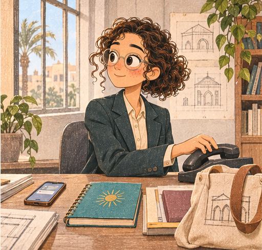

### K22 — ولد وبنت

المشهد S08، من 49 إلى 53 ثانية، المدة 4 ثوانٍ.

**الكاميرا:** عامة منزلية ذات عمق، 35 مم

**التكوين والشخصيات:** ليلى في البيت وقد خلعت الجاكيت وبقيت بالبلوزة الكريمية والبنطلون؛ ولدها بالبلوفر المستردة وبنتها بالبُرجندي والتنورة التركواز حول طاولة رسم، النافذة يسارًا.

**الفعل:** الولد يرفع ورقته، والبنت تزق له علبة الألوان؛ ليلى تقرب كرسيها منهما.

**الحوار:** الولد: «ماما، تبصيلي؟» ليلى: «جاية يا حبيبي.»

**الصوت:** ألوان وأطباق من بعيد.

**الانتقال:** قطع أقرب إلى ثلاثتهم.

**الاستمرارية:** الطفلان موجودان معًا، والعلاقة دافئة وليست صراخًا أو عبئًا فقط.

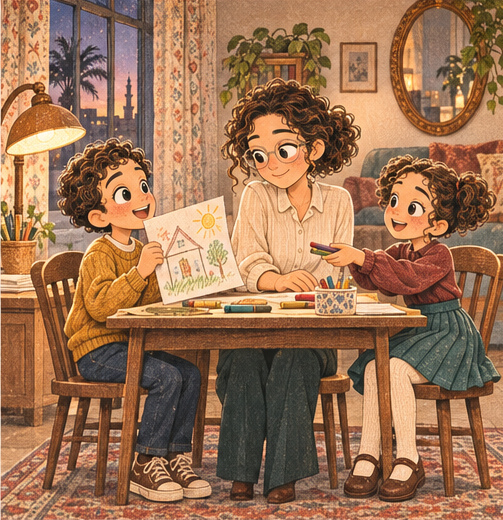

### K23 — ضحكة مشتركة

المشهد S08، من 53 إلى 57 ثانية، المدة 4 ثوانٍ.

**الكاميرا:** متوسطة على الثلاثة، 50 مم

**التكوين والشخصيات:** ليلى والولد والبنت يرسمون بيتًا على نفس الطاولة؛ يشير الولد لرسمة باب مائل والبنت تضحك.

**الفعل:** ليلى تضحك معهم وتعدل خطًا بالقلم.

**الحوار:** البنت بضحكة: «الباب مايل!»

**الصوت:** ضحكة قصيرة وثلاثة أقلام.

**الانتقال:** قطع إلى يد ليلى قرب الدفتر.

**الاستمرارية:** الأيدي متصلة وطبيعية؛ لا أطفال إضافيون ولا اختفاء أحدهما.

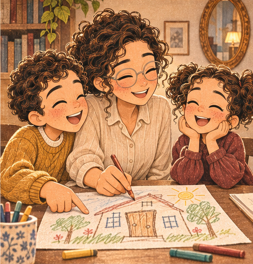

### K24 — هكتب بكرة

المشهد S08، من 57 إلى 61 ثانية، المدة 4 ثوانٍ.

**الكاميرا:** متوسطة قريبة ذات عمق، 50 مم

**التكوين والشخصيات:** ليلى تلمس دفترها التركواز على طرف الطاولة، والولدان يريَانها الرسم من الخلف؛ لعبة قطار خشبي صغيرة قرب السجادة.

**الفعل:** تفتح الدفتر قليلًا، ثم تقفله لتكمل الجلسة معهما.

**الحوار:** ليلى لنفسها: «هكتب بكرة.»

**الصوت:** غلاف دفتر ثم استمرار الضحكة.

**الانتقال:** قطع إلى اللعبة تحت القدم.

**الاستمرارية:** الدفتر سليم لكنه مستعمل؛ اللعبة تظهر قبل أن تعرقل الخطوة.

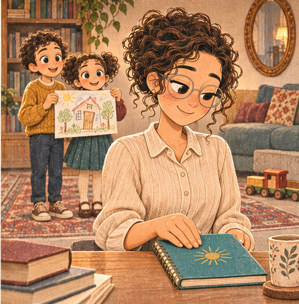

### K25 — لعبة في الطريق

المشهد S09، من 61 إلى 63 ثانية، المدة 2 ثوانٍ.

**الكاميرا:** منخفضة متوسطة، 50 مم

**التكوين والشخصيات:** ليلى تمر قرب السجادة، يظهر نصف جسمها ويدها، والقطار الخشبي في مسار قدمها؛ الولد والبنت يجمعان الألوان بعيدًا.

**الفعل:** تلاحظ اللعبة متأخرة فتقصّر خطوتها.

**الحوار:** لا حوار.

**الصوت:** لمسة حذاء خفيفة بالخشب.

**الانتقال:** قطع إلى مسند الكرسي.

**الاستمرارية:** لا تدوس بعنف ولا تقع؛ نفس اللعبة ونفس مكان السجادة.

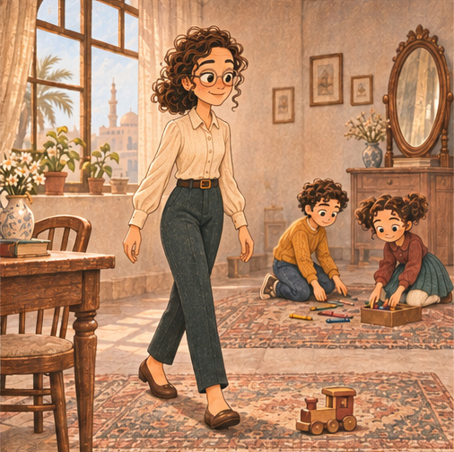

### K26 — تستند

المشهد S09، من 63 إلى 65 ثانية، المدة 2 ثوانٍ.

**الكاميرا:** متوسطة جانبية، 50 مم

**التكوين والشخصيات:** ليلى تمسك مسند الكرسي، تميل لتلتقط اللعبة بيدها الأخرى.

**الفعل:** تثبت القدمين ثم تنحني، الملابس والجسم يتحركان ككتلة متصلة.

**الحوار:** نفَس مفاجأة صغير.

**الصوت:** احتكاك قماش وكرسي.

**الانتقال:** قطع إلى اليد على الركبة.

**الاستمرارية:** لا يظهر أي مفصل مستطيل أو جلد منفصل؛ هذه رسمة كاملة وليست لقطة من الريج القديم.

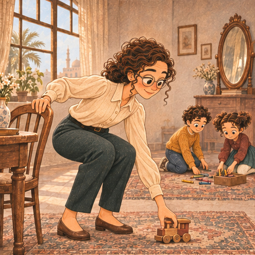

### K27 — كف على الركبة

المشهد S09، من 65 إلى 68 ثانية، المدة 3 ثوانٍ.

**الكاميرا:** قريبة تشمل الوجه جزئيًا والركبة، 85 مم

**التكوين والشخصيات:** ليلى تحمل اللعبة بيد وتسند الكف الأخرى على ركبتها كي تنهض.

**الفعل:** تبدأ دفع الجسم لأعلى وتثبت الكف على القماش.

**الحوار:** لا حوار.

**الصوت:** نفس واحتكاك قماش.

**الانتقال:** وصل زمني مطابق إلى28.

**الاستمرارية:** هدف التطابق: الكف عند60% عرض و62% ارتفاع؛ اللعبة باقية باليد الأخرى.

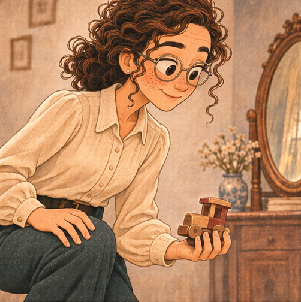

### K28 — السنين في الإيد

المشهد S10، من 68 إلى 70 ثانية، المدة 2 ثوانٍ.

**الكاميرا:** نفس القريبة والمحور، 85 مم

**التكوين والشخصيات:** كف ليلى الأكبر سنًا على الركبة يكمل نفس النهوض؛ طرف التنورة البُرجندي والكارديجان التركواز ظاهران واللعبة باليد الأخرى.

**الفعل:** الدفع لأعلى أبطأ لكنه مستقر.

**الحوار:** لا حوار.

**الصوت:** قماش ونفَس طبيعي.

**الانتقال:** اتساع يكشف ليلى72.

**الاستمرارية:** ليست قفزة سحرية؛ نفس اليد واللعبة والاتجاه.

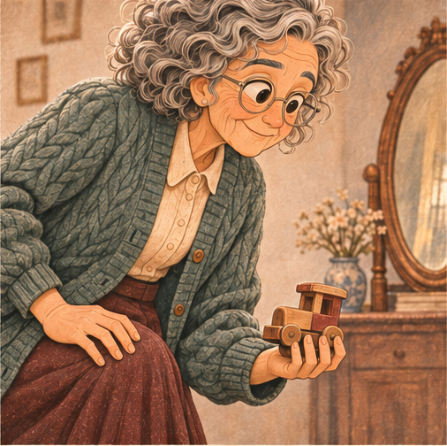

### K29 — ليلى الكبيرة

المشهد S10، من 70 إلى 73 ثانية، المدة 3 ثوانٍ.

**الكاميرا:** متوسطة واسعة، 50 مم

**التكوين والشخصيات:** ليلى72 تستقيم في نفس البيت؛ أثاثه باقٍ مع تغييرات بسيطة وعمر واضح، اللعبة على الطاولة بعد أن تضعها.

**الفعل:** تنظر بهدوء إلى المرآة الخشبية على الحائط.

**الحوار:** لا حوار.

**الصوت:** كرسي وعصافير خارج الشباك.

**الانتقال:** قطع على انعكاسها.

**الاستمرارية:** الطفلان لا يظلان طفلين بجوارها؛ لا نفترض غيابهما مأساة، هما خارج الكادر.

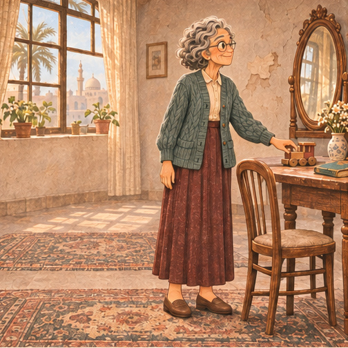

### K30 — نظرة للمرآة

المشهد S10، من 73 إلى 75 ثانية، المدة 2 ثوانٍ.

**الكاميرا:** قريبة عبر الكتف إلى المرآة، 85 مم

**التكوين والشخصيات:** وجه ليلى72 منعكس في نفس المرآة البيضاوية؛ الشعر الرمادي الكيرلي والنظارة وهوية الوجه محفوظة.

**الفعل:** تبتسم ابتسامة إدراك صغيرة، ثم تنظر خارج الانعكاس ناحية الدفتر.

**الحوار:** لا حوار.

**الصوت:** هواء خفيف وهدوء البيت.

**الانتقال:** قطع يتبع اتجاه نظرها إلى الطاولة.

**الاستمرارية:** انعكاس واحد صحيح، لا وجه إضافي ولا رجوع للشباب.

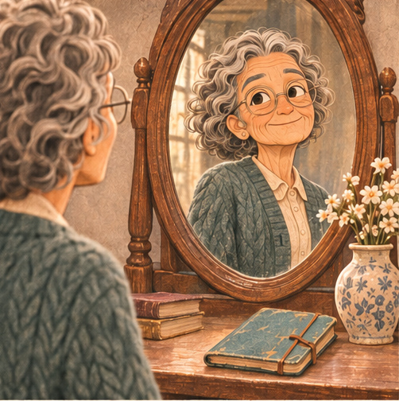

### K31 — الدفتر القديم

المشهد S11، من 75 إلى 78 ثانية، المدة 3 ثوانٍ.

**الكاميرا:** متوسطة عبر الكتف، 50 مم

**التكوين والشخصيات:** ليلى72 تفتح الدفتر التركواز على طاولة قرب الشباك؛ رسمة البيت والشمس القديمة تظهر، مع جزء من وجهها ويدها.

**الفعل:** تمرر أصابعها على رسم الشمس وتترك الصفحة مفتوحة.

**الحوار:** لا حوار.

**الصوت:** ورق قديم يتحرك.

**الانتقال:** قطع إلى نظرتها ناحية الضوء.

**الاستمرارية:** الدفتر نفسه وقد تهالكت الحواف، والرسم طفولي لا مخطط احترافي.

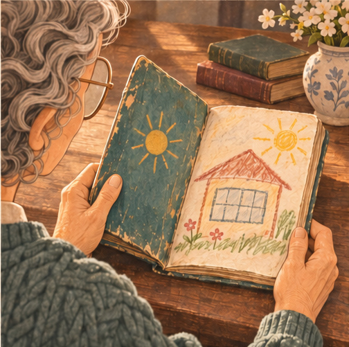

### K32 — الشباك موجود

المشهد S11، من 78 إلى 80 ثانية، المدة 2 ثوانٍ.

**الكاميرا:** متوسطة جانبية، 50 مم

**التكوين والشخصيات:** ليلى72 ترفع عينها من الدفتر إلى شباك كبير يسار الكادر يدخل منه ضوء ذهبي يشبه رسمتها.

**الفعل:** تلاحظ المستطيل المضيء على الأرض.

**الحوار:** لا تعليق يشرح المعنى.

**الصوت:** عصافير وشارع بعيد.

**الانتقال:** قطع أوسع مع حركة الكرسي.

**الاستمرارية:** الشباك جزء من نفس البيت؛ لا انتقال إلى منزل جديد أو بيت خيالي.

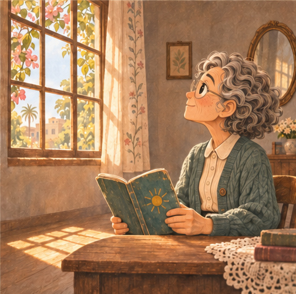

### K33 — تقعد في الشمس

المشهد S11، من 80 إلى 83 ثانية، المدة 3 ثوانٍ.

**الكاميرا:** عامة دافئة، 35 مم

**التكوين والشخصيات:** ليلى72 تسحب كرسيًا بسيطًا إلى بقعة الشمس بجوار الشباك، ثم تجلس والدفتر على الطاولة أمامها.

**الفعل:** تزحزح الكرسي وتستريح في الضوء وتفتح صفحة جديدة.

**الحوار:** لا حوار.

**الصوت:** رجل كرسي على الأرض ونفس هادئ.

**الانتقال:** قطع إلى الصفحة والقلم.

**الاستمرارية:** الحياة لم تضِع؛ الإحساس حضور ودفء، وليس انهيارًا أو رثاء.

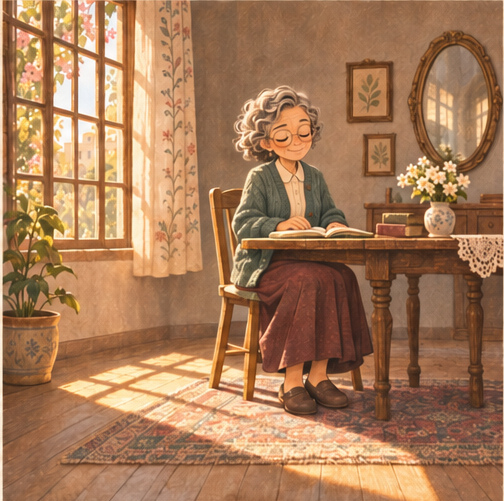

### K34 — عبارة قديمة

المشهد S12، من 83 إلى 85 ثانية، المدة 2 ثوانٍ.

**الكاميرا:** تفصيل من فوق كتفها، 85 مم

**التكوين والشخصيات:** صفحة جديدة في الدفتر، طرف وجه ليلى72 ونظارتها ظاهران، يدها بالقلم تستعد لكتابة العنوان.

**الفعل:** تكتب «لما أكبر» مرة أخيرة وتتوقف.

**الحوار:** لا حوار.

**الصوت:** القلم وحده.

**الانتقال:** قطع أقرب أو استمرار لنفس الصفحة.

**الاستمرارية:** النص داخل الدفتر: «لما أكبر». روجعت الكتابة بصريًا في صورة المراجعة؛ ليست ترجمة على الشاشة.

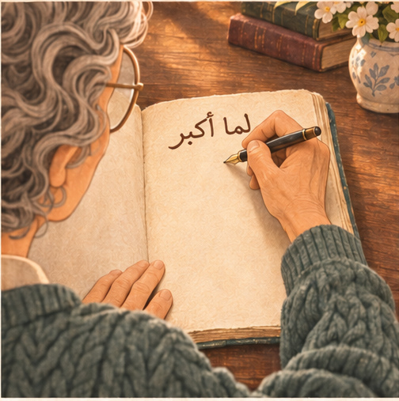

### K35 — النهارده

المشهد S12، من 85 إلى 87 ثانية، المدة 2 ثوانٍ.

**الكاميرا:** نفس التفصيل والاتجاه، 85 مم

**التكوين والشخصيات:** نفس الصفحة واليد؛ عبارة «لما أكبر» مشطوبة بخط واحد، وتحتها «النهارده…».

**الفعل:** تكمل كلمة النهارده ثم تحرك القلم لبدء سطر جديد.

**الحوار:** ليلى الأكبر سنًا: «النهارده…»

**الصوت:** صوت القلم نفسه الذي افتتح الفيلم.

**الانتقال:** قطع إلى الوجه الحاضر.

**الاستمرارية:** داخل الدفتر: «لما أكبر» مشطوبة بخط واحد، وتحتها «النهارده…». لا عناوين طافية أو شعار.

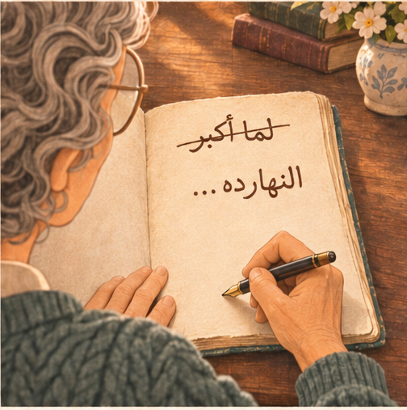

### K36 — بداية من الحاضر

المشهد S12، من 87 إلى 90 ثانية، المدة 3 ثوانٍ.

**الكاميرا:** قريبة للوجه مع اليد والدفتر أسفل الصورة، 85 مم

**التكوين والشخصيات:** وجه ليلى72 في الشمس، نظارتها وخدودها وهوية الطفلة باقية؛ تكتب خارج بؤرة التركيز أسفل الكادر.

**الفعل:** تتنفس وتواصل الكتابة بابتسامة صغيرة؛ ثبات أخير قرابة ثانية.

**الحوار:** لا جملة وعظية إضافية.

**الصوت:** قلم وهواء ثم سكتة طبيعية.

**الانتقال:** قطع نهائي هادئ.

**الاستمرارية:** لا موسيقى ولا عودة سحرية ولا جملة تشرح الرسالة.

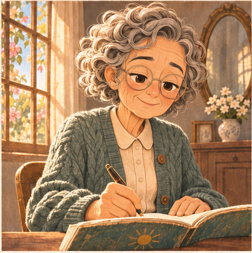

