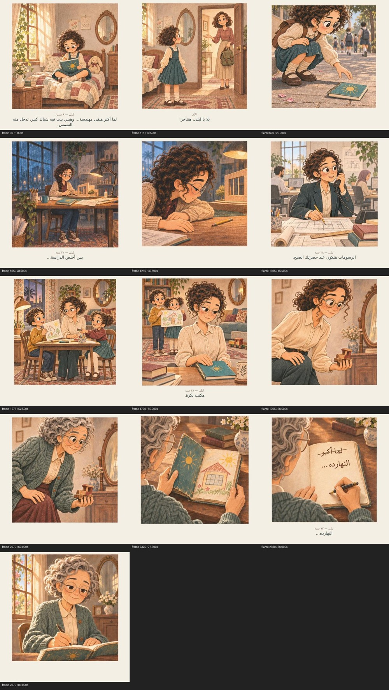

# لما أكبر — معاينة القصة كاملة

٩٠ ثانية،٣٦ كادرًا،حركة كاميرا هادئة،مؤثرات تجريبية ومن غير موسيقى. الكادرات الأصلية محفوظة من غير إعادة رسم أو قص الأطراف.

- [شوفي المعاينة بنص الحوار](https://raw.githubusercontent.com/aya47192-blip/ae-codes/refs/heads/storyboard/lama-curly-layered-psd-v1/storyboards/lama-akbar/free-animatic-v1/Lama-Akbar-Animatic-Dialogue-Review.mp4)
- [نفس المعاينة من غير كتابة](https://raw.githubusercontent.com/aya47192-blip/ae-codes/refs/heads/storyboard/lama-curly-layered-psd-v1/storyboards/lama-akbar/free-animatic-v1/Lama-Akbar-Animatic-Clean.mp4)
- [مصدر المعاينة القابل للتعديل في After Effects](https://raw.githubusercontent.com/aya47192-blip/ae-codes/refs/heads/storyboard/lama-curly-layered-psd-v1/storyboards/lama-akbar/free-animatic-v1/Lama-Akbar-Animatic-Editable-Source.zip)
- [نص الحوار بتوقيتاته SRT](https://raw.githubusercontent.com/aya47192-blip/ae-codes/refs/heads/storyboard/lama-curly-layered-psd-v1/storyboards/lama-akbar/free-animatic-v1/Dialogue-Review-AR.srt)

الكتابة في نسخة المراجعة تعرض الحوار المعتمد؛ لا توجد أصوات بشرية منطوقة. الحركة للكاميرا فوق رسوم ثابتة،وليست مشيًا أو تحريك شفاه. اللوحة داخل كل كادر ما زالت صورة واحدة للشخصيات والخلفية؛ مصدرAE يفصل الكادرات والكاميرا والورق ونص الحوار ومساري المؤثرات،ولا يحتوي ريج الشخصيات أو خلفيات داخلية مفصولة.

الفيديو رُندر محليًا وفُك ترميز جميع إطاراته وصوته. مصدرAE تم فحصه،لكنه لم يُشغّل داخل After Effects ولا يوجدAEP أصلي مُختبر. [التعليمات والحدود التفصيلية](README-AR.md).

