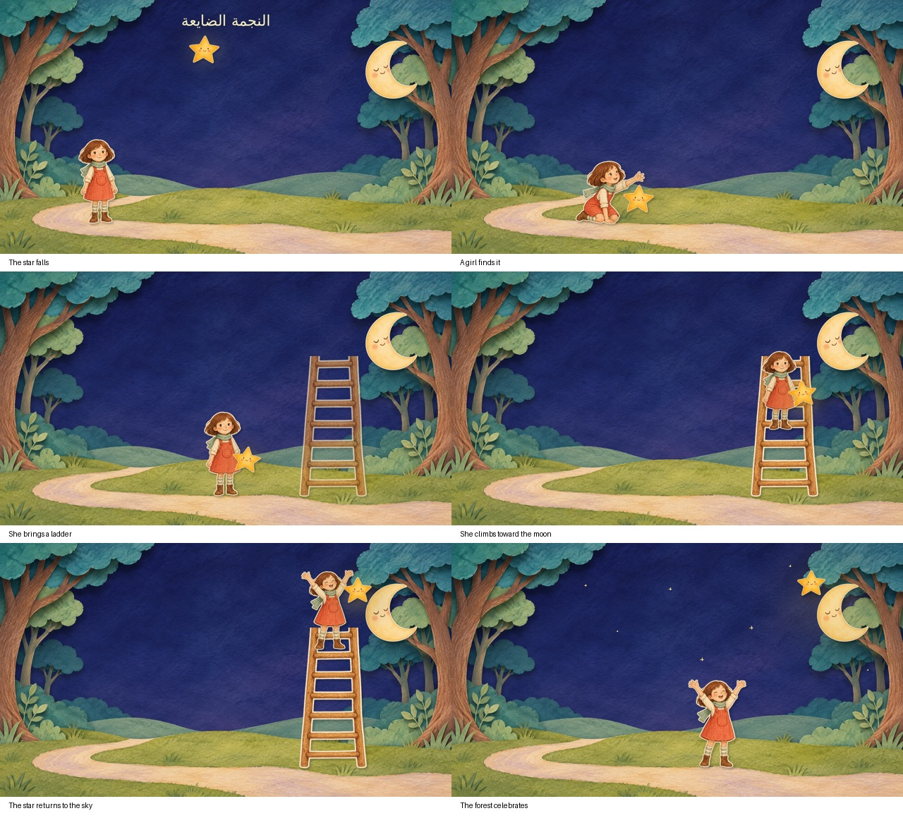

# قصاصات أليس وقصة جديدة

- [ملفات PDF المتاحة محليًا والخلفيات](Alice_Print_PDFs_and_Backdrops.zip)
- [صفحة طباعة بقية عناصر أليس من المتصفح](Alice_Browser_Print_All_Elements.zip)
- [ملفات PNG المحلية](Alice_Local_PNG_Assets.zip)
- [الفيديو الجديد: النجمة الضايعة](The_Lost_Star_Cutout_H264.mp4)
- [الفيديو الجديد وعناصره وملفات طباعته](The_Lost_Star_Film_and_Print_Assets.zip)

## الطباعة

مقياس المسرح ثابت: عرض 36 سم. أليس والساعة وبقية الأغراض تحتفظ بنسب الكادرات الأصلية، وليست كل القطع مكبرة لنفس الحجم. اطبعي A4 على **100% / Actual size** وأغلقي خيار Fit to page. مسطرة 50mm على الصفحة يجب أن تساوي 5 سم.

الحزمة المحلية فيها **22 قطعة فقط** على خلفية بيضاء: 13 كارتًا، عينا القطة وابتسامتها، الكأس، الطاولة الخالية المستكملة، القطة المستقلة المستكملة، البطانية المستكملة، وستارتا الغلق المستطيلتان. توجد نسخة مجمعة في 5 صفحات A4 ونسخة عنصر لكل ورقة. الخلفيات المستكملة للغابة والغرفة A3، أو مقسمة A4؛ وخلفية سوداء بديلة. هذه ليست كل الشخصيات في PDF محلي بعد.

الحزمة الثانية تتضمن ملف HTML يفتح مباشرة في Chrome أو Edge ويحمّل بقية القصاصات المفرغة من Runway. فيه **51 لوحة طباعة** تشمل الأشكال المحلية وصور الشخصيات والأغراض الخارجية. انتظري نجاح تحميل كل الصور، ثم اضغطي **طباعة / حفظ PDF**. اختاري Save as PDF أو الطابعة، A4، مقياس 100%، وأغلقي Headers and footers. لا تطبعي صفحات ناقصة أو صورًا عليها إطار أحمر. روابط الصور الخارجية مؤقتة؛ احفظي PDF بعد تحميلها.

## ما لم يكتمل

شبكة بيئة العمل تمنع تنزيل نتائج التفريغ من `dnznrvs05pmza.cloudfront.net` بخطأ 403. إعدادات `/etc/codex/network-policy.json` وحالة البيئة تؤكدان أن الموقع غير مسموح. لا يتوفر هنا زر لتعديلها نيابة عن المستخدم. لذلك لم يمكن فحص حواف الصور الخارجية محليًا، أو تضمين كل الشخصيات في PDF دائم وPNG دائم هنا. صفحة المتصفح بديل أولي لتحميلها على جهاز المستخدم؛ لا ندّعي أنها خضعت لفحص قص مثالي 100%. إن أتيح الموقع في إعدادات البيئة يمكن تنزيل النتائج وتجميع النسخة النهائية وفحصها.

الطاولة والبطانية والقطة المستقلة والخلفيات أجزاء معاد بناؤها من المرجع لأنها كانت محجوبة، وليست استرجاعًا للرسم الأصلي المخفي. الوضعيات الثماني لأليس قطع كاملة للتبديل بينها، وليست ريغ مفاصل مكتملًا.

## الفيلم الجديد

«النجمة الضايعة»: بنت تجد نجمة وقعت في الغابة، وتصعد سلمًا لتعيدها بجوار القمر. فيديو 23 ثانية، 1280×720، H.264/AAC، حركات قصاصات متدرجة. الرسوم مولدة بالـAI، والتحريك والتركيب والموسيقى البسيطة أُنجزت محليًا؛ ليس فيديو حركة مولدًا عبر Runway، لأن خطة الحساب المتصلة لا تتيح توليد الفيديو. لا يتضمن لقطات من فيلم أليس.

