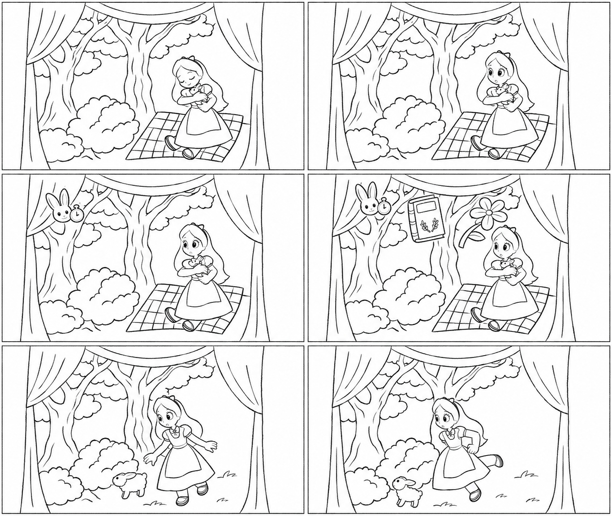
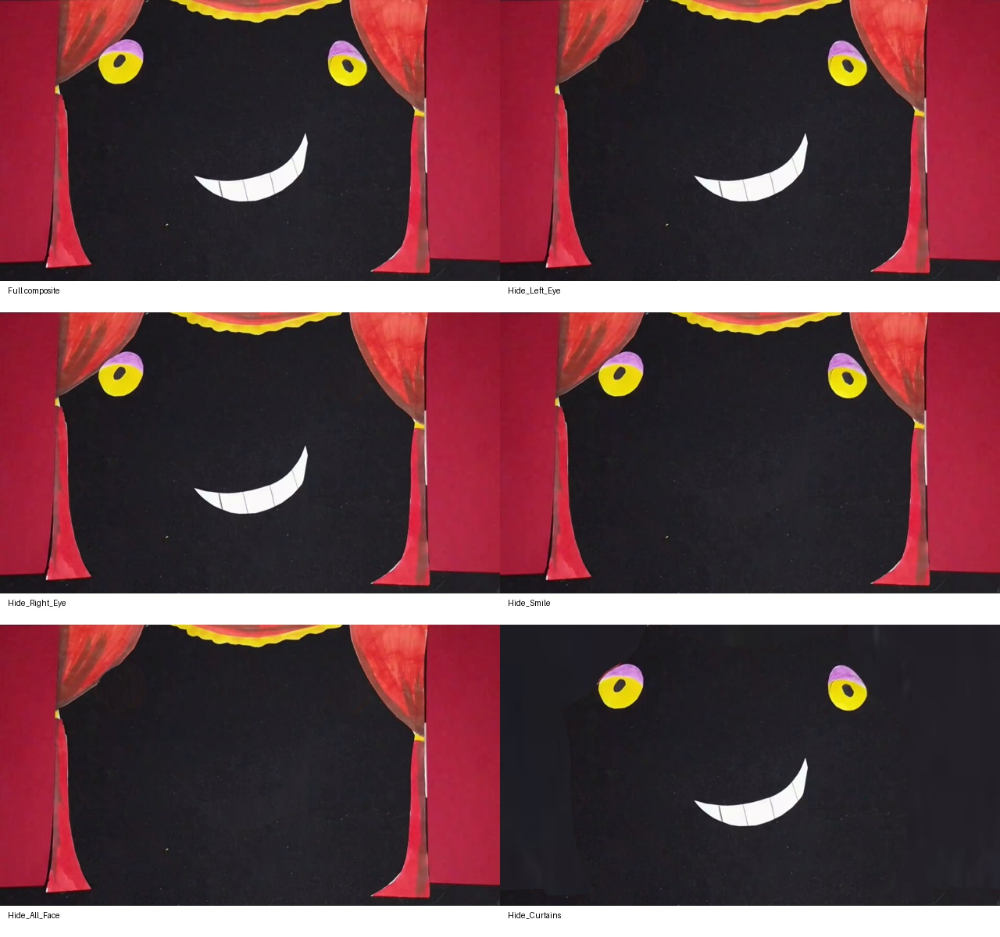

# Alice in Wonderland — الفيديو الجديد

- [تحميل الـStoryboard والمراجع](Alice_Storyboard_and_Models.zip)
- [الصور الملونة 01–15](Alice_Final_Panels_01_15.zip)
- [الصور الملونة 16–30](Alice_Final_Panels_16_30.zip)
- [الفيديو النهائي 1080p MP4](Video3_Alice_Final_HEVC.mp4)
- [Photoshop: طبقات العناصر](Alice_Photoshop_Objects.zip)
- [Photoshop: طبقات الألوان](Alice_Photoshop_Paint.zip)
- [تجهيز After Effects وتعليماته](Alice_AfterEffects_Setup.zip)

فكّي حزمتَي الصور الملونة مع حزمة الستوري بورد في نفس الفولدر. حزمة After Effects تحتوي على الفيديو وسكريبت يُنشئ AEP على جهازك، وليست ملف AEP مُختبرًا داخل البرنامج هنا. طبقات الخلفية مناطق من نفس الفيديو فوق نسخة كاملة، وليست فصلًا أصليًا للشخصيات.

## معاينة الرسم المبدئي

## اختبار إخفاء طبقات PSD

أليس — حزمة الفيديو الجديد

الـStoryboard: ثلاثون كادرًا، خمس صفحات لكل نسخة PDF: نسخة ملونة من المصدر ونسخة outline مرسومة من جديد. الكادرات بترتيب الأحداث. النسخة المرسومة تفسير مبدئي للتكوينات وقد تختلف تفاصيل الرسم عن الأصل؛ ليست الستوري بورد الأصلية لصاحب العمل. الرسوم المولدة تخص الستوري بورد فقط؛ لم تُستخدم لإعادة رسم الفيديو.

الصور: final-panels صور JPEG بدقة 1920×1080 من قصّ الكادرات الأصلية قبل تعديل الألوان. sketch-panels كل رسم outline لوحده. فكّي حزمة حزمتي Alice_Final_Panels_01_15.zip وAlice_Final_Panels_16_30.zip مع حزمة Storyboard في نفس الفولدر عشان storyboard.html يعرض النسختين مع وصف الحركة.

مراجع الشخصيات: أليس، عينا القطة وابتسامتها، والحيوانات الصغيرة المرئية، ورمز الأرنب والأغراض. كل الصور من الفيديو نفسه والزوايا المرئية فقط. ليست turnarounds مخترعة ولا ملفات موديل أصلية. لا توجد هنا زاوية خلفية كاملة موثّقة لأليس. رمز رأس الأرنب منفصل عن الحيوان الأبيض الصغير الذي يظهر بجوار أليس، ولم نفترض أنهما نفس الشخصية.

الفيديو: قص ثابت 1920×1080 من الملف الرأسي 1920×3412 عند y=1166، من غير تدوير أو تغيير للحركة. نفس 1464 إطارًا ونفس توقيت الإطارات، 25 إطارًا في الثانية، مدة 58.56 ثانية. تحسين محدود للألوان والحدّة مع الاحتفاظ بملمس الورق، من غير تنعيم زمني أو توليد حركة أو تغيير لطريقة التلوين. أُزيلت المساحات السوداء والنص الخارجي cut out animation. اسم Alice in Wonderland مأخوذ من كتابة المصدر ومعروض أول 3 ثوان فقط. لا كتابة خارجية في النهاية. الكتابات المرسومة على الأغراض مثل الكعكة والكروت تُركت كجزء من المشهد. MP4 بترميز HEVC مثل المصدر، بصوت AAC منقول من غير تعديل. ليست إعادة ضغط مطابقة للبايتات أو استرجاع تفاصيل تصوير مفقودة.

Photoshop: تجربة ثابتة لشوت القطة عند 56.20 ثانية. خمس طبقات كاملة: خلفية قماش سوداء، الستائر كلها مع بعض، العين اليسرى، العين اليمنى، والابتسامة. نسخة ثانية بدرجات اللون داخل مجموعات العناصر. اخفي مجموعة العنصر كلها لإخفائه بالكامل. القماش المخفي معاد بناؤه من أجزاء قماش ظاهرة في المصدر، وليس استرجاعًا للأصل المخفي. لم نرسم جسم قطة غير موجود في الصورة. التركيب الكامل يطابق كادر المصدر RGB قبل التحسين، وفتحنا ملفات PSD المحفوظة فعليًا ورندرنا اختبارات إخفاء العناصر. لم يتوفر Photoshop نفسه في بيئة العمل.

After Effects: سكريبت JSX يبني ويحفظ ملف AEP عند تشغيله عندك. داخل الحزمة تعليمات بسيطة وفيديو MP4. طبقات مناطق الخلفية نسخ من نفس الفيديو فوق نسخة كاملة محفوظة؛ إخفاؤها يكشف نفس الجزء الموجود في النسخة الكاملة، وليس حذف العنصر. لا فصل متحرك لأليس أو إعادة بناء أنيميشن. إعدادات 8-bit ومعاينة Quarter، بلا تأثيرات GPU إضافية أو اختبار رندر تلقائي ثقيل. اختُبرت صياغة السكريبت وحالة قفل الطبقات برمجيًا؛ لم يُشغَّل في After Effects هنا.

التغطية: مراجعة عينات كل ثانية على كامل المدة، وثلاثين كادرًا بالحجم الأصلي وقصاصات الشخصيات، وليست مراجعة بصرية لكل إطار. حدود المشاهد في shots.csv تقريبية. الصوت محفوظ وتحقّقنا من تطابق بصمات وتوقيت حزم AAC؛ لا تفريغ كلام أو تحليل سمعي لأن أداة استماع/تفريغ مناسبة غير متاحة هنا.

الأسلوب الظاهر: عرض قصاصات ورقية مصوّر بحركة متقطعة، وتؤكد عبارة cut out animation الموجودة بالمصدر هذا الوصف. لا يمكن تحديد برنامج رسم أو مونتاج بعينه من الملف المصدّر.
